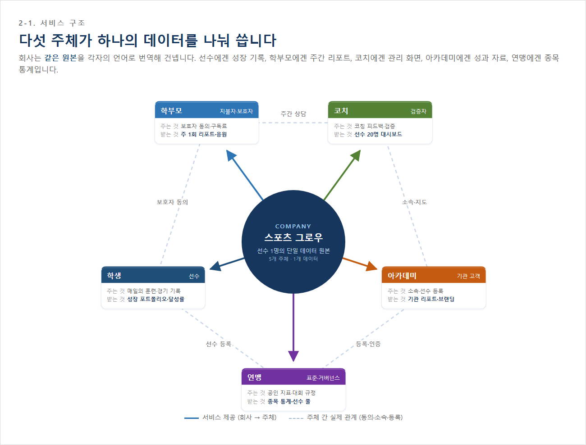
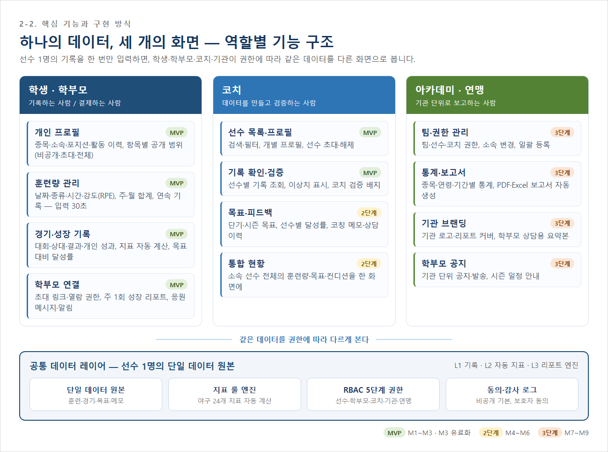
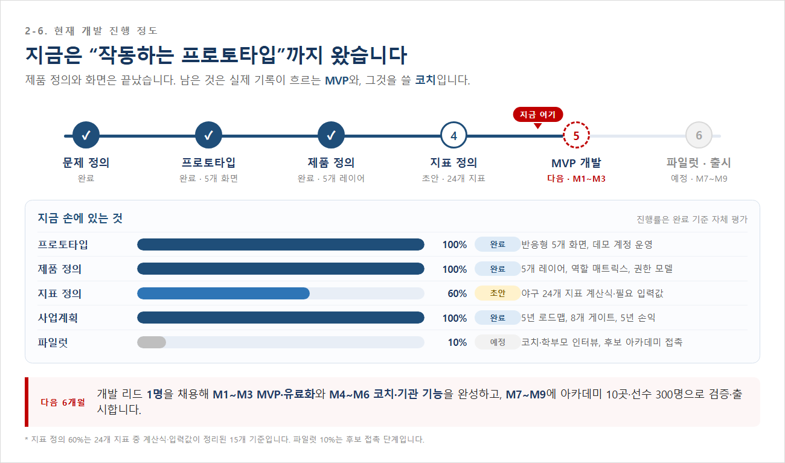
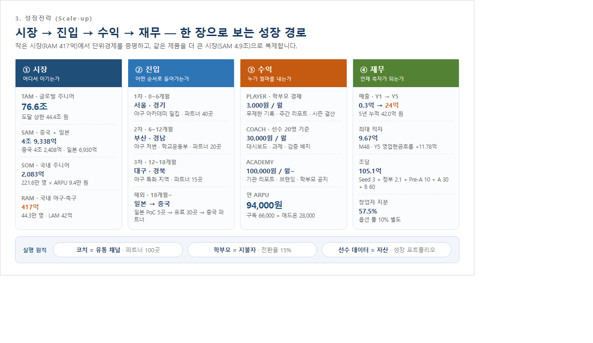
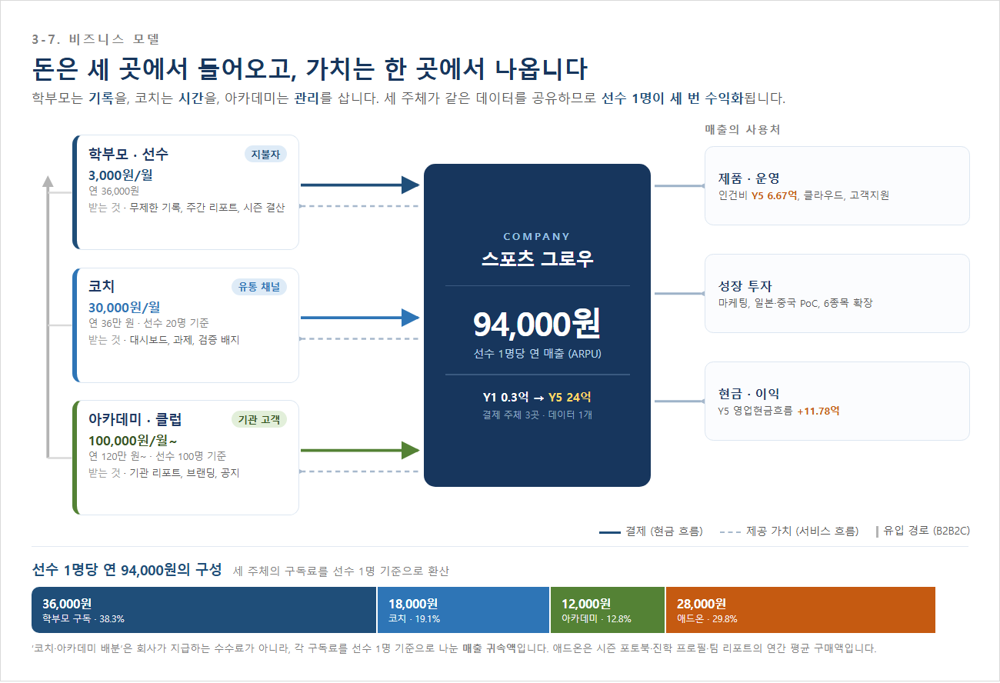
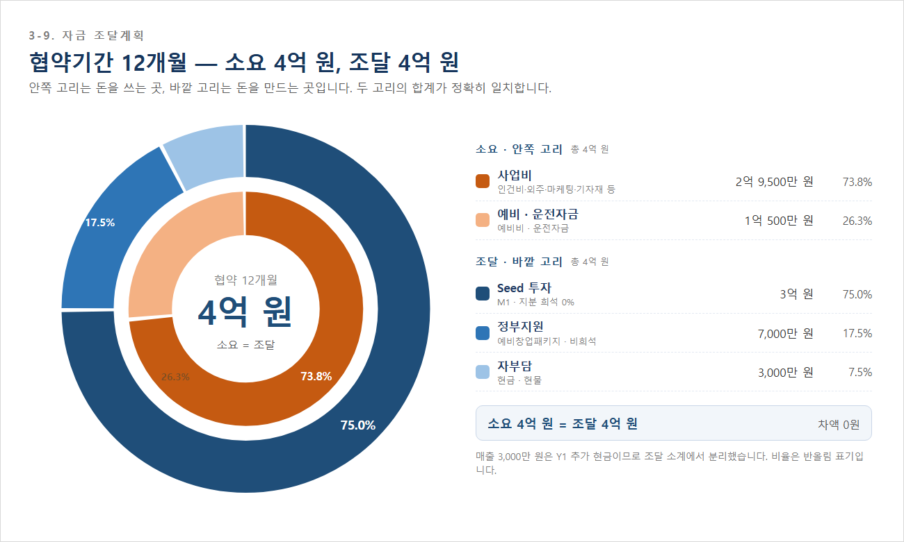
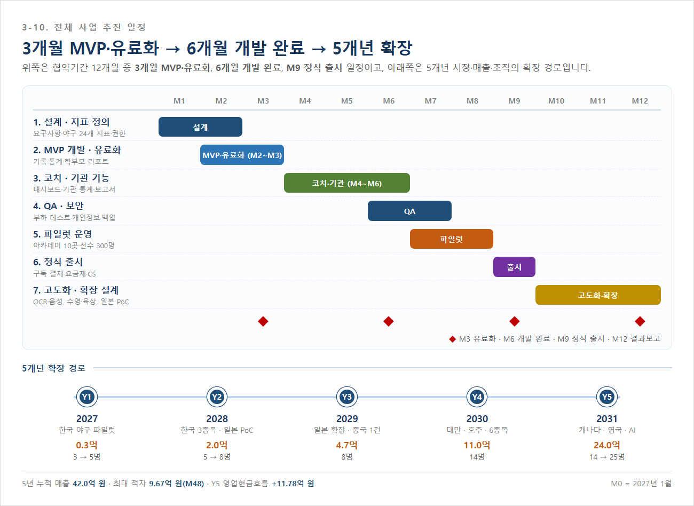

# 2026년 예비창업패키지 예비창업자 사업계획서

**스포츠 그로우 (Sports Grow)** — 주니어 선수의 성장을 기록하고 증명하는 플랫폼

> **작성 기준** 2026년 예비창업패키지 양식(일반현황 → 개요 → 문제 인식 → 실현 가능성 → 성장전략 → 팀 구성)에 맞춰 작성했습니다. 시장·재무 수치는 `사업계획서-시장규모.md` v3.0, `사업계획서-로드맵.md`, `사업계획서-팀-채용계획.md`와 동일한 기준입니다.
> **보완 기준** 2026 사업계획서 작성 교육(1~6회차)의 평가 관점 — 문제의 구체성(누가·언제·무엇 때문에), 고객 검증, 기술 완성도, 협약기간 내 성과, 자금 조달 대안, 팀의 실행 자산 — 을 반영해 v1.1로 보완했습니다.
> **표기 원칙** 모든 금액은 원화. `[확정 필요]`는 증빙·계약으로 채워야 하는 항목입니다.

---

## □ 일반현황

| 항목 | 내용 |
|---|---|
| **창업아이템명** | 주니어 운동선수의 훈련·경기·목표 기록을 하나의 성장 포트폴리오로 축적하고, 코치·학부모·아카데미가 같은 데이터를 권한에 따라 공유하는 **B2B2C 주니어 스포츠 성장 기록 플랫폼 '스포츠 그로우'** |
| **산출물 (협약기간 내 목표)** | 반응형 모바일 앱(PWA) **1개** — 야구 1종목 MVP, 코치 대시보드·학부모 주간 리포트·기관 통계 포함 |
| **직업 (직장명 기재 불가)** | 일반인 |
| **기업(예정)명** | 스포츠 그로우 |
| **(예비)창업팀 구성 현황 (대표자 본인 제외)** | 아래 표와 같음 |

**팀 구성 현황**

| 순번 | 직위 | 담당 업무 | 보유역량(경력 및 학력 등) | 구성 상태 |
|---|---|---|---|---|
| 1 | CTO (개발 리드) | 아키텍처·API·권한·배포 | 백엔드·풀스택 7년 이상, 개발 리드 2년 이상, B2B SaaS 0→1 | 예정 (협약 1개월차) |
| 2 | 프론트엔드 | 웹·PWA·대시보드·리포트 | TypeScript·React 3년 이상, 반응형 서비스 구축 | 예정 (협약 2개월차) |
| 3 | 프로덕트 디자이너 | 입력 UX·디자인 시스템·리포트 | B2B2C 0→1, 모바일 우선 설계, Figma | 예정 (협약 6개월차) |
| 4 | 파트너십 매니저 | 아카데미·코치 영업, 온보딩 | B2B 영업 3년 이상, 스포츠·교육 네트워크 | 예정 (협약 6개월차) |

> **팀 운영 원칙** 대표자는 기획·운영·홍보를 총괄하고, 개발은 CTO가 리드합니다. 디자인·QA·보안은 초기 6개월 외주로 보완합니다.

---

## □ 창업 아이템 개요(요약)

| 항목 | 내용 |
|---|---|
| **명칭** | 스포츠 그로우 (Sports Grow) |
| **범주** | 주니어 스포츠 성장 기록·포트폴리오 플랫폼 (B2B2C SaaS) |
| **아이템 개요** | 주니어 선수의 훈련량·경기 기록·목표 달성을 **선수 1명의 단일 데이터 원본**으로 통합합니다. 선수에게는 성장 포트폴리오를, 학부모에게는 주간 성장 리포트를, 코치에게는 선수 관리 OS를, 아카데미에는 기관 통계·보고서를 제공합니다. |
| **문제 인식 (Problem)** | 기록은 존재하지만 한곳에 모이지 않고, 비교되지 않고, 아무에게도 증명되지 않습니다. 그 결과 **선수는 동기를 잃고, 학부모는 과정을 모르고, 코치는 같은 정보를 반복 확인**합니다. |
| **실현 가능성 (Solution)** | 야구 1종목으로 **3개월 내 MVP·유료화, 6개월 내 개발 완료, 12개월 내 정식 출시**를 완료합니다. 핵심은 ① 30초 입력 ② 야구 24개 지표 자동 계산 ③ 학부모 주간 리포트 ④ 미성년자 권한·동의 관리 ⑤ 종목 템플릿 확장 구조입니다. |

---

## 1. 문제 인식 (Problem)_창업 아이템의 필요성

### 1-1. 문제 정의 — "기록은 있는데, 증명이 없다"

주니어 선수의 기록은 없지 않습니다. **수첩, 엑셀, 카카오톡, 팀 운영 앱, 학원 CRM에 흩어져 있을 뿐**입니다. 그래서 같은 정보를 코치가 세 번 입력하고, 학부모는 대회 성적표 한 장으로만 아이의 성장을 판단합니다.

> "주니어 선수의 기록은 존재하지만, **한곳에 모이지 않고, 비교되지 않고, 아무에게도 증명되지 않는다.** 그 결과 선수는 동기를 잃고, 학부모는 과정을 모르고, 코치는 같은 정보를 반복 확인한다."

### 1-2. 타깃 고객 페르소나 — "누가, 언제, 무엇 때문에 불편한가"

**핵심 타깃은 서울·경기 U15 야구 투수를 둔 학부모입니다.** 이 한 사람을 기준으로 문제의 빈도와 지불 명분을 정의합니다.

| 구분 | 내용 |
|---|---|
| **누가** | 초6~중3 야구 선수를 둔 학부모. 월 사교육비 40만~60만 원, 아이의 진학과 성장을 함께 고민 |
| **언제** | 주 5회 훈련이 끝난 저녁, 주말 경기 직후, 그리고 시즌이 끝나는 11~12월 |
| **무엇 때문에** | 아이가 "열심히 하고 있다"는 말은 들리지만, 늘었는지 확인할 기록이 없음. 대회 성적표 1장이 유일한 근거 |
| **얼마나 자주** | 훈련 후 주 3~5회 "오늘 뭐 했어?"를 묻지만, 확인 가능한 답은 시즌 1~2회 |
| **현재 대안** | 코치 카톡·수첩·대회 기록지. 확인하려면 코치에게 직접 물어봐야 함 |
| **지불 의사** | 월 3,000원 — 커피 한 잔 이하. "과정이 보이면 낸다" |

> **이 한 사람이 먼저입니다.** 12개월 안에 이 학부모가 유료로 전환되는지를 먼저 검증합니다. 전체 시장 규모는 그 다음 문제입니다. 시장이 커도 이 전환이 안 되면 사업은 성립하지 않습니다.

### 1-3. 왜 지금 문제인가 — 세 개의 구조적 공백

| 공백 | 현재 상태 | 결과 |
|---|---|---|
| **① 기록의 파편화** | 훈련은 수첩·메신저, 경기는 대회 기록지, 결제는 학원 CRM, 소통은 카톡 | 선수 1명의 1년 기록을 한 번에 볼 수 없음 |
| **② 지표 표준의 부재** | 종목별 지표가 코치 개인 경험에 의존. 야구 타율·OPS·구속의 주니어 기준 없음 | 학부모가 "우리 아이가 늘고 있는가"를 판단할 근거 없음 |
| **③ 과정의 미전달** | 학부모는 결과(대회 입상)만 확인. 훈련량·목표 달성·코치 피드백은 전달되지 않음 | 과정이 보이지 않으면 구독도, 응원도 지속되지 않음 |

**개인에서 사회로.** 이 문제는 한 가정의 불편으로 끝나지 않습니다. 기록이 끊기는 순간 선수의 노력은 이력이 되지 못하고, 코치의 지도는 다음 선수에게 재현되지 않으며, 아카데미의 성과는 홍보 문구에 머뭅니다. 학부모는 2조 3,188억 원의 체육·특기 지출을 하면서도 그 효과를 확인할 근거를 갖지 못합니다. **개인의 기록 부재가 인재 손실과 지출 비효율로 확장되는 지점**이 우리가 푸는 문제입니다.

**시장 규모가 아니라 '증명'이 비어 있습니다.**

- 대한체육회 경기인 등록 선수 **412,365명** (2026년 10월 29일 기준, 대한체육회)
- 초·중·고 사교육비 **29조 2,000억 원** 중 체육·특기 관련 지출 **2조 3,188억 원** (2024년 초중고 사교육비조사)
- 국내 주니어 운동 인구 **2,216,160명** — 이 중 야구·축구 주니어 **443,232명**이 우리의 1차 공략 시장

### 1-4. 고객별 문제의 진짜 원인

| 고객 | 겉으로 보이는 문제 | 진짜 원인 | 우리의 해결 |
|---|---|---|---|
| **선수** | "열심히 하는데 늘었는지 모르겠다" | 성장을 보여주는 **누적 기록**이 없음 | 개인 홈페이지·성장 그래프·목표 달성률 |
| **학부모** | "아이가 뭘 하는지 모르겠다" | 과정을 확인할 **채널과 주기**가 없음 | 주 1회 자동 리포트 + 응원 기능 |
| **코치** | "선수 30명 기록 관리가 너무 번거롭다" | 기존 도구가 **출석·결제·팀 운영** 중심 | 30초 입력 + 선수별 성장 관리 |
| **아카데미** | "우리 기관의 성과를 보여줄 자료가 없다" | **종목별 지표 표준**과 기관 리포트 부재 | 기관 대시보드 + 브랜딩 리포트 |

### 1-5. 왜 지금인가 (Why Now)

1. **스포츠 지출이 커지고 있다** — 사교육비에서 체육·특기 활동으로 지출이 이동하고, 학부모는 과정을 확인하려는 니즈가 커졌습니다.
2. **디지털 소통이 보편화됐다** — 카카오 알림톡·학원 앱으로 학부모 소통이 디지털화되어, 주간 리포트의 수용성이 높아졌습니다.
3. **지표 표준은 아직 비어 있다** — 팀 운영 앱과 학원 CRM은 개인 성장 데이터를 다루지 않습니다. **표준을 먼저 만든 쪽이 시장을 정의합니다.**
4. **미성년자 데이터 규제가 진입장벽이 됐다** — 비공개 기본·보호자 동의·감사 로그를 제품에 내장한 사업자만 기관·협회와 계약할 수 있습니다.

**네 개의 지표가 같은 방향을 가리킵니다.**

| 지표 | 수치 | 의미 | 출처 |
|---|---|---|---|
| ① 체육·특기 사교육 지출 | **2조 3,188억 원** (2024) | 학부모가 이미 지출하는 시장 | K1 |
| ② 경기인 등록 선수 | **412,365명** (2026.10) | 기록 수요가 있는 모집단 | K2 |
| ③ 주니어 운동 인구 | **2,216,160명** | 종목 확장의 상한 | K3 |
| ④ 주니어 야구·축구 | **443,232명** | 1차 공략 시장(RAM) | K2·K3 |

### 1-6. 해결 방식 — 한 문장

> **선수 1명의 단일 데이터 원본 위에, 코치용 관리 OS·학부모용 주간 리포트·선수용 성장 포트폴리오를 얹는다.**

이 구조는 기록을 **한 번만 입력**하면 코치·학부모·선수·기관이 **각자 다른 화면**으로 같은 데이터를 보게 합니다. 그래서 입력 부담은 줄고, 데이터는 쌓이고, 학부모의 지불 명분은 생깁니다.

### 1-7. 검증할 가설과 반증 조건

이 사업은 "학부모는 아이의 과정을 위해 돈을 낸다"는 가설에서 출발합니다. 12개월 안에 아래 다섯 가지를 순서대로 검증하고, 반증되면 계획을 수정합니다.

| 가설 | 검증 방법 | 성공 기준 | 반증 시 대응 |
|---|---|---|---|
| 학부모는 월 3,000원을 낸다 | M3 파일럿 300명 중 유료 전환 | 12개월 내 300명(10%) | 무료 + 애드온 단건 판매 |
| 코치는 입력을 계속한다 | 4주 입력 로그 분석 | 주 3회 이상 입력 60% | 입력 자동화·대리 입력 |
| 아카데미는 기관 리포트에 돈을 낸다 | 30곳 유료 계약 | 6개월 유지 12곳(40%) | 코치 플랜 중심으로 재편 |
| 개인 홈페이지가 진학에 쓰인다 | 진학 시즌 프로필 PDF 판매 | 100건 이상 | 시즌 결산 카드로 축소 |
| 지표 템플릿이 다른 종목에 이식된다 | 축구 템플릿 1종 추가 | 개발 6주 이내 | 야구 단일 종목 집중 |

> **검증 순서의 원칙** 개발이 끝난 뒤 시장을 확인하지 않습니다. **M3 MVP·유료 베타** 직후 파일럿 사용성을, M6 기관 기능 직후 입력 지속성을 먼저 봅니다. 숫자가 기준에 못 미치면 다음 기능을 만들지 않고 원인을 먼저 고칩니다.

---

## 2. 실현 가능성 (Solution)_창업 아이템의 개발 계획

### 2-1. 서비스 구조 — 5개 레이어

| 레이어 | 기능 | 고객이 얻는 것 |
|---|---|---|
| **L1 기록** | 훈련량(시간·강도), 경기 기록, 컨디션, 메모 | "남기는 습관" |
| **L2 자동 지표** | 야구 24개 지표 자동 계산, 시즌 누적, 성장률 | "숫자로 보는 성장" |
| **L3 성장 리포트** | 주간·월간·시즌 리포트, 목표 달성률 | "과정의 증명" |
| **L4 함께 보기** | 학부모 초대·응원, 코치 대시보드·과제, 기관 통계 | "혼자가 아닌 성장" |
| **L5 진로** | 검증 배지, 진학 프로필 PDF, 시즌 결산 카드 | "다음 단계의 이력서" |

> **그림 읽는 법** 가운데 원이 선수 1명의 데이터 원본입니다. 색 화살표는 회사가 각 주체에게 **제공하는 서비스**, 회색 점선은 회사 밖에서 이미 맺어진 **실제 관계**(보호자 동의·소속·등록)입니다. 플랫폼은 이 관계를 대체하지 않고, 기록으로 남겨 서로에게 보이게 합니다.

### 2-2. 핵심 기능과 구현 방식

| 구분 | 기능 | 세부 구현 | 개발 단계 |
|---|---|---|---|
| **학생·학부모** | 개인 프로필 | 종목·소속·포지션·활동 이력, 항목별 공개 범위(비공개·초대·전체) | MVP |
| | 훈련량 관리 | 날짜·종류·시간·강도(RPE), 주·월 합계, 연속 기록 | MVP |
| | 경기·성장 기록 | 대회·상대·결과·개인 성과, 지표 자동 계산, 목표 대비 달성률 | MVP |
| | 학부모 연결 | 초대 링크, 열람 권한, 주간 리포트, 응원 메시지, 알림 | MVP |
| **코치** | 선수 목록·프로필 | 검색·필터, 개별 프로필, 초대·해제 | MVP |
| | 기록 확인·검증 | 선수별 기록 조회, 이상치 표시, **코치 검증 배지** | MVP |
| | 목표·피드백 | 단기·시즌 목표, 선수별 달성률, 코칭 메모, 상담 이력 | 2단계 |
| | 통합 현황 | 소속 선수 전체의 훈련량·목표·컨디션 한 화면 | 2단계 |
| **아카데미·연맹** | 통합 관리 | 팀·선수·코치 권한, 소속 변경, 일괄 등록 | 3단계 |
| | 통계·보고서 | 종목·연령·기간별 통계, PDF·Excel 보고서 자동 생성 | 3단계 |
| | 기관 브랜딩 | 기관 로고·리포트 커버, 학부모 상담용 요약본 | 3단계 |
| | 학부모 공지 | 기관 단위 공지·발송, 시즌 일정 안내 | 3단계 |

### 2-3. 차별성 — "기록 앱"이 아니라 "성장 포트폴리오"

| 기능 | 수첩·엑셀 | 팀 운영 앱 | 학원 CRM | 협회 기록 시스템 | **스포츠 그로우** |
|---|---|---|---|---|---|
| 개인 프로필·공개 범위 | △ | ○ | △ | ○ | **●** |
| 훈련량(시간·강도) 기록 | ○ | △ | △ | × | **●** |
| 경기 기록·종목별 지표 자동 계산 | × | ○ | × | ○ | **●** |
| 목표 설정·달성률 | △ | △ | × | △ | **●** |
| 학부모 주간 리포트·응원 | × | △ | △ | × | **●** |
| 코치 피드백·다수 선수 통합 | × | ○ | ○ | △ | **●** |
| 기관 통계·보고서 자동화 | × | △ | ○ | ○ | **●** |
| 미성년자 권한·동의 관리 | × | △ | △ | ○ | **●** |
| 종목 확장성(템플릿) | × | △ | × | ○ | **●** |
| **개인 성장 포트폴리오** | × | × | × | △ | **●** |

**다섯 가지 차별점**

1. **3축 성장 데이터** — 훈련량·경기기록·목표 달성을 하나로 결합. 단순 기록장과 다릅니다.
2. **개인 홈페이지** — 시즌 카드·성장 그래프·코치 코멘트가 쌓이는 **살아있는 이력서**입니다.
3. **미성년자 특화 신뢰 설계** — 비공개 기본, 보호자 동의, 항목별 공개, 감사 로그.
4. **기관 통계 자동화** — 아카데미 원장이 학부모 상담·홍보에 바로 쓰는 리포트.
5. **템플릿 기반 확장** — 지표를 하드코딩하지 않아 **종목 추가 시 개발 공수가 작습니다.**

**경쟁 구도의 빈칸.** 팀 운영 앱은 팀·경기 운영을, 학원 CRM은 출석·결제·상담을, 협회 시스템은 공식 대회 기록을 중심에 둡니다. 세 진영 모두 **선수 개인의 훈련량·목표·성장 과정**을 하나의 데이터로 연결하지 않습니다. 우리는 기존 도구를 대체하기보다, 기존 도구가 남긴 기록을 **선수 1명의 성장 포트폴리오로 재조립**합니다. 3개 벤치마크(**플코·TeamSnap·TrainingPeaks**)와의 정면 비교와 대응은 **3-1**에서 다룹니다.

### 2-4. 기술 스택·아키텍처

| 영역 | 선택 | 이유 |
|---|---|---|
| 프론트엔드 | Next.js + TypeScript | 반응형 웹, 빠른 개발, 유지보수 |
| 모바일 | PWA 우선 → 필요 시 React Native | 초기 개발비 절감, 앱 수준 UX |
| 백엔드 | NestJS (Node.js) | 모듈 구조, 생산성, 채용 용이 |
| DB·캐시 | PostgreSQL + Redis | 관계형 데이터·통계 쿼리, 대시보드 성능 |
| 인프라 | 국내 리전 클라우드(NCP/AWS), Docker | 개인정보 국내 보관, 확장성 |
| 알림 | 카카오 알림톡·SMS·이메일 | 학부모 접근성 |
| 보안 | TLS, AES-256, RBAC, 감사 로그 | 미성년자 데이터 보호 |

**핵심 기술 자산 — 지표 룰 엔진**

- 지표를 코드에 하드코딩하지 않고 `지표명 / 계산식 / 필요 입력값 / 단위`로 정의합니다.
- 야구 24개 지표(타율·출루율·장타율·OPS·방어율·구속·회전수 등)를 v1.0으로 확정합니다.
- 연령·포지션·경기 수를 보정해 또래 비교의 신뢰를 확보합니다.
- **종목 추가 = 템플릿 등록** 구조로 6종목 확장 비용을 낮춥니다.

### 2-5. 개발 일정 (6개월)

**개발 M1~M6 — 6개월에 L1~L4 완성**

| 월 | 단계 | 주요 작업 | 산출물 |
|---|---|---|---|
| M1 | 설계 | 요구사항·IA·와이어프레임, 야구 지표 정의서, 권한 매트릭스 | 요구사항정의서·설계서 |
| M2 | 기반·기록 | 계정·인증(학생·학부모·코치·기관), RBAC, 프로필, 기록 입력 | 인증·기록 모듈 |
| M3 | 통계·리포트 · **유료 베타** | 주·월 집계, 성장 그래프, 주간 리포트, 요금제·결제 | **MVP·유료화 개시** |
| M4 | 코치 | 선수 목록·피드백·검증 배지, 코치 대시보드 | 코치 모듈 |
| M5 | 기관 | 팀 통합, 기관 통계·보고서 | 기관 모듈 |
| M6 | QA·보안 | 성능·부하 테스트, 개인정보 영향 검토, 백업·복구 | **개발 완료 (v0.9)** |

**개발 이후 M7~M12 — 사업기간 12개월 유지**

| 월 | 단계 | 주요 작업 | 산출물 |
|---|---|---|---|
| M7 | 파일럿 확장 | 아카데미 10곳·선수 300명 운영, 사용성 테스트 | 파일럿 리포트 |
| M8 | 피드백 반영 | 요금제 확정, 리텐션 개선, 알림 고도화 | v1.0 RC |
| M9 | 출시 | 구독 결제 고도화, 요금제, 고객지원, 마케팅 | **정식 출시(v1.0)** |
| M10 | 고도화 | OCR·음성 자동 입력 프로토타입, 이상치 관리 | 자동 입력 베타 |
| M11 | 안정화 | 리텐션 개선, 시즌 결산, 성능 튜닝 | v1.0 |
| M12 | 성과·확장 | KPI 분석, 결과보고, 수영·육상 확장 설계 | 결과보고서 |

> **개발 전제** ① 개발 인력 3명(대표·CTO·프론트)이 전담하고 디자인·QA는 외주로 보완합니다. ② 핵심 루프(기록·통계·학부모 리포트)를 **3개월에 MVP로 묶어 유료 베타**를 열고, **L4 코치·기관까지 6개월에 완성**합니다. ③ 6개월 안에는 수기 입력 **30초 UX**로 입력 부담을 해결하고, OCR·음성 자동 입력은 **출시 후(M10~)로 이연**합니다. 협약 개시월이 늦어지면 전체 일정을 같은 폭으로 이동합니다.

**개발 R&R** 대표는 요구사항·검수·파트너 영업, CTO는 아키텍처·백엔드·배포, 프론트는 웹·PWA·대시보드, 디자이너(외주)는 입력 UX·리포트, QA(외주)는 테스트·보안 점검을 담당합니다. 각 마일스톤의 완료 기준은 **기능 체크리스트와 QA 결과서**로 확인합니다.

### 2-6. 현재 개발 진행 정도

아래 그림은 **무엇이 끝났고, 지금 어디에 서 있으며, 다음 6개월에 무엇을 해야 하는지**를 한 장으로 정리한 것입니다.

> **그림 읽는 법** 왼쪽 세 단계(문제 정의·프로토타입·제품 정의)는 끝났고, 지표 정의는 24개 중 15개의 계산식·입력값이 정리된 초안 단계입니다. 빨간 표시가 현재 위치이며, 점선으로 표시한 MVP 개발(M1~M3)과 코치·기관 기능(M4~M6)이 다음 6개월의 과업입니다. 아래 표는 항목별 근거입니다.

| 구분 | 진행 내용 | 상태 |
|---|---|---|
| **프로토타입** | 반응형 웹 4개 화면(랜딩·로그인·학생·코치·아카데미) 구축, 데모 계정 운영 | **완료** |
| **제품 정의** | 5개 레이어, 역할별 기능 매트릭스, 권한 모델 설계 | **완료** |
| **지표 정의** | 야구 24개 지표 정의서 초안, 계산식·입력값 정리 | **초안 완료** |
| **사업계획** | 5년 로드맵, 8개 게이트, 시장 6계층, 5년 손익 | **완료** |
| **파일럿** | 코치·학부모 인터뷰, 파일럿 후보 아카데미 접촉 | **진행 예정** |

> **정직한 표현** "앱이 완성됐다"가 아니라 **"작동하는 프로토타입과 제품 정의가 있고, 이제 개발 리드를 붙여 MVP를 만든다"** 는 단계입니다. 그래서 예비창업패키지 자금의 핵심은 **개발 리드 채용과 MVP 개발**입니다.

### 2-6-1. 기술 완성도와 협약기간 내 성과 목표

**기술 완성도 — 5단계 중 2단계(시제품)에서 3단계(실체화)로**

| 단계 | 정의 | 현재 상태 | 다음 목표 |
|---|---|---|---|
| 1 아이디어 | 문제·해법 정의 | 완료 | — |
| 2 시제품 | 화면·데이터 구조 검증 | **현재** — 반응형 4개 화면 | M2까지 지표 24/24 |
| 3 실체화 | 실제 사용 가능한 MVP | M3 목표 | 기록·통계·학부모 리포트 |
| 4 상품화 | 결제·CS·기관 기능 | M6 목표 | 구독 결제·기관 리포트 |
| 5 대량생산 | 다종목·다국가 운영 | Y3~ 목표 | 템플릿·다국어 |

**협약기간(12개월) 내 성과 목표**

| 구분 | 목표 | 검증 방법 | 시점 |
|---|---|---|---|
| MVP 완성도 | L1~L4 기능 100% | 기능 체크리스트·QA | M6 |
| 테스트 | 파일럿 10곳·선수 300명 | 입력 로그·사용성 설문 | M8 |
| PoC | 아카데미 3곳 중 1곳 유료 전환 | 계약서·결제 기록 | M3 |
| 고객 | 유료 학부모 300명 | 결제 데이터 | M12 |
| 매출 | 0.3억 원 | 세금계산서·정산 | M12 |
| 입력 지속성 | 주 3회 이상 입력 코치 60% | 입력 로그 | M8 |

> **증빙 원칙** "했다"가 아니라 **계약서·결제 기록·로그·설문**으로 남깁니다. 협약기간 내 성과는 이 여섯 개 지표로 보고합니다.

### 2-7. 정부지원사업비 집행계획

**총사업비 1억 원 = 정부지원 7,000만 원 + 자부담 3,000만 원**

**1단계 (협약 1~6개월, 개발 집중) — 3,500만 원**

| 비목 | 산출 근거 | 정부지원사업비(원) |
|---|---|---|
| 인건비 | PM·기획 1, 백엔드 1, 프론트 1 (참여율 기준, 4대보험 포함) | 14,000,000 |
| 외주용역비 | UI/UX 고도화, QA, 보안 점검 | 11,000,000 |
| 기자재·SW | 클라우드·개발 장비·협업 라이선스 | 3,500,000 |
| 마케팅·판로 | 파트너 온보딩, 파일럿 후보 모집, 콘텐츠 | 2,500,000 |
| 교육·여비 | 코치 교육, 파일럿 방문 | 1,500,000 |
| 예비·기타 | 회계·법무 자문, 인쇄·소모품 | 2,500,000 |
| **합계** | | **35,000,000** |

**2단계 (협약 7~12개월, 파일럿·출시) — 3,500만 원**

| 비목 | 산출 근거 | 정부지원사업비(원) |
|---|---|---|
| 인건비 | PM·기획 1, 백엔드 1, 프론트 1, 디자인·운영 0.5 | 14,000,000 |
| 외주용역비 | 기관 리포트·콘텐츠, QA | 7,000,000 |
| 기자재·SW | 클라우드 증설, 모니터링·BI 라이선스 | 2,500,000 |
| 마케팅·판로 | 정식 출시 캠페인, 아카데미 설명회, 시즌 결산 | 7,500,000 |
| 교육·여비 | 코치 교육, 협회·전시회 참석 | 2,500,000 |
| 예비·기타 | 예비비, 정산·감사 대응 | 1,500,000 |
| **합계** | | **35,000,000** |

> **6개월 개발에 맞춘 배분** 개발이 M6에 끝나므로 1단계에 외주(UI/UX·QA·보안)와 기자재를 선집행하고(3,200→3,500만 원), 2단계는 파일럿·출시 마케팅 중심으로 조정했습니다(3,800→3,500만 원). 총액 7,000만 원은 변하지 않습니다.

> **집행 원칙** 협약 비목 내 집행, 증빙 기반, 전용 계좌 사용. 월별 집행률 점검, 분기별 정산, 비목 간 10% 이상 변경 시 사전 승인.

### 2-8. 사업비 집행 리스크와 통제

| 리스크 | 발생 조건 | 통제 방법 |
|---|---|---|
| 집행률 지연 | 개발·외주 대금이 분기 말에 몰림 | 월별 집행계획, 3개월 선집행 |
| 비목 불일치 | 인건비·외주 비중 변경 | 변경 전 승인, 증빙 2인 확인 |
| 정산 환수 | 증빙 누락·사적 사용 | 전용계좌·전용카드, 월별 증빙 스캔 |
| 인력 공백 | 핵심 인력 중도 이탈 | 직무 2인 백업, 90일 인수인계 문서 |

> **기록 원칙** 사업비는 "쓴 뒤 정리"가 아니라 **"쓰기 전에 기록"** 합니다. 집행 3일 내 증빙을 업로드하고, 월 마감일에 대표가 잔액과 증빙을 함께 확인합니다.

---

## 3. 성장전략 (Scale-up)_사업화 추진 전략

> **한 장 요약** 아래 그림은 이 장의 논리를 시장 → 진입 → 수익 → 재무 순서로 압축한 것입니다. 세부 근거는 3-1~3-11에 이어집니다.

### 3-1. 경쟁제품·경쟁사 분석

**벤치마크 3개 — 각각 다른 경계를 보여준다**

| 제품 | 무엇을 잘하는가 | 우리에게 주는 의미 |
|---|---|---|
| **플코(PLCO)** | 국내 프로·엘리트 팀의 컨디션·훈련 부하·부상 위험 관리 | 국내에서 가장 가까운 경쟁자. 단, 팀(구단) 단위 |
| **TeamSnap** | 유소년 팀 일정·출석·회비·커뮤니케이션의 글로벌 표준 | 학부모 접점은 강하지만 성장 기록은 없음 |
| **TrainingPeaks** | 개인 훈련 데이터 분석과 코치-선수 연결의 표준 | 개인 데이터·코치 루프 설계의 참조 |

**기능 분석표**

> 표시 — ◎ 핵심 기능·사실상 표준 / ○ 제공 / △ 부분·제한적 / - 미제공

| 분석 항목 | 플코 | TeamSnap | TrainingPeaks | **스포츠 그로우** |
|---|:--:|:--:|:--:|:--:|
| 선수 개인 홈페이지 중심 성장 관리 | △ | △ | ○ | **◎** |
| 훈련 목표 설정 및 달성률 관리 | △ | - | ◎ | **◎** |
| 훈련·경기 기록의 장기 축적 | ○ | △ | ◎ | **◎** |
| 개인별 성장 포트폴리오 구성 | △ | - | ○ | **◎** |
| 학부모 중심 성장 확인 및 격려 | - | △ | - | **◎** |
| 코치 피드백과 성장 이력 연계 | ○ | △ | ◎ | **◎** |
| 종목·연령별 통계 및 분석 | ○ | △ | ○ | ○ |
| 개인 기록과 단체 통계 연계 | ◎ | ○ | △ | ○ |
| 미성년 선수 맞춤형 공개 범위 설정 | △ | △ | - | **◎** |
| **종합 (◎ / ○)** | **1 / 2** | **0 / 1** | **3 / 2** | **6 / 3** |

> **읽는 법** 플코는 **개인→단체 연계(◎)** 가 강하지만 학부모·개인 포트폴리오는 비어 있고, TeamSnap은 학부모 접점(△)만 있으며 성장 데이터가 없습니다. TrainingPeaks는 **목표·기록·코치 루프(◎)** 가 강하지만 학부모·미성년자 맥락이 없습니다. 9개 항목을 동시에 ◎로 채우는 제품은 없습니다.

**기본 정보**

| 구분 | 플코 | TeamSnap | TrainingPeaks | **스포츠 그로우** |
|---|---|---|---|---|
| 서비스 정의 | 팀 퍼포먼스 관리 | 팀 운영·커뮤니케이션 | 개인 훈련 분석·코칭 | **주니어 성장 기록·포트폴리오** |
| 주 고객 | 프로·엘리트 팀 코치 | 유소년 팀·학부모 | 지구력 선수·코치 | **주니어 선수·학부모·코치·아카데미** |
| 판매 단위 | 팀(구단) | 팀 | 선수·코치 | **선수 1명(학부모 결제) + 기관** |
| 종목 | 축구 중심, 야구는 스카우팅 | 전 종목(야구 포함) | 사이클·러닝·트라이애슬론 | **야구 1종목 → 6종목** |
| 요금(공개) | 라이트·엘리트·프로 3단, 팀 견적 | 무료 / Premium $10.83·Ultra $13.75 (연납 시 월 환산) | Premium $19.95/월, Coach Edition $21.99/월~ | **학부모 3,000원·코치 3만 원·기관 10만 원/월~** |
| 국내 적합성 | 높음(국내 레퍼런스) | 낮음(영문·해외 결제) | 낮음(종목·언어) | **높음(알림톡·세금계산서·국내 리전)** |

> 요금은 2026년 11월 공개 정보 기준이며 플랜·환율에 따라 변동됩니다. 플코는 팀 유형별 견적제로 공개 단가가 없습니다.

**포지셔닝 — 축을 바꾸면 경쟁이 사라진다**

|  | 엘리트·프로 | 유소년·학부모 |
|---|---|---|
| **팀 단위** | 플코 | TeamSnap |
| **개인 단위** | TrainingPeaks | **스포츠 그로우** |

세 제품은 각자의 축에서 강하지만, **"유소년 × 개인 × 학부모 결제"** 칸은 비어 있습니다.

**경쟁 관계와 대응**

| 제품 | 관계 | 이유 | 대응 |
|---|---|---|---|
| 플코 | **인접(국내 최근접)** | 팀 단위 퍼포먼스에 강하지만, 유소년 개인·학부모 리포트는 전면 기능이 아님 | 정면 대결 대신 **선수·학부모 영역**으로 분리. 장기적으로 훈련 데이터 연동·파트너십 검토 |
| TeamSnap | **보완(대체 아님)** | 일정·출석·회비는 이미 표준. 성장 기록·지표·진로는 없음 | 일정·회비 기능은 최소화하고 **성장 기록·리포트**에 집중. 캘린더 연동 |
| TrainingPeaks | **참조(비경쟁)** | 지구력 개인 훈련 분석의 표준. 야구·미성년자·학부모 맥락과 다름 | 지표·코치 루프 설계를 벤치마크. **종목·연령·보호자** 맥락에서 차별화 |

#### 재분석 결론

1. 세 제품 모두 **"팀을 관리"** 하거나 **"엘리트 개인을 분석"** 합니다. **학부모가 결제하고 아이의 과정을 보는 제품**은 없습니다.
2. 국내 유소년 야구에서는 **플코는 팀·프로 중심이라 과하고, TeamSnap은 운영만 다루어 얕고, TrainingPeaks는 종목이 다릅니다.** 가격·종목·언어의 3중 미스매치가 우리의 진입 창입니다.
3. 따라서 경쟁 전략은 기능 추가가 아니라 **단위(선수 1명)와 지불자(학부모)를 바꾸는 것**입니다. 이 기준으로 3-3 가격과 2-3 차별성을 다시 검증합니다.

**위협 시나리오와 방어**

| 위협 | 가능성 | 방어 |
|---|---|---|
| 플코가 유소년 야구로 하향 확장 | 중 | 12개월 내 아카데미 30곳·학부모 300명 선점, 학부모 리포트·진로 포트폴리오로 차별화 |
| TeamSnap의 국내 진출 | 낮음 | 일정·회비는 양보하고 성장 기록·리포트로 포지셔닝 |
| TrainingPeaks 모델의 국내 복제 | 낮음 | 야구 24개 지표·미성년자 동의·학부모 결제를 먼저 표준화 |

> **출처** 플코(plco.pro, coach.plco.pro), TeamSnap(teamsnap.com/pricing·baseball), TrainingPeaks(trainingpeaks.com/pricing), Garmin 보도자료(2026.7.22). 공개 정보 기준이며 제출 전 재확인합니다.

### 3-2. 시장 규모 및 목표 시장

| 층 | 시장 | 전체 시장 크기 | 우리 제품 도달 상한 | 진입 시점 |
|---|---|---|---|---|
| **PAM** | 글로벌 주니어 스포츠·교육 결합 | 별도 산정 전 | — | 60개월~ |
| **TAM** | 글로벌 주니어 | 76조 5,810억 원 | 44조 4,150억 원 | 48개월~ |
| **SAM** | 중국 + 일본 | 중국 50조 8,731억 원, 일본 미확보 | **4조 9,338억 원** | 18~48개월 |
| **SOM** | 국내 전체 주니어 | 체육 사교육 2조 3,188억 원 | **2,083억 1,900만 원** | 0~18개월 |
| **RAM** | 국내 야구·축구 | — | **417억 원** | 0~18개월 |
| **LAM** | 국내 야구 1종목, 12개월 내 출시·판매 | — | **42억 396만 원** | 0~12개월 |

**산정 근거**

- SOM: 국내 주니어 운동 인구 **2,216,160명** × 연 ARPU **94,000원**
- RAM: SOM의 **20%**(야구·축구) = **443,232명** × 94,000원 = **416억 6,381만 원** (≈417억)
- LAM: RAM의 **10%** = **44,723명** × 94,000원 = **42억 396만 원**
- 3년차 목표 **4억 7,200만 원** = RAM의 **1.13%**

> **6단계 시장 사다리** PAM ⊃ TAM ⊃ SAM ⊃ SOM ⊃ RAM ⊃ LAM. PAM은 스포츠·교육·진로가 결합된 잠재 시장으로, 현재는 별도 매출 계획에 반영하지 않고 확장 옵션으로만 관리합니다.

> **주의** RAM의 20%는 종목별 등록선수 공식 통계가 없어 적용한 **가정**입니다. 15%(312억)~25%(521억) 범위로 함께 제시하며, 대한체육회 종목별 통계 확보 후 확정합니다.
>
> **이 계획의 목표는 점유율이 아니라 단위경제 검증입니다.** RAM 417억의 1.13%를 한국에서 증명하면, 같은 제품을 20배 시장(중국)에 복제합니다.

### 3-3. 목표 고객과 초기 진입 시장

| 고객 | 역할 | 지불 의사 | 초기 목표 |
|---|---|---|---|
| **코치** | 데이터 생산자·유통 채널 | 선수 20명 기준 월 30,000원 | 150명 |
| **학부모** | **결제자** | 월 3,000원 (커피 한 잔 이하) | 유료 300명 |
| **선수** | 사용자·데이터 주인 | 직접 결제하지 않음 | 3,000명 |
| **아카데미** | 기관 고객·확장 거점 | 월 100,000원~ | 30곳 |

**초기 진입 시장 — 국내 야구**

- 야구는 **지표가 풍부하고**(타율·출루율·OPS·구속·회전수) 아카데미 시장이 큽니다.
- 코치 1명이 선수 20~30명을 관리하는 구조라 **B2B2C 유통이 자연스럽습니다.**
- 12개월 목표: **파트너 100곳, 유료 선수 300명, 코치 150명, 아카데미 30곳, 매출 0.3억 원**

### 3-3-1. 고객 검증 현황과 PoC 계획

**"고객이 없어서 시작 못 한다"가 아니라, 작게 먼저 확인합니다.** 인터뷰·접촉·파일럿·유료 전환을 순서대로 쌓아 증빙을 만듭니다.

| 검증 항목 | 방법 | 목표 | 증빙 | 시점 |
|---|---|---|---|---|
| 문제 인터뷰 | 코치 10명·학부모 20명 심층 인터뷰 | 30건 | 인터뷰 노트·녹취 | M1~M2 |
| 파트너 리스트 | 야구 아카데미 100곳 접촉 | 30곳 미팅 | 리스트·미팅 기록 | M1~M4 |
| 파일럿 PoC | 아카데미 3곳·선수 100명 | 4주 사용 | 사용 로그·설문 | M3~M4 |
| 유료 전환 | 파일럿 3곳 중 1곳 유료 | 1곳 | 계약서·결제 | M3 |
| 학부모 리텐션 | 주간 리포트 4주 연속 열람 | 60% | 열람 로그 | M8 |

> **현재 상태** 인터뷰·파트너 접촉을 시작하는 단계입니다. 완료된 항목과 예정된 항목을 구분해 표기하고, 협약 후 3개월 내 **인터뷰 노트·미팅 기록·PoC 로그**를 확보합니다.

### 3-4. 서비스 진출 지역 순서

| 순서 | 권역 | 진입 시점 | 1차 목표 | 근거 |
|---|---|---|---|---|
| 1 | 서울·경기 | 0~6개월 | 파트너 40곳 | 야구 아카데미·클럽 밀집, 초기 영업 이동 효율 |
| 2 | 부산·경남 | 6~12개월 | 파트너 20곳 | 야구 저변·학교운동부, 협회 네트워크 |
| 3 | 대구·경북 | 12~18개월 | 파트너 15곳 | 야구 특화 지역, 코치 커뮤니티 |
| 4 | 인천·강원 | 18~24개월 | 파트너 15곳 | 수도권 확장·동계 훈련 수요 |
| 5 | 광주·전라 / 대전·충청 | 24~36개월 | 파트너 10곳씩 | 6종목 확장과 함께 |

> **지역 전략의 원칙** 인구가 많은 순서가 아니라 **"야구 아카데미가 밀집한 순서"** 로 들어갑니다. 그래야 1곳당 영업 비용이 낮습니다. 공식 인구·가구 통계는 부록에 첨부합니다.

### 3-5. 세부 마케팅 전략

**2트랙 구조** — 오프라인은 신뢰를 만들고(설명회·대회 부스·방문), 온라인은 확산을 만듭니다(커뮤니티·SNS·후기·콘텐츠). 오프라인에서 만난 코치가 온라인 콘텐츠로 다시 접점을 갖는 구조입니다.

| 채널 | 시기 | 홍보 방안 | 목적 |
|---|---|---|---|
| **코치 커뮤니티** | 상시 | 야구 카페·밴드·코치 단체방에서 "주간 리포트 샘플" 공유 | 코치 유입 |
| **아카데미 설명회** | 분기 1회 | 원장 대상 30분 데모 + 학부모 상담 자료 제공 | 파트너 계약 |
| **협회·대회 제휴** | 시즌 전 | 대회 기록 연동·부스 운영·시상 협찬 | 신뢰 확보 |
| **학부모 후기** | 상시 | 실제 주간 리포트·시즌 결산 카드 사례 | 전환율 |
| **검색·SNS** | 상시 | "야구 기록 앱", "주니어 야구 지표", "학부모 리포트" 키워드 | 인지도 |
| **시즌 결산 캠페인** | 시즌 종료 | 포토북·시즌 카드 할인, 재구독 유도 | 리텐션·애드온 |
| **콘텐츠** | 주 1회 | 코치 인터뷰, 지표 해설, 훈련 루틴 | 전문성 |

### 3-6. 마케팅 로드맵 (12개월)

| 구분 | M1 | M2 | M3 | M4 | M5 | M6 | M7 | M8 | M9 | M10 | M11 | M12 |
|---|---|---|---|---|---|---|---|---|---|---|---|---|
| 코치 인터뷰·리스트 | ● | ● | | | | | | | | | | |
| 파일럿 3곳 확정 | | ● | ● | | | | | | | | | |
| 아카데미 설명회 | | | ● | | ● | | ● | | ● | | ● | ● |
| 코치 커뮤니티 콘텐츠 | | | ● | ● | ● | ● | ● | ● | ● | ● | ● | ● |
| 학부모 리포트 샘플 | | | | ● | ● | ● | ● | ● | ● | ● | ● | ● |
| 파일럿 모집·온보딩 | | | | | | | ● | ● | | | | |
| 유료 전환 캠페인 | | | ● | ● | ● | ● | ● | ● | ● | ● | ● | ● |
| 시즌 결산 캠페인 | | | | | | | | | | ● | ● | ● |
| 협회·대회 제휴 | | | | | ● | | ● | | | ● | | ● |

### 3-7. 비즈니스 모델(수익화 모델)

아래 그림은 학부모·코치·아카데미 세 주체와 회사 사이에서 **돈과 가치가 오가는 경로**를 한 장으로 정리한 것입니다.

> **그림 읽는 법** 실선은 돈이 회사로 들어오는 길, 점선은 회사가 되돌려주는 가치입니다. 왼쪽 세로 화살표는 아카데미 → 코치 → 학부모로 이어지는 **B2B2C 유입 경로**로, 회사가 직접 광고하지 않고도 선수를 확보하는 구조입니다.

| 요금제 | 가격 | 대상 | 포함 기능 |
|---|---|---|---|
| **Player** | **3,000원/월** (연 36,000원) | 선수·학부모 | 무제한 기록, 주간 리포트, 시즌 결산, PDF |
| **Coach** | **30,000원/월** | 코치 1인 | 선수 20명, 대시보드, 과제, 검증 배지 |
| **Academy** | **100,000원/월~** | 아카데미·클럽 | 코치 다수, 기관 리포트, 브랜딩, 학부모 공지 |

**주수익과 부수익** — 주수익은 3개 구독 플랜(Player·Coach·Academy)이며 ARPU의 약 70%를 차지합니다. 부수익은 시즌 결산·진학 프로필·팀 리포트 애드온(약 30%)입니다. **B2B2C** 구조로, 결제는 학부모(B2C)가 하고 유통은 코치·아카데미(B2B)가 담당합니다.

**애드온 — ARPU 확장**

| 상품 | 가격 | 시점 |
|---|---|---|
| 시즌 결산 포토북 | 19,900~29,900원 | 시즌 종료 |
| 진학 프로필 패키지 | 49,000원 | 진학 시즌 |
| 팀 시즌 리포트 | 300,000원 | 시즌 종료 |

**단위경제**

- 1인당 연 ARPU **94,000원** = 선수·학부모 구독 36,000 + 코치 배분 18,000(선수 20명 기준) + 아카데미 배분 12,000(선수 100명 기준) + 애드온 28,000
- 코치 30,000원은 선수 1명당 **1,500원** — 월 4시간 절약이면 합리적
- 아카데미 100,000원은 학부모 상담·홍보 비용을 대체하는 **마케팅 비용**으로 포지셔닝

> **미성년자 데이터는 판매하지 않습니다.** 공개하는 것은 익명·집계 통계에 한정하고, 보호자 동의와 공개 범위를 명시합니다. 이 원칙 자체가 학부모 신뢰의 차별화 요소입니다.

### 3-8. 해외 시장 진출 방안

| 구분 | 내용 |
|---|---|
| **목표 시장** | 1차 일본 **6,930억 원**, 2차 중국 **4조 2,408억 원** (SAM 합계 4조 9,338억 원) |
| **진출 시기** | 일본 18개월~, 중국 36개월~ |
| **진출 방식** | 일본: 도쿄·오사카 少年野球팀 PoC 5곳 → 유료 10곳 → 30곳. 중국: 현지 파트너·법인과 라이선스 또는 합작 |
| **현지화** | 일본어 UI·종이 리포트 요구 반영, 중국 모드(규제·결제·데이터 보관) |
| **규제 대응** | 일본 개인정보보호법, 중국 PIPL — 현지 로펌 자문과 데이터 현지화 |
| **목표** | 5년차 해외 매출 비중 **42%** |

> **순서의 이유** 크기 순서(중국 → 일본)가 아니라 **진입 가능 순서(한국 → 일본 → 중국)** 입니다. 일본은 야구 문화와 유료 학원 시장이 한국과 유사해 복제가 쉽고, 중국은 규제·현지화 비용이 커서 파트너가 필요합니다.

### 3-9. 자금 조달계획

**협약기간(12개월) 소요·조달**

| 구분 | 금액 | 비고 |
|---|---|---|
| 소요 자금 | **4억 원** | 사업비 2억 9,500만 + 예비·운전자금 1억 500만 |
| 정부지원 (예비창업패키지) | 7,000만 원 | 비희석 |
| 자부담 | 3,000만 원 | 현금·현물 |
| Seed 투자 | 3억 원 | M1 |
| **조달 소계** | **4억 원** | 소요 자금과 일치 |
| 매출 (추가 현금) | 3,000만 원 | M3 유료화 — 연중 운전자금으로 사용 |

> **표 읽는 법** 조달 소계 4억 원이 소요 자금 4억 원과 정확히 맞습니다. 매출 3,000만 원은 소요를 메우는 재원이 아니라 **Y1에 추가로 들어오는 현금**이므로 소계에서 분리했습니다.

**5개년 조달 구조 — 105억 1,000만 원**

| 라운드 | 시점 | 금액 | 용도 |
|---|---|---|---|
| Seed | M1 | 3억 | MVP·초기 팀 |
| 정부출연 | M1~24 | 2억 1,000만 | R&D·인건비 (비희석) |
| Pre-A | M12 | 10억 | 3종목·일본 준비 |
| Series A | M30 | 30억 | 일본·중국·6종목 |
| Series B (선택) | M60 | 60억 | 미·독 진입 |
| **합계** | | **105억 1,000만** | 창업자 지분 57.5% |

**예비창업패키지 미선정 시 대안 조달**

| 구분 | 금액 | 용도 | 비고 |
|---|---|---|---|
| 자부담 확대 | 5,000만 원 | MVP 개발 | 대표자 현금·현물 |
| 후속 지원사업 | 5,000만 원 | 사업화 | 창업중심대학·지자체 |
| 정책자금 | 5,000만 원 | 운전·개발 | 중진공·기보, 상환 부담 |
| PoC·매출 | 2,000만 원 | 파일럿 | 아카데미 3곳 유료 전환 |
| **합계** | **1억 7,000만 원** | | 9개월 축소 운영 |

> **미선정 시 원칙** 12개월 계획을 9개월로 축소하고, 개발 범위를 L1~L3(기록·지표·리포트)로 제한합니다. OCR·음성 입력과 다국어는 후속 자금 확보 이후로 이연합니다. **정부지원금이 없어도 고객 검증은 멈추지 않습니다.**

### 3-10. 전체 사업 추진 일정

12개월 실행 계획과 5개년 확장 경로를 하나의 시간축에 놓으면 아래와 같습니다.

| 구분 | 추진 내용 | 추진 기간 | 세부 내용 |
|---|---|---|---|
| 1 | 설계·지표 정의 | M1~M2 | 야구 24개 지표, 권한 매트릭스, 요구사항 |
| 2 | MVP 개발·유료 베타 | M2~M3 | 기록·통계·학부모 리포트 — **M3 유료화 개시** |
| 3 | 코치·기관 기능 | M4~M6 | 대시보드, 기관 통계·보고서 — **개발 완료** |
| 4 | QA·보안 | M6~M7 | 부하 테스트, 개인정보 영향 검토, 백업·복구 |
| 5 | 파일럿 운영 | M7~M8 | 아카데미 10곳, 선수 300명 |
| 6 | 정식 출시 | M9 | 구독 결제, 요금제, CS |
| 7 | 고도화·확장 설계 | M10~M12 | OCR·음성 자동 입력, 수영·육상, 일본 PoC 준비 |

> **시간 배분** 12개월 중 **앞 3개월에 MVP·유료화, 6개월에 개발 완료, 뒤 6개월은 사업화·확장**입니다. 수익화를 M3로 앞당겨 초기 매출로 개발비를 일부 상쇄하고, 자동 입력 고도화는 출시 후로 이연했습니다.

**6개월 상세 추진일정 (M1~M6)**

| 월 | 추진내용 | 세부내용 |
|---|---|---|
| **M1** | 인력채용 · 설계 착수 · 영업 기반 | CTO·프론트엔드 채용 공고(P0), 야구 24개 지표 정의 착수, 아카데미 100곳 리스트 구축, Seed 3억 클로징 |
| **M2** | 지표 확정 · 계정·기록 개발 · 고객 인터뷰 | 24개 지표 계산식 24/24 확정, 계정·권한(RBAC) 구현, 기록 입력(L1) 착수, 코치 10명·학부모 20명 인터뷰 30건, 요구사항 동결 |
| **M3** | **MVP 완성 · 유료 베타 개시** | 기록·통계(L2·L3)·주간 리포트 완성, 3,000/30,000/100,000원 요금제·약관 확정, 파일럿 3곳 유료 계약 |
| **M4** | 코치 기능 · 결제 안정화 · 학부모 검증 | 코치 대시보드·피드백(L4) 개발, 결제·정산·권한 점검, 학부모 리포트 목업·실사용 테스트 |
| **M5** | 기관 기능 완료 · 통합 테스트 | 기관 통계·PDF 보고서 구현, 4개 역할 통합 테스트, 파일럿 10곳 확장 준비 |
| **M6** | QA 인계 · 마케팅 · 5명 체제 | QA 시나리오·테스트 케이스 인계, 랜딩·알림톡·콘텐츠 제작, 5명 채용 완료 — **개발 완료(v0.9)** |

> **M6 이후 연결** M7 QA·보안 → M8 파일럿 10곳·선수 300명 → M9 **정식 출시(v1.0)** 순으로 이어집니다. 6개월 안에 **채용 5명·MVP(L1~L4)·유료 고객 3곳**을 완료하는 것이 이 구간의 목표입니다.

**5개년 마일스톤**

| 연차 | 시장 | 제품 | 조직 | 매출 |
|---|---|---|---|---|
| Y1 (2027) | 한국 야구 파일럿 | 야구 MVP → v1.0 | 3→5명 | 0.3억 |
| Y2 (2028) | 한국 3종목·일본 PoC | 3종목·아카데미 | 5→8명 | 2.0억 |
| Y3 (2029) | 일본 확장·중국 1건 | 진학 프로필·중국 모드 | 8명 | 4.7억 |
| Y4 (2030) | 대만·호주 | 6종목·기관 리포트 | 14명 | 11.0억 |
| Y5 (2031) | 캐나다·영국 | AI·영어권 | 14→25명 | 24.0억 |

> **5년 누적 매출 42.0억, 최대 적자 9.67억(M48), Y5 영업현금흐름 +11.78억.** Y5에 흑자로 전환하며, 그때까지 조달한 105.1억 중 실제 사용은 98억입니다.

**기술 로드맵 — 규칙 기반에서 개인화·글로벌 운영으로**

| 연차 | 기술 목표 | 핵심 과업 | 검증 지표 |
|---|---|---|---|
| Y1 | 기록·지표 기반 구축 | 24개 지표 룰 엔진, 권한·동의, 주간 리포트 | 입력 완주율 60% |
| Y2 | 데이터 축적·자동화 | OCR·음성 입력, 이상치 탐지, 3종목 템플릿 | 자동 입력 30% |
| Y3 | 다국어·현지화 | 일본어 UI, 일본 지표 템플릿, 데이터 분리 | 일본 유료 10곳 |
| Y4 | 개인화·예측 | 성장 예측, 이탈 예측, 기관 BI | 리텐션 80% |
| Y5 | 글로벌 통합 운영 | 다국가 결제·데이터·CS 통합 | 해외 매출 42% |

### 3-11. 중장기 사회적 가치 도입계획 (ESG)

| 축 | 실천 항목 | 내용 | 지표 |
|---|---|---|---|
| **E (환경)** | 종이 기록 대체 | 수첩·인쇄물을 디지털 기록으로 전환 | Y5 210,000명 기록, 종이 0장 |
| | 저탄소 웹 | 경량 코드·캐시·국내 리전 | 페이지 탄소 30% 감축 |
| | 전자폐기물 | 기기 4년 수명, 100% 재활용 | 재활용률 100% |
| **S (사회)** | 접근성 | 저소득·지방·다문화·장애 선수 **전액 무료** | 연 5,000명 |
| | 지역사회 | 지역 거점 12곳, 오프라인 측정회, 학교운동부 연계 | 거점 12곳 |
| | 아동 보호 | 비공개 기본, 보호자 동의, 코치 표준계약 | 권한 오류 0건 |
| | 다양성 | 여성·파라 지표, 12개 언어, WCAG AA | 여성 코치 30% |
| **G (지배구조)** | 윤리경영 | 행동강령 6조, 청탁금지, 이해충돌 신고 | 윤리교육 100% |
| | 투명경영 | 사외이사 3인, 외부감사, 연 1회 공시 | ESG 보고서 |
| | 근로환경 | 주 40시간, 초과근무 승인제, 전 직원 스톡옵션 | 괴롭힘 0건 |

> **SROI 2.7배(추정)** — 편익 4.90억 ÷ 투입 1.82억. 외부 검증 전에는 "2.0~3.0배 추정"으로 표기합니다.

---

## 4. 팀 구성 (Team)_대표자 및 팀원 구성 계획

### 4-1. 대표자 현황

**보유역량 — "20년 동안 사업을 기획하고, 운영하고, 알린 사람. 그리고 협회에서 사람을 관리해 본 사람."**

| 구분 | 보유 역량 | 본 사업에서의 쓰임 |
|---|---|---|
| **경영 능력** | 약 **20년** 사업기획·운영 | 60개월 로드맵, 8개 게이트, 5년 손익 관리 |
| **경력** | 기획·운영·**홍보** 전반 | 3~5명 초기 조직의 1인 다역 |
| **학력** | `[학교 / 전공 / 학위]` | `[졸업증명서]` |
| **기술력** | 서비스 기획·데이터 활용·운영 자동화 | 30초 입력, 야구 24개 지표, 리포트 자동화 |
| **노하우** | **회원 관리·고객 응대·커뮤니케이션** | 학부모 CS, 코치 온보딩, 이탈 방지 |
| **네트워크** | 협회·체육단체·아카데미 운영자 | 파트너 100곳, 학교운동부·지자체 연계 |

**대표자 서술 (제출용)**

> 대표자는 약 20년간 사업기획과 운영을 수행하며 **사업계획 수립부터 예산 편성, 실행, 성과 점검까지** 사업의 한 바퀴를 반복적으로 경험했습니다. 특히 **기획·운영·홍보를 함께** 담당하며 시장 조사에서 고객 확보, 운영 안정화까지 하나의 흐름으로 연결해 왔습니다. 또한 협회에서 **회원을 관리하며** 다양한 이해관계자의 요구를 조율하고 신뢰를 쌓는 커뮤니케이션 능력을 익혔습니다. 이 능력은 코치·아카데미를 유통 채널로, 학부모를 결제자로 하는 B2B2C 구조에서 **파트너 100곳과 학부모 전환율 15%** 를 만드는 핵심 역량입니다.
>
> 대표자는 개발자가 아니라 **"개발을 시킬 수 있는 사람"** 입니다. 입력 30초, 야구 24개 지표, 역할별 권한, 주간 리포트 자동화는 모두 기술적 판단이 아니라 **제품 설계**의 결과입니다. 개발 리드는 **협약 1개월 내** 채용해 6개월 개발을 리드하게 하고, 대표자는 요구사항 정의·검수·파트너 영업에 집중합니다.

**대표자가 이미 확보한 자산**

| 자산 | 내용 | 상태 | 사업에서의 쓰임 |
|---|---|---|---|
| 프로토타입 | 반응형 4개 화면 | 완료 | 파일럿 데모 |
| 제품 정의 | 5개 레이어·권한 모델 | 완료 | 개발 요구사항 |
| 지표 정의 | 야구 24개 중 15개 초안 | 초안 | 룰 엔진 입력 |
| 파트너 후보 | 아카데미 3곳·협회 협의 | 진행 | PoC·MOU |
| 특허·상표 | 지표 룰 엔진 출원 예정 | 예정 | 진입장벽 |

### 4-2. 팀 구성(안)

| 구분 | 직위 | 담당 업무 | 보유 역량(경력 및 학력 등) | 구성 상태 |
|---|---|---|---|---|
| 1 | 대표 (CEO·PM) | 기획·요구사항·파트너 영업·정부사업 | 사업기획·운영 20년, 기획·운영·홍보 전반, 협회 회원관리 | **완료** |
| 2 | CTO (개발 리드) | 아키텍처·API·권한·배포 | 백엔드·풀스택 7년 이상, 리드 2년 이상, B2B SaaS 0→1 | 예정 (1개월차) |
| 3 | 프론트엔드 | 웹·PWA·대시보드·리포트 | TypeScript·React 3년 이상 | 예정 (2개월차) |
| 4 | 프로덕트 디자이너 | 입력 UX·디자인 시스템·리포트 | B2B2C 0→1, 모바일 우선 | 예정 (6개월차) |
| 5 | 파트너십 매니저 | 아카데미·코치 영업·온보딩 | B2B 영업 3년 이상, 스포츠·교육 네트워크 | 예정 (6개월차) |

> **채용 순서** "만드는 사람(CTO) → 파는 사람(디자이너·파트너십) → 붙잡는 사람(CS)" 순입니다. 5년 인원 계획은 **3 → 5 → 8 → 14 → 25명**이며, 인건비는 Y4·Y5 각 6.67억 원 안에서 관리합니다.
>
> **왜 이 순서인가** CTO는 6개월 개발의 임계 경로이고, 프론트는 MVP 화면을 완성합니다. 디자이너와 파트너십 매니저는 M6 개발 완료 후 파일럿·출시를 위해 합류합니다. 5명 모두 **협약기간 내 채용 완료**를 목표로 합니다.

### 4-3. 협력 기관 현황 및 협업 방안

| 구분 | 파트너명 | 보유 역량 | 협업 방안 | 협력 시기 | 진행 상태 |
|---|---|---|---|---|---|
| 1 | 파일럿 야구 아카데미 3곳 | 선수·코치·학부모 접점 | MVP 테스트, 기록 입력, 학부모 리포트 검증 | 1~3개월차 | 후보 3곳 |
| 2 | 대한야구소프트볼협회 (협의 예정) | 회원·대회 기록, 지표 표준 | 지표 정의서 자문, 공식 기록 연동 협의 | 3~6개월차 | 협의 예정 |
| 3 | 개인정보·보안 자문 | 개인정보 영향평가, ISMS | 권한·동의 설계 검토, 보안 점검 | 6~7개월차 | 자문사 선정 |
| 4 | 클라우드·개발 파트너 | 국내 리전 인프라, 장애 대응 | 인프라 구축, 보안 설정 | 1~6개월차 | 계약 예정 |

> **협약 전 활동도 증빙입니다.** 협약서가 없는 파트너도 **접촉 기록·미팅 노트·요청 공문**으로 남깁니다. 계약 전이라도 영업 활동의 증빙을 확보해 대표자의 실행력을 보여줍니다. `[확정 필요]` 파트너명·협약서는 실제 계약 후 기재합니다.

---

## 부록 A. 시장 규모 출처

| # | 자료 | 발행 기관 | 기준 연도 |
|---|---|---|---|
| K1 | 2024년 초중고 사교육비조사 | 국가데이터처·교육부 | 2024 |
| K2 | 경기인 등록현황 | 대한체육회 | 2026-10-29 |
| K3 | 2025년 국민생활체육조사 | 문체부·한국스포츠과학원 | 2025 |
| C1 | 2025年青少年体育培训行业报告 | 중국체육용품업연합회 계열 | 2025 |
| J1 | 学校基本調査 (令和6年度) | 일본 문부과학성 | 2024 |
| J2 | 子ども・青少年のスポーツライフ・データ | 笹川スポーツ財団 | 2025 |
| G1 | Youth Sports Market Report | Global Growth Insights | 2025 |

**환율** 2026-10-28 ECB 고시 — 1 USD = 1,340원, 1 CNY = 201원, 1 JPY = 8.49원

## 부록 B. 확정 필요 항목

| 항목 | 현재 상태 | 확정 방법 |
|---|---|---|
| 대표자 학력·전공 | `[학교 / 전공 / 학위]` | 졸업증명서 |
| 법인명·사업자등록 | 스포츠 그로우 (예정) | 법인 설립 |
| 파트너 아카데미 | 3곳 후보 | 파일럿 협약서 |
| 협회 협의 | 협의 예정 | 공문·MOU |
| RAM 20% 가정 | `[가정]` | 대한체육회 종목별 통계 |
| 협약기간 | 12개월 기준 | 공고문 확인 후 월차 조정 |
| 보유 특허·상표 | 출원 예정 | 출원 후 기재 |

---

**문서 상태** v1.1 — 2026년 예비창업패키지 양식 기준. 2026 사업계획서 작성 교육(1~6회차)의 평가 관점을 반영해 문제 페르소나·고객 검증·기술 완성도·협약기간 성과·조달 대안·기술 로드맵을 보완했습니다. 시장 수치는 `사업계획서-시장규모.md` v3.0, 재무는 `사업계획서-로드맵.md`, 팀은 `사업계획서-팀-채용계획.md`와 동일합니다.
