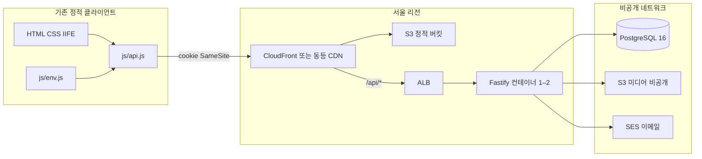
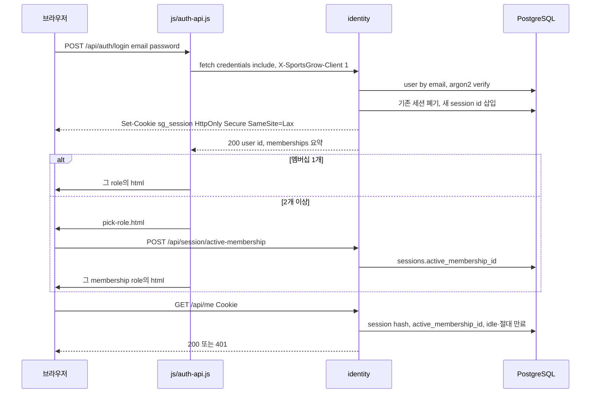
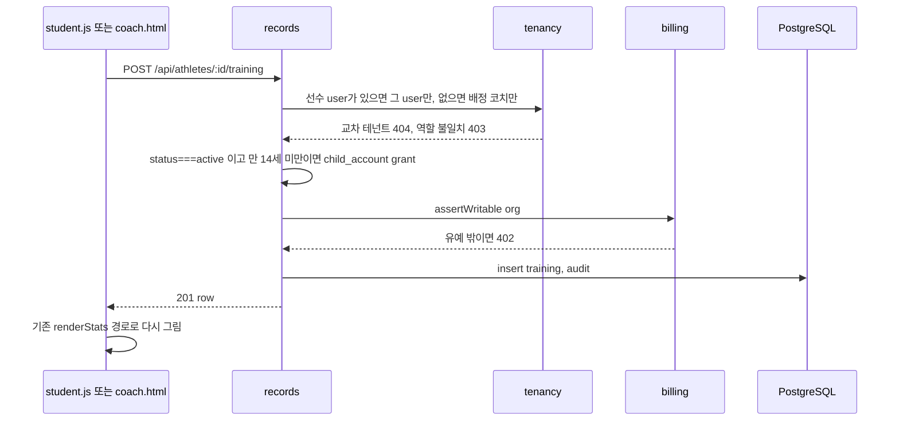
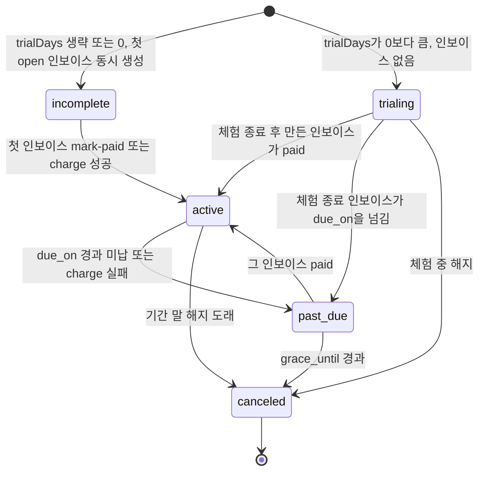

# Sports Grow 상용화 설계 — 한국 유료 파일럿

| 항목 | 값 |
| --- | --- |
| 문서 | Sports Grow 상용화 설계 (유료 배포 v1) |
| 작성 | Sports Grow |
| 날짜 | 2026-11-17 |
| 상태 | Draft |
| 기준 저장소 | `/Users/kwanbum/Documents/korea_IT/lanhchain_ai_vision/sportsgrow` (`main`, origin `https://github.com/noux8223/sportsgrow.git`) |
| 범위 | 정적 프로토타입을 깨지 않고, 대한민국에서 실제로 돈을 받을 수 있는 최소 제품과 그 뒤의 경로 |

이 문서는 사업계획서의 문장을 구현 명세로 옮기지 않는다. 현재 상태는 저장소 코드를 기준으로 하고, 가격·시장·일정은 **검증되지 않은 사업 가정**으로만 인용한다. 코드와 가정이 충돌하면 현재 상태는 코드가 이긴다.

---

## Overview

Sports Grow는 유소년 선수(데모의 중심 인물은 야구 선수 김하람, `p-haram`)의 훈련·경기·목표를 학생, 학부모, 코치, 아카데미, 사이트 운영자가 역할별로 보는 정적 HTML/CSS/JS 프로토타입이다. 프레임워크, 빌드, 서버, 계정 데이터베이스, 결제 연동은 없다. 기록은 브라우저 `localStorage`에만 있다. README와 `docs/사업-앱-개발-진행정도-표.md`가 적는 TRL 2(시제품), 서버 MVP 미착수는 코드와 일치한다.

유료 배포를 막는 것은 화면 부족이 아니다. 화면은 랜딩·로그인·네 역할 대시보드·운영 콘솔·PWA까지 있다. 막는 것은 다음이다. 비밀번호 `grow1234`가 `js/auth.js`에 하드코딩되어 있고, 세션은 만료 없는 `localStorage` JSON이며, 역할 문자만 바꾸면 가드를 통과한다. 선수 사진·영상은 data URL로 `localStorage`에 들어간다. 이용약관·개인정보 처리방침 페이지가 없다. 청구는 `js/admin.js`가 만든 가짜 입금 행이다. 만 14세 미만 아동의 법정대리인 동의, 세금계산서, 환불, 구독 만료 시 차단은 코드에 없다.

제안하는 최소 상용 경로는 다음과 같다. 기존 vanilla IIFE 화면을 클라이언트로 유지한다. 그 앞에 같은 사이트 오리진의 작은 API, 서울 리전 PostgreSQL, 비공개 오브젝트 스토리지를 붙인다. **첫 청구의 결제자는 아카데미(사업자) 한 곳당 구독 하나**다. 코치·보호자·선수는 그 구독의 좌석이며 별도 결제자가 아니다. 선수 본인 결제와 학부모 월 3,000원 체크아웃은 첫 유료 코호트에 넣지 않는다. 데모 원장 `sportsgrow.demo.v1`는 운영 데이터로 이관하지 않는다.

---

## Background & Motivation

### 현재 구현 (코드 기준)

저장소 루트는 정적 사이트다. `package.json`, Dockerfile, CI, 테스트 러너, 서버 디렉터리는 없다. README의 실행 방법은 `python -m http.server`다.

| 표면 | 파일 | 실제로 하는 일 |
| --- | --- | --- |
| 소개·요금·안전 문구 | `index.html`, `js/site.js` | 요금 숫자 토글, 랜딩 목업. 결제로 이어지지 않음 |
| 역할 로그인 | `login.html`, `admin-login.html`, `js/auth.js` | 이메일·비밀번호를 `ROLES` 상수와 비교 |
| 학생·학부모·코치 열람 | `student.html`, `js/student.js` | 원장 읽기/쓰기. 역할에 따라 기록 수정 제한 |
| 코치 | `coach.html`, `js/coach.js` | 시드 명단 12명 + 원장의 김하람 숫자만 덮어씀 |
| 아카데미 | `academy.html`, `js/academy.js` | 팀 인원·참여율을 생성. 김하람 한 행만 원장 수치 |
| 운영 콘솔 | `admin.html`, `js/admin.js`, `css/admin.css` | 회원·가짜 입금·공지·문의·설정을 `localStorage`에 저장 |
| 기획 보드 | `mockup.html` | 참고용. Service Worker 프리캐시에 없음 |
| PWA | `manifest.json`, `sw.js`, `js/pwa.js`, `offline.html` | 정적 자산 캐시. `VERSION`은 `sportsgrow-v13` |
| 데모 원장 | `js/demo-data.js` | `window.SportsGrowDemo`, 키 `sportsgrow.demo.v1` |

역할과 세션은 `js/auth.js`에만 있다.

- 계정 다섯 개, 비밀번호는 모두 `grow1234`: `player@`, `parent@`, `coach@`, `admin@`(아카데미), `ops@`(사이트 운영).
- `saveSession`이 저장하는 값은 `{ role, email, name, org, loggedAt }`이다. 서버 토큰, 만료, 서명, 기기 바인딩이 없다.
- `guard()`는 `document.body[data-role]`과 세션의 `role` 문자열만 비교한다. `student.html`은 `player`, `parent`, `coach`를 허용한다 (`PAGE_ROLES`). 아카데미 세션은 학생 화면으로 가지 못한다.
- `resolveDestination`은 `next`를 `/^[A-Za-z0-9._-]+\.html$/`와 역할별 허용 목록으로 제한한다. 이 부분은 `docs/프로토타입-보완-수정-분석.md`(2026-11-16)가 적었던 오픈 리다이렉트보다 좁다. 그 분석 문서의 해당 문단은 현재 코드와 맞지 않는다.
- 세션이 없으면 `js/student.js` 상단에서 시드를 쓰지 않고 return 한다. 분석 문서의 “비로그인 시드” 서술은 현재 코드와 맞지 않는다.
- 공개 푸터(`index.html`)에 `admin-login.html` 링크가 있다. 운영 화면이 같은 오리진에 프리캐시된다 (`sw.js` `PRECACHE`).

데모 원장 형태는 `js/demo-data.js`의 `seed()`가 정한다.

```text
{
  version: 1,
  players: [{
    id: "p-haram", name: "김하람", email, sport: "야구",
    teamId: "team-hanbit", team, position, grade: "중학교 2학년",
    age: "14",          // 생년월일이 아닌 표시용 문자열
    region, bats, coachId: "c-park", parentId: "pa-lee",
    visibility: { profile: "team", training: "team", games: "team", goals: "private" },
    training: [{ id, date, type, minutes, intensity: "high|mid|low", memo }],
    games: [{ id, date, competition, opponent, result, score, performance,
              achieved, atBats, hits, walks }],
    history: [{ monthOffset, atBats, hits, walks }],  // 경기 행이 없는 달의 데모 채움
    goalsMeta: []
  }],
  cheers: {},
  requests: [],
  gallery: [{ id, type, src, caption, author, authorEmail, authorRole, createdAt, comments }],
  heroMedia: null,
  notes: [],
  goalOverrides: {}
}
```

시드 훈련 오프셋 0–6일 합은 35+35+60+30+70+40+50 = **320분**이다. `weekMinutes`, `weekDays`, `goalAverage`, `growthSeries`가 이 배열에서 계산된다. `WEEKLY_GOAL_DAYS`는 5, 월간 타율 목표는 0.320, 시즌 안타 목표는 30이다. `growthSeries`의 `obp` 분기는 `(hits + walks) / (atBats + walks)`라서 공식 출루율이 아니다. 희생플라이·사구·희생번트가 입력에 없다.

`js/student.js`는 이 원장을 읽고 쓴다. 갤러리·히어로 미디어는 사진을 긴 변 1280px JPEG data URL로, 영상을 2MB 이하 data URL로 `localStorage`에 넣는다 (`IMAGE_MAX_SIDE`, `VIDEO_MAX_BYTES`). 업로드 전 사전 한도는 12MB다. 스트릭은 `streakDays`가 오늘 날짜부터 거꾸로 세다가 기록이 없는 날에서 끊으므로, 오늘 기록이 없으면 0이다. 강도는 RPE 1–10이 아니라 `high|mid|low`다. 보호자 요청은 `commitRequests`가 `SportsGrowDemo.save`로 `sportsgrow.demo.v1`에만 쓰고, 생성 시 `status`는 `"pending"`이다. 취소는 상태 변경이 아니라 행 삭제다.

공개 범위는 저장되고, `canSee`는 다음 한 줄이다.

```javascript
return IS_STUDENT || visibilityOf(section) !== "private";
```

따라서 `team`과 `public`의 열람 결과는 같다. `public`이어도 익명 URL은 없다. `index.html`의 `sportsgrow.app/player/haram`은 랜딩 목업 문자열이지 라우트가 아니다. 사업계획서의 “비공개·초대·전체”와 화면의 “비공개·팀 공개·전체 공개”는 여전히 이름이 다르다. 기본값이 비공개라는 랜딩 문구(`index.html` `#safety`)와 시드 기본값(`profile/training/games = team`)도 다르다.

코치·아카데미·운영 콘솔은 원장을 **일부만** 본다.

- `js/coach.js`는 `SEED` 12명의 분·목표·메모를 코드에 갖고, `id === "p1"`인 김하람의 `minutes`/`goal`/`last`/목표 목록만 `SportsGrowDemo` 계산으로 덮는다. 시드에 적힌 350분은 그 덮어쓰기 전의 상수다. 나머지 11명은 원장에 없다. 메모·목표·커스텀 선수는 `sportsgrow.coach.notes.v1`, `sportsgrow.coach.goals.v1`, `sportsgrow.coach.customPlayers.v1`에만 쓴다. 목표 폼은 계산된 달성률이 아니라 사람이 넣은 `pct`를 저장한다. 보호자 요청은 원장에 `requests` 배열이 있으면 그 배열만 저장하고, 없을 때만 `sportsgrow.parent.requests.v1`에 쓴다. 시드가 `requests: []`를 만들므로 레거시 키는 상시 이중 기록이 아니다. `demo-data.js`의 `migrate`가 그 키를 최초 1회 복사할 뿐이다. `updateRequestStatus`는 `done`과 `pending`만 쓴다.
- `js/academy.js`의 팀 5개(야구·축구·농구·배구·육상)와 선수 행은 `SEED_TEAMS`와 생성 로직이다. 저장 키 `sportsgrow.academy.teams.v1`는 추가 팀만 담는다. 김하람 한 명만 `p-haram`으로 끼워 넣고 주간 분·목표 평균을 원장에서 읽는다. 참여율은 생성값이다. 보고서 기간 라벨 일부는 `2026년 10월`처럼 고정 문자열이다 (`REPORT_PERIODS`).
- `js/admin.js` 회원 30명, 6개월 입금, 공지, 문의는 별도 시드다. 김하람 행 `ST-1001`에 한해 `weekDays`를 `sessions`에, `goalAverage`를 `growth`에 덮어쓴다. 출석률 94는 그대로다. 입금 금액은 `amountFor`가 랜딩과 같은 3,000 / 30,000 / 100,000(연간은 12배)을 넣는다. 상태는 한 해시가 네 값을 고르는 구조가 아니다. `seedPayments`는 이번 달(`offset === 0`)만 `seed % 10`으로 `입금대기`·`연체`·`입금완료`를 나누고, 과거 달은 `seed % 19 === 0`이면 `환불`, 아니면 `입금완료`다. PG, 세금계산서 번호, 웹훅이 없다.
- `js/site.js`의 점검 배너는 **같은 브라우저**의 `sportsgrow.admin.settings.v1`만 읽는다. 다른 사용자 로그인, 기록 쓰기를 막지 않는다. 배너 문구도 “데모 화면을 둘러볼 수 있습니다”다.

Service Worker(`sw.js`):

- navigate는 network-first 후 `STATIC_CACHE`에 HTML을 넣는다.
- 같은 오리진의 그 외 GET은 stale-while-revalidate로 `STATIC_CACHE`에 넣는다. 나중에 `/api`를 같은 오리진에 두면 **인증된 GET 응답이 캐시된다.**
- `cdn.jsdelivr.net`(Pretendard)은 버전 없는 `sportsgrow-runtime-v1`에 들어간다. 페이지 `<link>`에 SRI는 없다.
- 오프라인 훈련 큐는 없다. README가 말하는 한계와 같다.

`docs/사업-앱-개발-진행정도-표.md`의 “단일 원장으로 맞추는 중이며 끝났다고 단정하지 않는다”는 문장은 2026-11-17 코드 기준으로 반만 맞다. 김하람의 주간 분과 목표 평균은 학생·코치·아카데미·관리자가 `SportsGrowDemo`로 맞춘다. 명단·입금·다른 선수는 여전히 화면별 시드다.

`docs/프로토타입-보완-수정-분석.md`는 2026-11-16 기준 분석이다. 아래는 그 문서와 오늘 코드가 다른 부분이라, 상용화 백로그로 다시 열지 않는다.

- 오픈 `next`, 비밀번호 눈 아이콘, 비로그인 시드, `sw.js` 버전 `sportsgrow-v11`, “데이터가 완전히 네 벌이고 김하람 주간 분이 350” — 현재는 허용 목록, `#i-eye-off`, 세션 가드, `sportsgrow-v13`, 김하람 주간 분 원장 계산으로 바뀌어 있다.
- 남아 있는 지적(공개 범위가 팀/전체를 구분하지 않음, 약관 페이지 없음, 공유 비밀번호, 점검 모드가 사이트 전역이 아님, 코치 명단과 원장 분리, 지표 엔진 없음)은 이 설계의 입력으로 쓴다.

### 이미 있는 것 / 데모로만 있는 것 / 전혀 없는 것

**이미 있는 것 (브라우저 데모로 동작)**

- 역할별 화면, 해시 뷰 라우터(`js/app-shell.js`), 학부모 읽기 전용 + 응원·코치 요청·갤러리 업로드·본인 댓글 삭제.
- 학생의 훈련·경기 CRUD에 가까운 흐름(경기 필드에 타수·안타·볼넷·점수·id).
- 김하람 한 명에 대한 주간 분, 주 5일 목표, 세 가지 목표 달성률 평균, 월별 타율 곡선.
- 관리자 콘솔 UI: 필터, CSV, 활동 로그(최대 60행, 클라이언트), 설정 폼.
- PWA 설치·오프라인 폴백·업데이트 토스트.
- 로그인 `next` 파일명 허용 목록. 학생 화면 HTML 이스케이프는 `SportsGrowDemo.escapeHtml`를 거친다.

**데모로만 있는 것 (화면·시드·카피는 있고 서버 계약은 없음)**

- 계정, 비밀번호, 역할, “권한”. 전부 클라이언트.
- 아카데미 5개 팀·다종목 통계, 코치 소속 12명, 운영 회원 30명, 입금 원장. 김하람 외에는 생성·시드 숫자.
- 요금제 3종 표시(`index.html` `#pricing`: 학생·학부모 3,000원, 코치 30,000원, 아카데미 100,000원, 월/연, “부가세 별도”, “기획 단계 가정”).
- 안전 원칙 카피(최소 수집, 보호자 동의, 열람·삭제). 동의 저장, 처리방침 문서, 삭제 API는 없음.
- 알림 버튼의 고정 문구(분석 문서 4.3과 동일하게, 요청 처리와 배지가 연결되지 않음).
- 관리자 “가입 승인”, “자동 갱신”, “입금 마감일”. 설정 객체를 다른 클라이언트가 강제하지 않음.
- 랜딩의 개인 홈페이지 URL, 전체 공개 옵션.

**전혀 없는 것**

- 서버 계정, 조직(tenant), 멤버십, 초대, 비밀번호 재설정(로그인 화면은 토스트로 “데모에서는 지원하지 않습니다”).
- 이메일 발송, 카카오 알림톡, 푸시, SMS.
- 결제사 연동, 빌링키, 웹훅, 세금계산서, 환불 원장, 구독 상태 기계, 권한과 연결된 entitlement.
- 법정대리인 동의 기록, 생년월일, 아동 연령 계산, 개인정보 내보내기·삭제 잡.
- 비공개 미디어 버킷, 서명 URL. 영상은 data URL뿐이다.
- 주간 리포트 생성·발송, PDF.
- 야구 24지표 룰 엔진. 저장소에 지표 정의서 파일이 없다. “24개 중 15개 초안”은 `docs/사업-앱-개발-진행정도-표.md`의 주장이지 코드나 별도 문서가 아니다.
- 이상치 탐지, 코치 검증 배지, 감사 로그의 서버 보존.
- 다국어, 앱스토어 바이너리, OCR·음성.
- 사업자 정보(상호·대표자·주소·사업자등록번호·통신판매업 신고번호). `docs/사업계획서-예비창업패키지-2026.md`는 법인 설립을 “예정”으로 적는다.
- 사업계획서가 고른 Next.js, NestJS, PostgreSQL, Redis, 국내 리전, Docker. 저장소에 해당 의존성이 없다. “기술 설계 개발완료”는 문서 선택이지 구현이 아니다.

### 왜 지금 돈을 받을 수 없는가

실제 사용자에게 유료로 열려면 동시에 네 가지가 필요하다. 지금은 네 가지 모두 없다.

1. **계약의 상대와 청구 객체.** 돈을 낼 법인·사업자와, 그 구독이 어떤 조직의 데이터에 연결되는지.
2. **아동 개인정보의 적법한 처리.** 생년월일, 법정대리인 동의, 사진 초상, 보관·파기, 제3자(코치·기관 스태프) 제공 범위.
3. **권한이 서버에 있을 것.** 다른 아카데미, 다른 자녀, 추측 가능한 미디어 URL, 개발자 도구로 역할을 `admin`으로 바꾸는 행위가 데이터를 열면 안 된다.
4. **전자상거래·세무가 남길 기록.** 사업자 고지, 청약 조건, 세금계산서 또는 카드매출전표, 실패·환불·해지 상태.

데모를 공개 URL에 그대로 올리는 것은 유료 파일럿의 전 단계로도 부적합하다. 공유 비밀번호와 운영 콘솔이 같은 배포에 있다.

### 사업 문서에서 가져온 가정 (요구사항이 아님)

아래 숫자는 구현 완료 조건이 아니다. 청구 객체를 설계할 때만 라벨을 붙여 쓴다.

| 가정 | 출처 | 이 설계에서의 취급 |
| --- | --- | --- |
| 학부모 3,000원/월, 코치 30,000원/월, 아카데미 100,000원/월~, 부가세 별도, 연간은 12배 | `index.html` `data-price`, `docs/사업계획서-통합본.md` | 첫 상품은 아카데미 월 100,000원+부가세 **가정**만 청구 객체에 매핑. 나머지 둘은 팔지 않음 |
| 지불자는 학부모, 유통은 코치·아카데미 (B2B2C) | 통합본, 예비창업패키지 | 첫 코호트 결제 구조로는 채택하지 않음. Alternatives에 둠 |
| M3에 파일럿 3곳 중 1곳 유료, M7–M8에 10곳·선수 300명 | 진행정도 표, 실현가능성 | 용량 가정의 상한으로만 사용 |
| 통계 p95 1초, 리포트 5초, 가용성 99.5%, 동시 1,000, RPO 24시간/RTO 4시간 | `docs/사업계획서-실현가능성.md` 2-2 | 동시 1,000과 RPO 24시간은 첫 코호트 목표로 쓰지 않음. 이유는 비기능 절 |
| Next.js + NestJS + Redis | 같은 문서 1-3 | 기본 경로가 아님. Alternatives |
| 야구 24지표, OCR, 알림톡, 앱스토어 | 로드맵·실현가능성 | 첫 청구 이후 |

시장 규모 문서의 TAM·SAM·SOM은 용량 산정에 쓰지 않는다.

---

## Goals & Non-Goals

### Goals

1. 아카데미 사업자 1곳이 세금계산서(또는 카드매출전표)를 받을 수 있는 월 구독으로, 자기 조직의 야구 선수 기록을 서버에 저장하고 코치·보호자에게 역할 범위만 보여 준다. 훈련·경기 행의 작성자는 그 선수의 user가 있으면 그 user뿐이고, user가 없으면 배정된 코치뿐이다. 만 14세 미만은 user가 없으므로 배정 코치가 `coach.html`에서 쓴다.
2. 기존 `student.html` / `coach.html` / `academy.html` / `admin.html` IIFE를 기본 UI로 유지한다. 화면 단위로 API를 켜고, 데모 모드를 끄지 않은 로컬 정적 사이트는 지금처럼 돌아야 한다.
3. 공유 비밀번호와 `localStorage` 세션을 운영 환경에서 제거한다.
4. 만 14세 미만은 법정대리인 `child_account` 동의 없이 `active`가 되지 않고, 동의 전·`draft`인 동안에는 훈련·경기·목표·미디어·응원·요청·노트를 읽거나 쓰지 못한다. 실패는 409 `athlete_not_active`다. 동의 전에 저장하는 것은 이름, 생년월일, 조직, 팀뿐이다. 목표 3행은 `draft` 생성이 아니라 `POST /api/athletes/:id/activate`가 성공한 트랜잭션에서 생긴다. 18세 미만 사진은 초상 동의와 서버 재인코딩 없이 자산 행이 되지 않는다.
5. 구독이 없거나 유예가 끝나면 쓰기가 서버에서 거절된다. 읽기·내보내기·삭제는 정책 기간 동안 남는다.
6. 데모 원장과 관리자 시드 회원·입금은 운영 DB로 들어가지 않는다.
7. 첫 유료 코호트 규모(아래 가정)에서 백업, 감사 로그, 장애 시 롤백이 가능하다.

### Non-Goals (v1에서 만들지 않음)

- 학부모·코치 개별 체크아웃, 선수 본인 결제, 앱 내 가격 A/B.
- Next.js/React 전환, 화면 전면 재작성, 네이티브 앱스토어 출시.
- 야구 24지표 룰 엔진, 연령 보정, 코치 검증 배지, 이상치 탐지, 다종목 템플릿.
- 공식 출루율·장타율·OPS·방어율. 입력 컬럼이 생기기 전에는 계산하지 않는다. 데모의 유사 OBP를 유료 화면에 옮기지 않는다.
- 공개 프로필, 전체 공개 갤러리, 선수 검색, 기관 간 벤치마크, 아동 영상·사진으로의 모델 학습.
- 동영상 업로드(프로토타입의 2MB data URL 정책을 서버로 연장하지 않음).
- 카카오 알림톡, 푸시, SMS, OCR, 음성, 오프라인 기록 큐, 다국어.
- Redis, 마이크로서비스, 이벤트 소싱.
- ISMS·GS 인증 취득(사업계획서의 2년차 목표로 남겨 둔다).
- 데모 데이터의 마이그레이션 도구.
- 채용 계획. 일정은 PR 순서만 다룬다.
- 중국·일본 법인, 결제, 데이터 이전.

### 첫 유료 코호트에 넣을 기능 vs 이후

| 능력 | 첫 청구 전 필수 | 이후 |
| --- | --- | --- |
| 계정·조직·멤버십·초대 | 예. 공개 자가 가입으로 테넌트를 만들지 않음. 운영자가 조직을 만든 뒤 초대 | 자가 가입, SSO |
| 로스터·팀·코치 배정 | 예. 야구만 | 다종목, 일괄 CSV 등록은 있으면 좋으나 필수 아님. 한 팀 CSV는 PR에 넣되 실패해도 수동 등록으로 파일럿 가능 |
| 훈련·경기 기록 | 예. 현재 필드만. 선수 user가 있으면 그 user만 작성하고, 없으면 배정 코치가 `coach.html`에서 작성한다. `org_admin`과 보호자는 작성하지 않는다 | RPE 1–10, 투구 구속, 24지표 |
| 보호자 연결 | 예. 동의 전 선수는 `draft` | 보호자 여러 명, 양육권 분리 |
| 코치 배정 | 예 | 검증 배지 |
| 갤러리 | 사진만, 비공개 버킷, 서명 URL | 동영상, 히어로 영상 |
| 주간 리포트 | 예. 인앱 HTML + 이메일. PDF 아님 | PDF, 알림톡, 시즌 포토북 |
| 성장 지표 | 주간 분, 훈련 일수, 스트릭, 타율(안타/타수), 기존 3개 목표의 평균 | 룰 엔진 |
| 알림 | 이메일(초대, 동의, 리포트, 결제 실패, 해지) | 푸시, 알림톡, SMS |
| 청구 | 구독 상태 기계, entitlement, 수동 입금 기록, 세금계산서 필드, 웹훅 수신 포트 | 특정 PG SDK, 학부모 빌링키 |
| 운영 | 점검 플래그의 서버 강제, 문의 티켓, 감사 로그, 회원 검색은 조직 안 | 풀 기능 운영 콘솔을 한 번에 재작성하지 않음. 기존 `admin.html`을 API에 연결 |
| PWA·오프라인 | 앱 셸 캐시 유지. `/api`는 캐시하지 않음. 오프라인 쓰기는 없음 | 배경 동기화 |
| 스토어 앱 | 없음 | 필요해지면 별도 설계. 기본은 PWA |

---

## Proposed Design

### 상업 동작 (누가 누구에게 내는가)

**채택: 아카데미 B2B 구독 하나.**

- 청구 당사자(payer)는 아카데미 또는 클럽의 사업자다. 화면 역할명 `academy`에 해당한다.
- 공급자(payee)는 Sports Grow 법인이다. 법인이 없으면 청구를 열지 않는다. 예비창업 문서의 “법인 설립 예정”은 미완료 전제다.
- 코치(`coach`), 보호자(`parent`), 선수(`player`)는 이용자다. v1 인보이스에 이들의 카드가 올라가지 않는다.
- 보호자 계정과 주간 리포트는 아카데미 구독에 포함된다. 학부모에게 3,000원을 다시 청구하지 않는다.
- 사이트 운영자(`admin` / `ops@`)는 고객 조직의 멤버가 아니다. 별도 `platform_staff`다. 데모처럼 아카데미 로그인과 비밀번호를 공유하지 않는다.

가격은 가정이므로 코드에 상수로 박되, 화면 문구는 “파일럿 약정”으로 두고 랜딩의 3단 요금은 결제 버튼이 아니어야 한다.

**파일럿 플랜 가정 `academy_monthly_v1`**

- 공급가 100,000원 / 월, 부가세 10,000원, 합계 110,000원.
- 포함 좌석 기본값: 선수 프로필 100, 코치 멤버십 10, 선수당 보호자 2명, 조직 관리자 3명. 랜딩의 “협의”는 가격 가정의 문구일 뿐이고, 무제한 생성을 막기 위해 이 네 숫자를 `plans`와 `orgs` 컬럼의 기본값으로 둔다. 조직 생성 시 운영자가 그 조직의 컬럼만 덮어쓸 수 있다. 초과 insert·초대는 409 `seat_limit`이다. 가격 100,000원은 여전히 가정이다.
- 연간 1,200,000원(부가세 별도)은 랜딩에 12배로 적혀 있을 뿐 할인이 아니다. v1 상품 코드는 월간만 판다. 연간은 상태 기계가 `interval`을 받도록 컬럼만 둔다.
- 첫 1–3곳은 PG 없이 세금계산서 + 계좌이체로 받을 수 있다. 상태 기계의 진실 공급원은 DB다. PG는 나중 어댑터다.

사업계획서의 “코치가 유통하고 학부모가 결제”는 유통 경로는 유지한다. 코치·원장이 선수를 등록하고 보호자를 초대한다. 바뀌는 것은 **카드 명의가 보호자가 아니다**는 점이다. 파일럿 3곳·10곳이라는 영업 단위도 아카데미와 맞다.

### 용량 가정 (라벨)

인프라를 이 봉투에 맞춘다. 시장 문서의 억 단위 매출로 샤딩하지 않는다.

| 구간 | 가정 | 출처 라벨 |
| --- | --- | --- |
| 첫 청구 | 유료 아카데미 1–3곳, 곳당 선수 약 30명, 코치 2–4명, 보호자 약 30명. MAU 200 미만 | 진행정도 표의 “파일럿 3곳”을 엔지니어링 봉투로 축소 |
| 재설계 없이 버틸 파일럿 | 조직 10, 선수 300, 코치 40, 보호자 300, MAU 800 | 같은 문서의 “10곳·300명”. 달성 목표가 아니라 스키마·인덱스 상한 |
| 사진 | 선수당 월 4장. 서버가 재인코딩한 JPEG만 보관, 평균 400KB. 300명×4×0.4MB ≈ 480MB/월, 연 약 6GB. 클라이언트 원본과 EXIF는 저장하지 않음 | 이 설계의 가정 |
| 영상 | 0 | v1 비목표 |
| 훈련 행 | 선수당 주 5행 × 300 × 52 ≈ 8만 행/년 | 데모의 주 5회 목표를 상한 밀도로 사용 |

이 규모에서 PostgreSQL 단일 프라이머리(Multi-AZ, `db.t4g.small`, gp3 20GiB)와 API 컨테이너 1–2개가 충분하다. Redis, 샤딩, 파티션, 읽기 복제본, PgBouncer는 첫 배포에 넣지 않고, 임계값과 설정은 「데이터베이스 물리 설계와 최적화」에 고정한다. 로그인 제한은 프로세스 메모리가 아니라 `login_attempts`다. 태스크가 두 개여도 한도가 갈라지지 않는다. IP당 60초에 5회, 이메일당 3600초에 10회를 넘으면 429다.

### 비기능 목표 (이 코호트)

| 항목 | 목표 | 비고 |
| --- | --- | --- |
| 기록 저장 API | 서울 리전, p95 300ms (인증·단일 insert) | 입력 30초는 UX 목표(`실현가능성` 2-2)이지 서버 지연이 아님 |
| 선수 목록·최근 기록 조회 | p95 500ms, 그중 DB 시간 100ms | 10곳·300명. 기관 목록은 훈련 테이블을 Seq Scan하지 않음 |
| 통계(주간 분, 타율) | p95 1초, 선수 1명 DB 시간 20ms | 사업계획서 문구를 이 규모에 한정해 채택. 사전 집계 테이블은 아래 최적화 절의 임계값 이후에만 |
| 주간 리포트 | 조직당 30초 이내 생성 후 이메일 큐 | 5초는 300명 전체 동기 응답으로 약속하지 않음. 사용자는 인앱에서 폴링 |
| 가용성 | 월 99.5% (약 3.6시간) | 사업계획서의 출시 목표와 같음. 99.9는 비목표 |
| 동시 접속 | 설계 부하 50, 여유 100 | “1,000명”은 이 코호트의 요구가 아님. 부하 시험 게이트로 남기려면 10곳 이후에 |
| RPO | DB 1시간 (PITR). 오브젝트는 PUT 성공 후 유실 0을 스토리지 내구성에 의존 | 사업계획서 RPO 24시간은 유료 아동 기록에 느슨하다고 보고 강화한다 |
| RTO | 4시간 | 사업계획서와 동일. 복구 리허설을 파일럿 전 1회 |
| 백업 보관 | 35일. 삭제된 아동 데이터는 운영 DB에서 즉시 제거되고, 백업에서는 보관 기간이 끝나야 사라짐. 파기 매니페스트는 RDS PITR 밖 버킷에 있고 복구 후 재적용한다 | 처리방침에 이 문장을 넣는다 |
| 비밀번호·세션 | argon2id, memory 19 MiB(19456 KiB), iterations 2, parallelism 1 (OWASP Password Storage Cheat Sheet의 argon2id 최소). 비밀번호 10자 이상 128자 이하. 세션 유휴 12시간, 절대 14일 | |
| 감사 로그 보관 | 13개월 후 파기 잡 | 열람 사실 확인용. 무기한 보존하지 않음 |

### 논리 구성



정적 파일과 API는 **한 사이트 오리진**이다. 세션 쿠키를 퍼스트파티로 두기 위해서다. 경로는 `/api`. 그 오리진에 API를 붙이기 전에 `sw.js`가 `/api/`로 시작하는 요청을 `respondWith`하지 않고, navigate 캐시에도 넣지 않는다. `VERSION`을 그 변경과 함께 올린다. Fastify는 모든 `/api` 응답에 `Cache-Control: no-store`를 붙인다. CDN 동작 `/api/*`는 캐시 TTL 0이고 쿠키가 있는 응답을 저장하지 않는다. 이 세 가지는 체크리스트 문장이 아니라 배포 설정이다. 설정이 없으면 pilot 프로파일은 기동하지 않는다.

데모 호스트(로컬, 시연용 정적 호스팅)는 `js/env.js`의 `demoLogin: true`, `api: false`다. 유료 호스트의 환경 변수는 `APP_ENV=pilot`이고 `demoLogin: false`, `api: true`다. `NODE_ENV`는 이 가드의 이름이 아니다. 두 설정을 한 번들에 비밀번호와 함께 넣지 않는다. pilot 정적 버킷에는 `js/auth.js`, `js/demo-data.js`, `admin.html`, `admin-login.html`을 올리지 않는다. 운영 콘솔 HTML은 공개 버킷에 없고, 별도 호스트에서만 받는다. API가 `platform_staff`가 아니면 404를 주는 것은 **데이터** 보호이지 HTML 은닉이 아니다. 소스 저장소에는 데모 비밀번호가 시연을 위해 남아도 된다. 운영 산출물과 소스를 구분하는 수단은 파일 선택과 프리캐시 목록이다.

### 모듈 경계

서버는 한 프로세스, 한 스키마, 모듈 폴더만 나눈다. NestJS 모듈과 1:1로 옮길 수 있게 의존 방향을 고정한다. `billing`은 `records`를 import하지 않는다. `records`는 `billing`의 `assertWritable`만 호출한다.

| 모듈 | 책임 | 하지 않는 일 |
| --- | --- | --- |
| `identity` | users, password hash, sessions, 이메일 인증 토큰 | 조직 권한 판단 |
| `tenancy` | orgs, memberships, invites, 요청마다 멤버십 로드 | 요금 계산 |
| `roster` | teams, athletes, coach_assignments | 미디어 바이트 |
| `records` | training, games, goals, notes, cheers, coach requests, 파생 쿼리 | 지표 플러그인 |
| `consent` | policy_versions, consent_events, 연령 게이트 | 마케팅 수신 이외의 제3자 판매 |
| `media` | presign, asset 행, 댓글, 서명 GET | 공개 ACL, 영상 |
| `billing` | plans, subscriptions, invoices, payments, tax invoice fields, webhook inbox, entitlement | 특정 PG SDK를 도메인 계층에 노출 |
| `notify` | email outbox, 재시도 | 알림톡 |
| `reports` | 주간 스냅샷 | PDF 렌더러 |
| `ops` | platform_staff, platform_settings, tickets, notices | 고객 조직의 일상 기록 수정. 수정 시 감사 로그 필수 |
| `audit` | append-only audit_events | 업데이트·삭제 API 없음 |

클라이언트는 새 프레임워크 없이 `js/api.js` IIFE 하나와, 각 화면 스크립트의 로드 분기(`env.api`이면 API, 아니면 `SportsGrowDemo`)다.

### 테넌시와 신원

데모는 “역할 = 사람 = 화면”이다. 상용은 다음 네 겹이다.

1. **User.** 이메일 전역 유일. 비밀번호는 user 소속. 한 사람이 여러 멤버십을 가질 수 있다.
2. **Org.** 아카데미 테넌트. 모든 아동 행은 `org_id`를 가진다. 클라이언트가 보낸 `org_id`는 힌트일 뿐이고, 권한은 세션의 `active_membership_id`에서 온 멤버십과 일치할 때만 준다. 불일치·비멤버의 선수 조회는 404다. 이 404는 구독 만료와 섞지 않는다. 구독 문제는 402다.
3. **Membership.** unique는 `(org_id, user_id, role)`이다. 같은 조직에서 역할이 다른 행은 허용한다. 코치이면서 그 아카데미 선수의 보호자인 경우를 두 계정으로 쪼개지 않기 위해서다. 한 요청의 권한은 멤버십의 합이 아니다. 세션은 `active_membership_id` 하나만을 현재 역할로 본다. role은 `org_admin | coach | guardian | athlete`만. 문자열 `admin`은 테넌트 role로 쓰지 않는다. 데모의 `academy`는 `org_admin`, `parent`는 `guardian`, `player`는 `athlete`다.
4. **Platform staff.** `platform_staff.user_id`. 고객 멤버십이 없어도 운영 콘솔에 들어온다. 선수 본문(프로필 상세, 훈련, 경기, 노트, 미디어 메타, 사진 바이트)은 쿼리 `ticketId`가 있고 그 티켓이 열린 상태일 때만 반환한다. 없으면 404다. 감사 행에 그 `ticketId`를 남긴다. 티켓 없는 목록(조직 이름, 구독 상태, 티켓 큐)은 허용한다. 운영 HTML은 공개 정적 버킷에 두지 않는다. API 404는 그 HTML을 숨기지 못한다.

선수 행은 user가 없을 수 있다. 만 14세 미만은 user를 만들지 않는다. 직접 가입 폼을 제출해도 계정을 만들지 않는다. 만 14세 이상은 본인 user를 만들 수 있다. 없어도 된다. 선수 user가 있는지는 `memberships.role = athlete`이고 `athlete_id`가 그 선수인 행이 있는지다. 훈련·경기 행의 작성자는 그 판정 하나다. user가 있으면 그 선수 user만 만들고 `author_user_id`는 그 user다. user가 없으면 그 선수의 `coach_assignments`에 있는 코치만 만들고 `author_user_id`는 그 코치다. `org_admin`과 보호자는 훈련·경기 행을 만들지 않는다. 코치는 선수 user가 쓴 행을 고치지 않는다. 사진 업로드는 18세 미만 전원 보호자 `portrait` 동의가 필요하다. 연령은 `athletes.birth_date`로 매 요청 시 `Asia/Seoul` 기준 만 나이를 계산한다. 데모의 `age: "14"` 문자열은 저장하지 않는다.

`POST /api/orgs/:orgId/athletes`가 `draft`로 넣는 컬럼은 `display_name`, `birth_date`, `org_id`, `team_id`뿐이다. 포지션·학년·메모·사진·목표 행은 넣지 않는다. 이 insert는 개인정보 처리다. 목적은 법정대리인에게 동의를 요청하는 것 하나다. 제품 이용(기록, 리포트, 갤러리, 목표)이 아니다. 호출자는 `org_admin`, 또는 그 조직의 `coach`(호출한 코치를 그 선수의 `coach_assignments`에 바로 넣음)다. 초대가 만료되고 14일이 지나도 `draft`이며 `child_account` 동의가 없으면 잡이 그 선수 행을 삭제한다. `goals`는 activate 전에는 없어야 한다. 남아 있으면 같은 잡이 선수 행과 함께 지운다.

`draft → active`는 `POST /api/athletes/:id/activate`만 한다. 다른 라우트는 status를 `active`로 쓰지 않는다.

- 만 14세 미만: 연결된 `guardian`만 호출할 수 있다. 현재 정책 버전의 `child_account` granted 행이 없으면 409. `org_admin`이 대신 활성화할 수 없다.
- 만 14세 이상: 그 선수의 `athlete` user, 또는 `org_admin`. 선수 user가 없어도 활성화된다. 그 경우 훈련·경기는 배정 코치가 쓴다. 초상 동의 없이는 사진은 여전히 거절된다.
- 성공한 activate 트랜잭션은 그 선수에게 `goals`가 없을 때만 3행을 넣는다. `week_training_days` 목표 5, `month_batting_average` 목표 0.320, `season_hits` 목표 30. 철회 뒤 다시 활성화하면 기존 행을 복제하지 않는다.
- 동의 철회(`granted=false`인 최신 `child_account`)가 있으면 만 14세 미만 선수는 즉시 `draft`로 돌아가고 제품 쓰기가 멈춘다.

조직 생성은 공개 API에 없다. `platform_staff`만 `POST /api/ops/orgs`. 영업이 계약한 뒤에 연다. 데모 랜딩의 “무료로 시작하기”는 운영 호스트에서 데모 로그인이 아니므로 제거하거나 “도입 문의” 메일로 바꾼다.

초대:

- `invites`: `org_id`, `role`, `email`, `athlete_id` nullable, `token_hash`, `expires_at` (7일), `accepted_at`.
- 토큰 원문은 이메일 한 번만. DB에는 SHA-256.
- 보호자 초대는 특정 `athlete_id`에 묶인다. 수락 시 `guardian_links`가 생긴다. 다른 선수는 보이지 않는다.
- 코치 초대는 조직 단위다. 선수 열람은 `coach_assignments`가 있는 행만. 배정이 없으면 빈 목록이지 조직 전체가 아니다. 데모는 코치가 김하람 화면 전체를 본다. 서버는 그렇게 하지 않는다.
- `org_admin`은 조직 안 모든 선수를 본다. 지원·파기 때문이다. 열람은 감사 로그에 남는다.

### 데모 원장을 어떻게 빼는가

이관 스크립트를 만들지 않는다. 데모 JSON을 받는 라우트도 만들지 않는다. 410을 반환하는 업로드 엔드포인트는 없다. 거부 수단은 부팅·배포 검사 하나다.

`APP_ENV === "pilot"`일 때 프로세스 기동과 배포 스크립트는 같은 목록을 본다. 하나라도 있으면 기동·배포가 실패한다.

- DB 또는 시드 SQL에 `p-haram`, `ST-1001`, `player@sportsgrow.kr`, 비밀번호 `grow1234`의 해시
- 컬럼·주석·설정 값에 문자열 `sportsgrow.demo.v1`
- pilot 정적 버킷 객체 키에 `js/auth.js`, `js/demo-data.js`, `admin.html`, `admin-login.html`

알 수 없는 JSON 본문은 일반 검증 400이다. 데모 원장 전용 상태 코드는 두지 않는다.

화면별 전환:

1. `env.api === false`: 지금과 동일. `SportsGrowDemo.load()` / `save()`.
2. `env.api === true`: 해당 화면은 `localStorage` 원장을 읽지 않는다. 첫 API 로드 성공 후 그 브라우저의 데모 키를 삭제하지는 않는다(시연 기기와 실사용 기기를 섞지 않기 위해, 삭제는 사용자가 브라우저 데이터를 지울 때). 실사용 기기에서 데모 키가 남아 있어도 API 모드 UI는 그것을 렌더하지 않는다.
3. 역할 화면이 모두 API 모드가 되면 운영 HTML에서 `js/demo-data.js` 스크립트 태그를 뺀다. 데모 호스트에는 남긴다.

레거시 키(`js/demo-data.js` `LEGACY_KEYS`, 코치 키, `sportsgrow.academy.teams.v1`, `sportsgrow.admin.*`)는 서버 엔티티로 **대응표만** 두고 데이터를 옮기지 않는다. 대응표는 Data Model에 있다.

### 인증 시퀀스



로그인 성공 시 세션 id를 회전한다. 쿠키 값과 DB의 `token_hash`만 저장한다. 역할과 `org_id`는 쿠키에 넣지 않는다. 멤버십이 하나면 서버가 그 행을 `active_membership_id`로 두고 기존 HTML로 보낸다. `org_admin` → `academy.html`, `coach` → `coach.html`, `guardian`과 `athlete` → `student.html`. 둘 이상이면 정적 `pick-role.html`(IIFE, 프레임워크 없음)에 조직 이름과 역할만 보여 주고, 선택 결과는 `POST /api/session/active-membership`으로 세션 컬럼에 저장한다. 다시 고르려면 같은 페이지다.

`js/auth.js`의 `saveSession`을 운영 모드에서 호출하지 않는다.

로그아웃은 `POST /api/auth/logout` 하나다. 세션 행을 지우고 쿠키를 만료시킨다. `DELETE /api/auth/session`은 만들지 않는다.

비밀번호 재설정은 1시간짜리 단일 사용 토큰을 outbox로 보낸다. 구현 PR은 초대보다 앞선 메일 PR이다. 데모 모드에서는 현재 토스트(“데모에서는 비밀번호 재설정을 지원하지 않습니다”)를 유지한다.

CSRF: 상태 변경 메서드는 커스텀 헤더 `X-SportsGrow-Client: 1`이 없으면 403. 크로스 사이트 폼은 그 헤더를 붙이지 못한다. CORS는 운영 오리진만, `credentials: true`. SameSite=Lax는 이메일 링크의 정상 이동을 위해 Strict 대신 쓴다.

401이면 현재 가드와 같이 `login.html?next=<file>.html`로 보낸다. `next` 검증은 서버가 아니라 기존 `resolveDestination` 규칙을 `auth-api.js`에 복사한다. 서버는 HTML 파일을 고르지 않는다. 서버는 멤버십이 없으면 데이터를 주지 않을 뿐이다.

### 기록 쓰기와 권한



훈련·경기·목표·미디어·응원·요청·노트의 읽기와 쓰기는 모두 `athletes.status === "active"`일 때만 한다. 만 14세 미만이면 그에 더해 현재 정책 버전의 `consent_events.purpose = child_account`이고 `granted = true`인 행이 최신이어야 한다. `draft`는 404가 아니라 409 `athlete_not_active`다. 목표 GET·PUT도 같다. 활성 라벨만 검사하고 동의 행을 안 보는 분기는 두지 않는다. 테스트는 (1) `draft` 쓰기 409, (2) 만 14세 미만·동의 없음 쓰기 409, (3) 동의 철회 후 쓰기 409, (4) 조건이 맞은 `active` 쓰기 201, (5) 선수 user가 없는 active에 배정 코치 POST 201, (6) 그 경우 `org_admin`·보호자 POST 403, (7) 선수 user가 있는 행을 코치가 PATCH하면 403을 고정한다.

파생 수치는 저장하지 않는다. 화면은 서버 `summary`만 표시하고 브라우저에서 다시 합산하지 않는다. 날짜 경계는 `Asia/Seoul`. 데모 `daysAgo`는 `setHours(12, 0, 0, 0)`으로 **로컬 정오**에 맞춘 달력 날짜다. 자정이 아니다. 브라우저 시간대와 서울이 다르면 하루가 어긋나므로 API 모드는 서버 날짜만 쓴다.

`GET /api/athletes/:id/summary` 필드:

- `weekMinutes`, `weekDays`: 서울 오늘과 그 앞 6일. 데모 `inWindow(player, 7)`과 같은 롤링 7일이되 시간대만 서울이다.
- `monthMinutes`: 서울 달력의 이번 달.
- `streak`: `streakDays`와 같다. 서울 오늘에 훈련이 없으면 0. 오늘부터 과거로 하루씩 기록이 있는 동안만 센다.
- `monthBattingAverage`: 이번 달(서울) 경기의 `sum(hits) / sum(at_bats)`. 분모 0이면 null.
- `seasonHits`: 서울 달력 **올해 1월 1일–12월 31일** 경기의 안타 합. 데모는 저장된 경기 전체를 더하지만, v1은 해를 넘기면 끊는다. 학년도가 아니다.
- 출루율 필드는 없다.
- `goals[]`: 각 행의 `pct`는 저장값이 아니다. `week_training_days`는 `weekDays / target`, `month_batting_average`는 이번 달 타율 / `target_numeric`, `season_hits`는 `seasonHits / target_numeric`. 상한 100. 분모 0인 타율 목표는 pct 0.

목표 3종(주 5일, 이번 달 타율 0.320, 시즌 30안타)은 플랜 기능이 아니라 현재 코드의 하드코딩이다. `goal_definitions` 테이블은 만들지 않는다. 3행은 `draft` 생성이 아니라 `POST /api/athletes/:id/activate`가 성공한 트랜잭션에서, 그 선수에게 목표 행이 없을 때만 생긴다. 읽기와 `title`·`target_numeric` 수정은 훈련과 같은 `active` 및 만 14세 미만 `child_account` 게이트를 통과해야 하고, 실패는 409 `athlete_not_active`다. 코치가 API 모드에서 고치는 값은 `title`과 `target_numeric`이다. 데모 코치 폼의 수동 `pct`는 `env.api === false`일 때만 남긴다. API 모드 코치 화면은 서버가 계산한 `pct`를 보여 준다. `draft` GET은 이름·생년월일·조직·팀만 반환하고 목표를 포함하지 않는다.

가시성. 기본값은 네 구역 모두 `private`다. 데모 시드의 `team`을 복사하지 않는다. `public`은 400이다. 만 14세 미만은 user가 없으므로 학생 폼이 가시성을 못 바꾼다. `PUT /api/athletes/:id/visibility`는 선수 user 본인, 선수 user가 없으면 `org_admin`만 호출한다. 코치·보호자는 호출하지 못한다.

열람 함수 `canSee(actor, athlete, section)`:

| 주체 | `training`, `games` | `profile`, `goals` |
| --- | --- | --- |
| 선수 본인 user | 항상 | 항상 |
| `org_admin` | 항상. 감사 로그 | 항상. 감사 로그 |
| `platform_staff` | `ticketId`가 있을 때만. 가시성 값과 무관 | 같음 |
| 배정된 코치, 연결된 보호자 | `private`여도 읽는다. `team`과 같다 | `team`만. `private`면 키를 주지 않음 |
| 그 외 조직 스태프 | 불가. 선수 목록에도 안 나온다 | 불가 |

`private`는 “배정·링크된 사람 외의 스태프에게 선수를 숨김”이고, 배정 코치와 연결 보호자의 훈련·경기 열람을 막지 않는다. 그래서 아동 계정이 없어도 파일럿 화면이 열린다. 프로필과 목표는 기본 `private`라 코치·보호자에게 안 보이고, `org_admin` 또는 만 14세 이상 본인이 `team`으로 바꾸면 보인다.

주간 메일의 각 필드는 수신 보호자에 대해 같은 `canSee`를 통과한 것만 넣는다. 훈련이 읽히므로 훈련 분·일수는 들어갈 수 있다. 목표가 `private`면 목표 문단은 생략한다. 가시성을 통과하지 못한 숫자를 메일에만 넣는 경로는 없다.

보호자는 훈련·경기 행을 만들거나 고치지 못한다. 응원, 요청 생성, 대기 중 요청 삭제, 갤러리 사진 업로드(초상 동의 후), 본인 댓글 삭제만 가능하다. `org_admin`도 훈련·경기 행의 작성자가 아니다. 불법 게시물 제거를 위한 미디어 삭제만 하고 감사 로그에 남긴다.

훈련·경기 작성은 다음 하나다. 그 선수에 `athlete` 멤버십이 있으면 `student.html`에 로그인한 그 user만 POST·PATCH·DELETE하고, `author_user_id`는 그 user다. 코치는 그 행을 고치지 않는다. 데모의 `js/student.js`가 학생 계정만 쓰게 한 동작은 이 경우에 유지된다. `athlete` 멤버십이 없으면 배정 코치만 POST·PATCH·DELETE하고, `author_user_id`는 그 코치다. 입력 폼은 기존 `coach.html`의 IIFE다. 새 프레임워크나 새 페이지가 아니다. API 모드에서 그 선수에게 user가 없을 때만 폼을 그리고, user가 있으면 그 화면의 훈련·경기는 읽기 전용이다. 감사 행에는 행위자와 `author_user_id`를 남긴다.

코치의 그 밖 쓰기는 메모, 게이트를 통과한 목표의 `title`/`target_numeric`, 커스텀 선수(`draft` 생성), 요청 상태를 `done` 또는 `pending`으로 바꾸는 것, 갤러리 댓글, 본인 미디어 삭제다. 이 분기와 `coach.html` 훈련·경기 폼은 `js/coach.js`를 API에 연결하는 PR에 있다.

요청 상태 이름은 데모와 같다. `pending | done`만 있다. `open`과 `canceled`는 쓰지 않는다. 보호자 취소는 `DELETE`다. 코치의 “대기로 되돌리기”는 `pending`으로의 `PATCH`다.

### 청구 상태 기계

PG를 고르기 전에 상태부터 고정한다. 공급자는 `payments.provider` 문자열이다. v1 구현체는 `manual`만.



구독 행의 `org_id` 전역 unique는 쓰지 않는다. 부분 유니크는 `status not in ('canceled')`인 행이 조직당 하나다. 재계약은 끝난 행을 `active`로 되돌리지 않고 새 행을 넣는다. `trialDays`를 생략하거나 0이면 그 행은 `incomplete`이고, 같은 트랜잭션에 첫 기간 `open` 인보이스가 있다. `trialDays > 0`이면 그 행은 `trialing`이고 인보이스는 아직 없다. `mark-paid` 또는 그 체험이 끝나 발행된 인보이스의 완납 없이는 `active`가 되지 않는다.

인보이스가 생기는 시점은 둘이다.

1. `POST /api/ops/orgs/:orgId/subscription`에서 `trialDays`가 생략되었거나 0이다. 구독 `incomplete`와 첫 기간 `open` 인보이스를 한 트랜잭션에 넣는다. 멱등 키는 `(subscription_id, period_start)`다. 재계약으로 생긴 새 `incomplete` 행도 같다.
2. `trialDays > 0`이면 이 POST는 인보이스를 만들지 않는다. 체험 기간이 끝난 뒤 매일 잡이 첫 장을 만든다.

매일 잡(서울 00:10, 멱등)이 만드는 인보이스는 그 다음 기간뿐이다.

1. `active` 또는 `trialing`이고 `current_period_end`가 오늘 이전이면, 끝난 기간 바로 다음 `period_start`의 인보이스 1장. 같은 `(subscription_id, period_start)`가 있으면 만들지 않는다. `trialing`의 이 한 장이 체험 종료 후 첫 청구서다. `incomplete`는 대상이 아니다. 첫 장은 이미 구독 생성 트랜잭션에 있다.
2. `due_on`이 지났고 `status = open`인 인보이스가 있으면, 구독이 `active` 또는 `trialing`일 때 `past_due`로 두고 `grace_until = due_on + 7일`. 체험 종료 인보이스의 `due_on` 경과가 `trialing → past_due`다.
3. `past_due`이고 `grace_until`이 지났으면 `canceled`. `read_until = now + 30일`, `export_until = read_until + 30일`.

| 상태 | 기록 쓰기 | 읽기 | 내보내기·삭제 | 새 초대 |
| --- | --- | --- | --- | --- |
| `incomplete` | 불가 | 조직 프로필만 | 불가 | 불가 |
| `trialing` | 가능 | 가능 | 가능 | `assertCanInvite` 통과 시 가능 |
| `active` | 가능 | 가능 | 가능 | 가능 |
| `past_due`이며 `now < grace_until` | `assertWritable` 통과 | 가능 | 가능 | **불가.** `assertCanInvite`가 409 |
| `canceled`이며 `now < read_until` | 불가 | 가능 | 가능 | 불가 |
| `read_until <= now < export_until` | 불가 | 제품 읽기 불가 | 가능 | 불가 |
| 그 이후, 파기 전 | 불가 | 불가 | 잡이 파기 | 불가 |
| 파기 완료 | 불가 | 아동 본문 없음 | 완료 통지 | 불가 |

해지는 기간 말 해지가 기본이다. 당월 공급가의 일부 환불은 자동 산정하지 않는다. 운영자가 `refund` 결제를 올리면 그때 금액을 적는다. B2B 약관에 “월 중 해지 시 잔여 일 환불 없음”을 적어야 하며, 변호사 문안은 이 설계가 쓰지 않는다. 엔지니어링은 그 문안을 버전으로 저장하고 동의 시각을 남긴다.

실패 결제(`provider`가 나중에 붙었을 때):

- `payments.status`가 `failed`.
- 구독은 `past_due`, `grace_until = now + 7d`.
- 조직 관리자 이메일 1통. 보호자에게 “아이가 차단됐다”는 메일은 보내지 않는다. 아동 데이터 접근과 무관한 영업 메일을 보호자에게 섞지 않는다.
- 쓰기가 거절될 때만 402다. 유예 안에서는 기록 쓰기가 200/201이므로 402를 만들지 않는다. 거절 본문은 `{ "error": "subscription_inactive", "status": "<subscription status>", "graceUntil": "<ISO 또는 null>" }`이다. `graceUntil`은 유예가 이미 끝난 시각이거나, 유예가 없던 `incomplete`면 null이다. `js/api.js`는 402에서 기존 `SportsGrow.toast`로 “구독 확인이 필요합니다”를 띄우고 클라이언트 배열을 되돌린다.

웹훅이 생기기 전 `manual` 전이:

- `platform_staff`가 `POST /api/ops/invoices/:id/mark-paid`에 입금일, 금액, 세금계산서 승인번호(있으면)를 넣는다.
- 금액이 `invoices.total_krw`와 다르면 거절. 부분 입금을 추측하지 않는다.
- 동일 invoice에 `paid` 결제가 있으면 두 번째 mark-paid는 409.

웹훅 멱등 (어댑터 계약):

```text
webhook_events (provider, event_id) primary key
처리: 트랜잭션 안에서 결제 upsert 후 구독 전이, commit 뒤에 200
같은 event_id 재전송: 200, 부수 효과 없음
서명 실패: 401, 행을 남기지 않음
본문 파싱 실패: 400
금액이 invoices.total_krw와 다름: 400, 구독 전이 없음
```

도메인 핸들러는 `parseWebhook`이 돌려준 `invoiceId`, `amountKrw`, `status`, `providerPaymentId`만 본다. `amountKrw`가 해당 인보이스 `total_krw`와 다르면 결제를 넣지 않는다. `status = paid`일 때만 미납 인보이스를 완납으로 두고, 그 구독이 `incomplete` 또는 `past_due`이면 `active`로 보낸다. `failed`는 구독을 `past_due`로 두고 `refunded`는 환불 행만 추가한다.

원문 body는 `payload jsonb`로 저장한다. 서명 검증은 어댑터 밖이 아니라 `BillingProvider.parseWebhook` 안에서 한다. 잘못된 서명을 도메인 계층이 처리하게 두지 않는다.

```ts
type BillingProvider = {
  readonly name: "manual" | string;
  charge(input: {
    invoiceId: string;
    amountKrw: number;
    billingKeyRef: string;
  }): Promise<{ providerPaymentId: string; status: "paid" | "failed"; failureCode?: string }>;
  refund(input: {
    providerPaymentId: string;
    amountKrw: number;
    idempotencyKey: string;
  }): Promise<{ providerRefundId: string; status: "refunded" | "failed" }>;
  parseWebhook(headers: Headers, rawBody: Buffer): {
    eventId: string;
    type: string;
    occurredAt: string;
    invoiceId: string;
    amountKrw: number;
    status: "paid" | "failed" | "refunded";
    providerPaymentId: string;
  };
};
```

v1의 `manual` 어댑터는 `charge`/`parseWebhook`을 호출하면 명시적 에러를 던진다. 입금은 ops 엔드포인트뿐이다. 컬럼과 인터페이스를 먼저 두는 이유는 파일럿 도중 PG를 골라도 구독 전이를 다시 쓰지 않기 위해서다. **Toss, 카카오페이, Stripe, KCP와 계약했다는 전제는 두지 않는다.** 저장소와 사업계획서 어디에도 선정 기록이 없다.

세금계산서에 필요한 조직 필드(청구 전 NOT NULL):

- `legal_name`, `business_number`(10자리), `representative_name`, `business_address`, `business_type`, `business_item`, `tax_invoice_email`.

`tax_invoices` 행: `invoice_id`, `supply_krw`, `vat_krw`, `total_krw`, `issued_on`, `nts_approval_number` nullable, `status = draft | issued_manual | void`. 월 3건 수준이면 홈택스 수기 발행 후 승인번호만 적어도 된다. 전자세금계산서 API는 좌석이 늘기 전의 일이며 이 설계의 PR에 넣지 않는다. 카드 결제가 나중에 붙으면 카드매출전표 URL을 `payments.receipt_url`에 두고, 사업자가 세금계산서를 중복 요구하지 않도록 `invoices.evidence = tax_invoice | card_receipt`를 배타로 둔다.

환불 행은 원 결제를 지우지 않는다. `payments.kind = charge | refund`, `refund_of_payment_id`. 구독 상태와 환불은 별개다. 전액 환불이어도 자동 해지하지 않는다. 운영자가 해지 전이를 따로 한다. 아동 데이터 파기와 환불을 한 버튼에 묶지 않는다.

좌석 초과: 선수 101명째, 코치 11명째, 한 선수의 보호자 3명째, 조직 관리자 4명째는 409 `seat_limit`. 컬럼은 `seat_athletes`, `seat_coaches`, `seat_guardians_per_athlete`, `seat_org_admins`이고 기본값은 100, 10, 2, 3이다. 기존 데이터는 지우지 않는다. 다운그레이드 상품이 v1에 없으므로 “초과 시 과거 선수 숨김”은 없다.

### Entitlement 검사

모든 테넌트 쓰기 라우트는 한 함수를 통과한다.

```ts
function assertWritable(sub: Subscription | null, now: Date): void {
  if (!sub) throw httpError(402, "subscription_inactive");
  if (sub.status === "active" || sub.status === "trialing") return;
  if (sub.status === "past_due" && sub.graceUntil > now) return;
  throw httpError(402, "subscription_inactive");
}
```

읽기 라우트는 `assertReadable`: `active | trialing | past_due` 또는 `canceled && now < read_until`. 조직의 멤버인데 이 조건을 벗어나면 **402** `subscription_inactive`다. 선수 존재 은닉용 404로 쓰지 않는다. 404는 세션의 활성 멤버십이 그 `org_id`·선수와 무관할 때만이다. `org_admin`의 402 문장은 “재계약이 필요합니다”이고, 코치·보호자의 402 문장은 “소속 기관의 이용이 일시 중지되었습니다”다. 청구 금액은 보호자·코치 화면에 넣지 않는다. `read_until`이 지난 뒤 `export_until` 전에는 제품 GET도 402이고, 내보내기·삭제만 허용한다.

초대는 `assertWritable`를 쓰지 않는다. `assertCanInvite`는 `active`와 `trialing`만 통과시키고 `past_due`는 유예 중이어도 409 `invite_blocked`다. 기록 POST는 유예 중 허용되므로 둘을 한 함수로 합치지 않는다.

점검 모드: `platform_settings.maintenance = true`이면 테넌트 쓰기는 503, 읽기는 허용, `platform_staff` 쓰기는 허용. 지금은 `js/site.js` 배너뿐인 동작을 이것으로 바꾼다. 배너 문구는 `GET /api/status`가 내려준다. `localStorage` 설정을 랜딩이 읽게 두지 않는다.

### 미디어

1600px는 서버 한도다. 클라이언트 캔버스는 미리보기일 뿐이고, 그 결과를 신뢰하지 않는다. 데모의 1280px·JPEG 0.82·12MB 사전 검사는 `env.api === false`일 때만 남는다.

1. `POST /api/athletes/:id/media/uploads`는 `status === active`, 만 14세 미만이면 `child_account` grant, 18세 미만이면 `portrait` grant를 본 뒤에 서명 PUT을 준다. 서명 조건은 `Content-Type`이 `image/jpeg`, `image/png`, `image/webp` 중 하나이고 `Content-Length`가 1 이상 8_388_608 이하다. 영상 MIME은 서명하지 않는다.
2. 버킷은 퍼블릭 액세스 차단, SSE-KMS. 업로드 키는 `incoming/{uuid}`다. 선수 이름·날짜·순번을 넣지 않는다.
3. `POST .../media/complete`에서 서버가 객체를 읽어 디코드하고, EXIF를 제거한 뒤 긴 변 1600px 이하 JPEG(품질 0.82)로 다시 인코딩한다. 디코드 실패·8MB 초과·이미지가 아니면 incoming 객체를 지우고 400이다. 성공하면 `org/{orgId}/athlete/{athleteId}/{uuid}.jpg`에 재인코딩 바이트만 쓰고 incoming을 삭제한다. **그 다음에만** `media_assets` 행을 넣는다. 행이 없는 객체는 자산이 아니다.
4. 미완료 `incoming/` 객체는 24시간 뒤 수명 규칙으로 삭제한다.
5. 목록 API는 바이트를 주지 않는다. 서명 GET TTL 5분. 응답 헤더는 `Content-Type: image/jpeg`, `Content-Disposition: inline; filename="photo.jpg"`, `X-Content-Type-Options: nosniff`, `Cache-Control: private, no-store`다.
6. 댓글 작성자는 본인 댓글만 삭제. `org_admin`의 미디어 삭제는 감사 로그가 있다.
7. `kind`는 `hero | gallery`만. 영상은 체크 제약이 거절한다.

### 주간 리포트

`week_start`는 `Asia/Seoul` 달력의 월요일 날짜다. 잡은 매주 월요일 07:00에 돌고, 창은 **직전 월–일**이다. 즉 `[이번 주 월요일 00:00 - 7일, 이번 주 월요일 00:00)`. 대시보드의 롤링 7일(오늘 포함)과 일부러 다르다. 재시도가 화요일이 되어도 같은 `week_start`라 창이 밀리지 않는다.

포함 필드는 수신 보호자의 `canSee`를 통과한 것만이다. 훈련·경기가 보이면 그 창의 훈련 분, 훈련 일수, 경기 수, 타수·안타, 그 창의 타율(분모 0이면 생략)을 넣는다. 프로필·목표가 `private`면 그 문단은 넣지 않는다. 코치 메모는 `visible_to_guardian = true`인 행만 넣고, 그 체크박스는 API 모드 `coach.html` 메모 폼에 둔다. 체크가 없는 기존 데모 노트는 리포트에 넣지 않는다. 기본값은 false다. 보호자 요청의 `pending`/`done` 변경만 한 줄로 적는다. 사진 파일은 넣지 않고, 갤러리를 볼 수 있을 때만 “사진 N장”과 인앱 링크를 넣는다. 이메일 HTML은 외부 이미지가 없다.

수신: 해당 선수에 연결된 보호자 중 `report_email = true`(동의 화면의 별도 체크, 기본 꺼짐이 아니라 리포트 목적 동의와 함께 켜짐). 조직 관리자에게는 발송 성공·실패 건수만.

생성물 테이블 `weekly_reports`: 재실행은 같은 `(athlete_id, week_start)`를 upsert. 이메일은 outbox 멱등 키로 한 통만.

PDF, 카카오톡, 푸시는 없다.

### 법적·운영 기능을 엔지니어링이 받치는 범위

문안은 변호사가 쓴다. 서버·정적 페이지가 반드시 있을 것은 다음과 같다.

| 필요 | 제품이 할 일 |
| --- | --- |
| 이용약관 | `legal/terms.html`. `policy_versions`에 본문 해시, 발효일. 조직 관리자 가입 시 `accept` 기록 |
| 개인정보 처리방침 | `legal/privacy.html`. 같은 버전 테이블. 아동·초상·보관·수탁(클라우드) 절이 비어 있으면 운영 배포 스크립트가 실패 |
| 결제·환불 정책 | `legal/billing.html`. 월 중 해지, 유예 7일, 환불은 전액 수기, 미성년자 결제 불가 문구의 자리 |
| 사업자 고지 | 푸터에 상호, 대표자, 주소, 전화, 이메일, 사업자등록번호, 통신판매업 신고번호. 값이 비어 있으면 유료 호스트 부팅 실패 (`ORG_LEGAL_*` env). 데모 호스트는 “데모이며 판매하지 않음” 문구 유지 |
| 청약철회 | B2B 첫 상품은 소비자 청약철회 7일을 자동 로직으로 구현하지 않는다. 소비자(학부모) 결제를 여는 순간 `orders.consumer = true`와 7일 철회 잡이 필요하며, 그건 이후 상품이다. 약관 페이지에는 변호사 문안이 들어갈 앵커만 둔다 |
| 미성년자 결제 | 선수·보호자 역할에는 `billing_methods`를 만들 수 없다. API가 403 |
| 문의 | `tickets` 테이블. 기존 운영 콘솔의 문의 상태(답변 대기/처리 중/답변 완료)를 서버 상태로. 데모 시드 6건은 넣지 않음 |
| 탈퇴 | 조직 해지와 개인 삭제를 분리. 보호자는 자기 user와, 단독 보호자인 경우 선수 파기를 요청. 다른 보호자가 있으면 링크만 해제. 조직 파기는 `platform_staff`와 조직 관리자 양쪽 확인(7일 지연) |
| 열람·정정·삭제·처리정지 | 인앱 “내 정보 내려받기”(JSON + 사진 zip, 목표 7일, 파일럿은 잡이 돌면 즉시~수 시간), 정정은 기존 수정 UI, 삭제는 위 파기 |

개인정보 보호법에서 엔지니어링이 전제로 삼는 조항(문안 대체 아님):

- 수집·이용 동의와 처리방침 공개(법 제15조, 제30조).
- 만 14세 미만 아동은 법정대리인 동의(제22조의2). 동의 방법은 시행령이 정한 수단 중 제품이 구현 가능한 것: v1은 **보호자 본인 계정의 이메일 인증 + 동의 체크 + 시각·정책 해시 저장**이다. 부여 순간에 `ip`와 `user_agent`를 `consent_events`에 적는다. 선수 파기 잡이 그 두 컬럼을 지운다. IP는 가명 식별자가 아니므로 파기 뒤에 남기지 않는다. 남는 것은 보호자 user id, 정책 해시, 목적, 부여 여부, 시각이다. 휴대폰 본인확인 모듈은 업체 계약이 없으므로 v1 필수로 두지 않는다. 이메일만으로 제22조의2를 충족하는지는 Open Question이고, 충족 여부와 무관하게 `policy_versions.counsel_reviewed = true`가 아니면 파일럿에서 실아동을 `active`로 만들지 않는다.
- 코치·다른 스태프에게 아동 정보를 보이게 하는 것은 제3자 제공(제17조)이거나, 조직을 공동 처리자로 보는 계약이다. 이 설계는 **Sports Grow를 개인정보처리자**, 아카데미 스태프를 “처리자가 권한을 부여한 이용자”로 둔다. 조직과 처리 위탁 계약서(클라우드, 이메일 발송)를 운영이 갖춰야 하며, 제품은 수탁사 목록을 처리방침 데이터로 갖고 `subprocessors` 테이블에 이름·업무·이전 국가(대한민국)를 적는다.
- 안전조치(제29조): 암호화 저장(비밀번호, 버킷, RDS), 접근 권한, 접속 기록.
- 파기(제21조): 운영 DB 즉시, 백업은 35일 내 순환. 처리방침에 명시.
- 민감정보(제23조): 건강·부상 전용 필드를 v1에 만들지 않는다. 메모에 건강 정보가 섞일 수 있으므로 메모는 보호자 공개 기본값을 끄고, 코치가 “보호자에게 보임”을 켠 메모만 리포트에 넣는다. 위치, 생체인식, 얼굴 임베딩은 수집하지 않는다.
- 초상: 사진 업로드 전 별도 동의 목적 `portrait`. 홍보 목적 동의는 기본 체크 해제이고, v1 코드는 홍보 동의가 있어도 공개 URL을 만들지 않는다. 동의만 받아 두고 기능이 없으면 안 되므로 **홍보 체크박스 자체를 v1 화면에서 뺀다.**

아동 데이터로 v1에 하면 안 되는 일: 공개 프로필, 조직 밖 갤러리, 검색 엔진 노출, 학습 데이터셋, 스폰서 제공, 익명 벤치마크(300명 규모는 재식별된다), 선수 간 랭킹 게시판.

### 배포 형태

| 구성 | 선택 | 이유 |
| --- | --- | --- |
| 클라이언트 | 현재 HTML/CSS/JS | 동작하는 화면을 유지. 과제 조건 |
| API | Node.js 22 LTS, TypeScript, Fastify | 정적 페이지 뒤의 얇은 서버. 데코레이터 프레임워크 없이 모듈 폴더로 경계 유지 |
| DB | PostgreSQL 16, 서울 리전, 암호화, Multi-AZ, PITR. 접근은 `pg` Pool과 SQL. ORM 없음 | 관계와 감사에 맞고 이 용량에 충분. 인덱스·풀·실행 계획은 물리 설계 절 |
| 미디어 | S3 호환, 서울, 퍼블릭 액세스 차단, SSE-KMS | 서명 URL |
| 메일 | SES 서울 또는 동등한 국내 리전 트랜잭션 메일 | 초대·리포트. SPF/DKIM·발신 도메인은 인프라 PR의 배포 설정 |
| 엣지 | CDN이 `/`는 정적, `/api/*`는 ALB | 쿠키 오리진 통일 |
| 시크릿 | SSM 또는 동등 서비스. 저장소에 없음 | |
| 관측 | 구조화 JSON stdout, 업타임 체크 `/api/health`, 에러 카운트 | 코호트에 APM 플랫폼은 필수 아님 |
| IaC | `server/`와 `infra/`(Terraform). 첫 PR은 compose로 로컬 Postgres | |

리전은 **서울**이다. AWS `ap-northeast-2`를 기본으로 적는다. NCP는 동등 대안이며 정부 과제 계정이 NCP를 요구하면 스토리지만 바꿔도 도메인은 그대로다. 해외에만 있는 매니지드 Postgres(기본 리전이 서울이 아닌 Neon, Supabase 클라우드 등)는 기본 경로에서 제외한다.

컨테이너는 하나다. 마이그레이션은 배포 전 단일 실행(`node migrate`)이고 앱 부팅마다 돌리지 않는다. 실패하면 이전 이미지로 롤백하고, 마이그레이션이 역방향 가능한 경우에만 역방향 SQL을 실행한다. 파괴적 컬럼 삭제는 파일럿 기간에 하지 않는다.

환경 이름: `demo`, `pilot`. 프로덕션이라는 이름의 무제한 공개 가입 환경은 없다. `pilot`이 첫 유료 호스트다.

### 클라이언트 계약 (화면을 유지한 채)

`js/api.js` (신규, IIFE, `"use strict"`, 의존성 없음):

```javascript
function api(path, options) {
  options = options || {};
  var headers = Object.assign({}, options.headers || {});
  var redirectOn401 = options.redirectOn401 !== false;
  if (options.body) headers["Content-Type"] = "application/json";
  if (options.method && options.method !== "GET") headers["X-SportsGrow-Client"] = "1";
  return fetch(env.apiBase + path, {
    method: options.method || "GET",
    headers: headers,
    body: options.body ? JSON.stringify(options.body) : undefined,
    credentials: "include"
  }).then(function (res) {
    if (res.status === 401) {
      if (redirectOn401) location.href = "login.html?next=" + encodeURIComponent(currentHtml());
      return Promise.reject(res);
    }
    if (res.status === 402) {
      return res.json().then(function (body) {
        window.SportsGrow.toast((body && body.message) || "구독 상태를 확인해 주세요.", "warn");
        return Promise.reject(res);
      }, function () {
        window.SportsGrow.toast("구독 상태를 확인해 주세요.", "warn");
        return Promise.reject(res);
      });
    }
    if (!res.ok) return Promise.reject(res);
    return res.json();
  });
}
```

`redirectOn401` 기본값은 true다. 화면을 여는 조회는 로그인으로 보낸다. `/api/status`와 배지 폴링은 `{ redirectOn401: false }`다. 401마다 `login.html`로 옮기지 않는다.

`js/student.js`의 `commitTraining`은 `env.api`일 때 `Demo.save` 대신 `api("/api/athletes/" + id + "/training", { method: "POST", body })`를 호출하고, 실패 시 지금처럼 이전 배열로 되돌린다. 렌더 함수는 유지한다.

날짜는 서버가 `YYYY-MM-DD` (서울)로 주고받는다. 브라우저 로컬 오프셋을 운영 데이터의 날짜 키로 쓰지 않는다.

---

## API / Interface Changes

기존 공개 인터페이스는 `window.SportsGrow`와 `window.SportsGrowDemo`뿐이다. 데모 호스트에서 둘 다 유지한다. 파일럿 호스트의 앱 페이지는 `SportsGrowDemo`를 로드하지 않는다. `window.SportsGrow.toast`, `getSession`은 `auth-api.js`가 `GET /api/me` 응답을 메모리에 담아 제공한다. HTTP 캐시나 Service Worker 캐시가 아니다. `saveSession(roleKey)`는 운영 스크립트에 export하지 않는다.

### 신규 HTTP (파일럿)

인증

- `POST /api/auth/login` `{ email, password }` → 200 + Set-Cookie. 세션 행을 새로 만든다. 비밀번호 상수는 `ARGON2_MEMORY_KIB = 19456`, `ARGON2_ITERATIONS = 2`, `ARGON2_PARALLELISM = 1`, `PASSWORD_MIN = 10`, `PASSWORD_MAX = 128`
- `POST /api/auth/logout` 하나. 세션 행 삭제와 쿠키 만료. `DELETE /api/auth/session`은 없다
- `POST /api/auth/password/forgot` `{ email }` → 항상 202 (계정 존재 여부 숨김). outbox PR에서 구현. 토큰은 1시간, 1회
- `POST /api/auth/password/reset` `{ token, password }` 같은 PR. 성공 시 그 사용자의 세션 행을 모두 지운다
- `GET /api/me` → `{ user, memberships: [{ id, orgId, orgName, role, athleteIds }], activeMembershipId }`. role은 쿠키에 없다
- `POST /api/session/active-membership` `{ membershipId }` 본인 멤버십만. 세션의 `active_membership_id`만 갱신

조직·초대 (org_admin 또는 platform_staff)

- `POST /api/ops/orgs` platform_staff
- `POST /api/orgs/:orgId/invites` `{ email, role, athleteId? }`
- `POST /api/invites/accept` `{ token, password?, name }`
- `GET /api/orgs/:orgId/members`

로스터

- `GET/POST /api/orgs/:orgId/teams`
- `GET/POST /api/orgs/:orgId/athletes` 생성 시 `status=draft`. 저장 컬럼은 `displayName`, `birthDate`, `orgId`, `teamId`뿐. 이 insert는 동의 요청을 위한 개인정보 처리이고 제품 이용이 아니다. `draft` GET은 그 네 필드만 반환
- `POST /api/athletes/:id/activate` 만 14세 미만은 연결된 보호자만, 현재 `child_account` grant가 있을 때만. 만 14세 이상은 그 선수 user 또는 `org_admin`. `APP_ENV=pilot`이면 현재 처리방침의 `counsel_reviewed`가 없으면 409 `counsel_pending`. 성공 트랜잭션에서 그 선수에게 `goals`가 없을 때만 3행을 넣는다. 주 5일, 이번 달 타율 0.320, 시즌 30안타
- `POST /api/orgs/:orgId/athletes/:id/assignments` `{ coachUserId }`
- `DELETE` 배정

동의

- `GET /api/legal/policies/current`
- `POST /api/athletes/:id/consents` `{ policyVersionId, purposes: ["child_account","portrait","report_email"] }`
  - 호출자는 그 선수의 `guardian` 멤버십이어야 함
  - 만 14세 미만에서 `child_account` 없으면 선수 `status`가 `active`로 안 바뀜
  - 사진 complete는 `portrait` 필요

기록 (기존 필드)

- `GET/POST /api/athletes/:id/training` 선수 user가 있으면 그 user만 POST하고 `author_user_id`는 그 user다. 없으면 배정 코치만 POST하고 `author_user_id`는 그 코치다. `org_admin`과 보호자는 403. 코치는 선수 user가 쓴 행을 고치지 않는다
- `PATCH/DELETE /api/athletes/:id/training/:rowId` `author_user_id`가 자기인 사람만. 선수 user가 쓴 행을 코치가 고치면 403
- `GET/POST/PATCH/DELETE /api/athletes/:id/games` 훈련과 같은 작성자 규칙
- `GET /api/athletes/:id/summary` → `weekMinutes`(서울 오늘과 그 이전 6일), `weekDays`, `monthMinutes`, `streak`(오늘 훈련이 없으면 0), `monthBattingAverage`(서울 이번 달 `sum(hits)/sum(at_bats)`, 분모 0이면 null), `seasonHits`(서울 올해 1월 1일–12월 31일 안타 합), `goals[]`. 출루율 필드는 없다
- `GET/PUT /api/athletes/:id/goals/:goalId` 코치가 `title`, `targetNumeric`만. `pct`는 서버 계산. `goal_definitions` 테이블은 없다. `draft`이거나 만 14세 미만인데 현재 `child_account` grant가 없으면 409 `athlete_not_active`. 행은 activate 성공 트랜잭션에서만 생긴다
- `GET/PUT /api/athletes/:id/visibility` `private|team`만. `public`은 400. 호출자는 선수 user, 선수 user가 없으면 `org_admin`
- `GET/POST /api/athletes/:id/notes` 코치. 본문에 `visibleToGuardian` 체크가 있다. 기본 false
- `GET/POST /api/athletes/:id/cheers` 보호자
- `GET/POST /api/athletes/:id/requests` 생성은 보호자이고 상태는 `pending`
- `PATCH /api/athletes/:id/requests/:requestId` `{ status: "pending"|"done" }` 코치
- `DELETE /api/athletes/:id/requests/:requestId` 보호자의 취소. `open`과 `canceled`는 없다
- 위 기록·목표·미디어·응원·요청·노트는 `athletes.status === active`이고, 만 14세 미만이면 현재 정책의 `child_account` grant가 있을 때만. 아니면 409 `athlete_not_active`
- `platform_staff`의 선수 본문 GET은 쿼리 `ticketId`가 있고 티켓이 열려 있을 때만. 없으면 404. 감사 행에 `ticketId`를 남긴다

미디어

- `POST /api/athletes/:id/media/uploads`
- `POST /api/athletes/:id/media/complete`
- `GET /api/athletes/:id/media`
- `DELETE /api/media/:id`
- `POST/DELETE /api/media/:id/comments`

청구 (고객이 보는 것)

- `GET /api/orgs/:orgId/subscription` org_admin만. 금액 포함
- `GET /api/orgs/:orgId/invoices`

청구 (운영)

- `POST /api/ops/orgs/:orgId/subscription` `{ planCode: "academy_monthly_v1", trialDays?: number }`. `trialDays` 생략 또는 0이면 `incomplete`와 첫 기간 `open` 인보이스를 같은 트랜잭션에 넣는다. 멱등 키는 `(subscription_id, period_start)`. `trialDays > 0`이면 `trialing`만 넣고 인보이스는 만들지 않는다. 첫 장은 체험이 끝난 뒤 매일 잡이 만든다
- `POST /api/ops/invoices/:id/mark-paid`
- `POST /api/ops/invoices/:id/refund` `{ amountKrw, reason }`
- `POST /api/ops/subscriptions/:id/cancel` `{ when: "period_end" }`
- `POST /api/billing/webhooks/:provider` 서명 검증, 멱등. provider 구현 전까지 라우트는 404가 아니라 501로 두고 테스트 더블만 연결

본인 권리·지원

- `POST /api/me/export` → `export_jobs` (`queued`). 요청자는 연결 보호자, `org_admin`, 또는 선수 본인 user. `platform_staff`는 `ticketId`가 있어야 한다
- `GET /api/me/exports/:id` `ready`일 때만 서명 URL. TTL 10분. 잡의 `expires_at`은 약 24시간. 상태는 `queued|ready|expired|failed`
- `POST /api/athletes/:id/erasure`
- `POST /api/tickets` `{ title, body, category }`
- `GET /api/status` `{ maintenance, message }` 인증 불필요. `Cache-Control: no-store`. CDN TTL 0. 30초 캐시는 없다. 클라이언트는 `redirectOn401: false`로 폴링하고, Service Worker는 `/api`를 저장하지 않는다

운영 콘솔이 이미 가진 회원 검색·공지·문의·CSV는 위 자원의 목록 API로 바꾼다. 가짜 `INV-*` 생성기를 파일럿 페이지에서 호출하지 않는다.

에러 형식은 하나다. `{ "error": "<code>", "message": "<한국어 사용자 문장>" }`. 사용자 문장에 다른 조직의 id를 넣지 않는다. 그 조직의 멤버인데 구독 때문에 읽기가 거절되면 402다. `org_admin` 문장은 “재계약이 필요합니다”, 코치·보호자 문장은 “소속 기관의 이용이 일시 중지되었습니다”. 402 본문의 `status`와 `graceUntil`은 그 거절이 났을 때만 붙인다. 404는 세션의 활성 멤버십이 그 조직·선수와 무관하거나, 가시성상 선수 목록에 없을 때뿐이다.

---

## Data Model Changes

PostgreSQL. UUID PK는 `gen_random_uuid()`다. 연 8만 행에서 v4 무작위 삽입의 페이지 분할은 측정 대상이 아니다. `org_id`가 있는 모든 테이블은 `(org_id, id)` 조회 인덱스를 둔다. 날짜 범위와 커버링 인덱스는 「데이터베이스 물리 설계와 최적화」에 있다. `updated_at`은 트리거.

### localStorage → 서버 엔티티 (이관 없음, 대응만)

| 키 | 데모에서 살아 있는 정도 | 서버 엔티티 |
| --- | --- | --- |
| `sportsgrow.session.v1` | 유일한 세션 | `sessions`. 쿠키. role을 저장하지 않음 |
| `sportsgrow.demo.v1` `players[]` | 김하람 1명, 학생 화면의 진실 | `athletes`, `athlete_profiles` |
| `players[].training` | 학생 화면이 기록 | `training_sessions` |
| `players[].games` | 학생 화면이 기록 | `game_appearances` |
| `players[].history` | 빈 달 채움용 데모 | **만들지 않음**. 경기 행만 집계 |
| `players[].visibility` | 저장됨. team과 public 구분 약함 | `athlete_visibility` |
| `players[].goalsMeta`, `goalOverrides` | 코치 화면은 별도 키를 더 씀 | `goals` |
| `gallery`, `heroMedia` | data URL | `media_assets` + 버킷 키. data URL 컬럼 없음 |
| `cheers` | 학생 화면 | `cheers` |
| `requests` | 학생 `commitRequests`는 원장만 저장. 취소는 행 삭제. 코치는 원장에 `requests`가 있으면 원장만, 없을 때만 레거시 키. 시드가 `requests: []`라 레거시는 상시 이중 기록이 아니고 `migrate` 1회 | `coach_requests`. 상태는 pending 또는 done. 취소는 DELETE |
| `notes` | 원장에도 있으나 코치는 `sportsgrow.coach.notes.v1`에 기록 | `coach_notes` |
| `sportsgrow.coach.customPlayers.v1` | 코치 추가 선수 | `athletes` + `coach_assignments` |
| `sportsgrow.coach.goals.v1` | 코치 목표 override | `goals` |
| `sportsgrow.academy.teams.v1` | 추가 팀. 시드 5팀은 코드 | `teams`. 생성 선수 없음 |
| `sportsgrow.admin.members.v1` | 30명 시드 | `users` + `memberships` + `athletes`. 시드 복사 금지 |
| `sportsgrow.admin.payments.v1` | 가짜 입금 | `invoices` + `payments` |
| `sportsgrow.admin.notices.v1` | 공지 시드 | `notices` |
| `sportsgrow.admin.inquiries.v1` | 문의 시드 | `tickets` |
| `sportsgrow.admin.logs.v1` | 최근 60, 클라이언트 | `audit_events` append-only |
| `sportsgrow.admin.settings.v1` | 같은 브라우저 배너 | `platform_settings` 한 행 |
| 레거시 `sportsgrow.player.*` | `demo-data.js`가 최초 1회 읽음 | 대응 없음. 서버가 무시 |

### 핵심 테이블

```text
users(id, email unique, password_hash, name, email_verified_at, created_at)
sessions(id, user_id, token_hash unique, active_membership_id,
         created_at, last_seen_at, idle_expires_at, absolute_expires_at, user_agent, ip)
  -- 쿠키에는 세션 토큰만. role, org_id 없음. 권한은 active_membership_id 한 행
login_attempts(id, scope, key_hash, created_at)  -- scope ip|email. 메모리 카운터 아님
orgs(id, name, status, legal_name, business_number, representative_name,
     business_address, business_type, business_item, tax_invoice_email,
     seat_athletes default 100, seat_coaches default 10,
     seat_guardians_per_athlete default 2, seat_org_admins default 3, created_at)
memberships(id, org_id, user_id, role, athlete_id nullable, created_at)
  unique(org_id, user_id, role)  -- 같은 조직의 코치+보호자 두 행은 허용. 인가 합산은 금지
  -- role = athlete 이면 athlete_id NOT NULL. 그 행이 있으면 그 선수는 user가 있다
platform_staff(user_id primary key, created_at)
teams(id, org_id, name, sport)  -- sport check = 'baseball' in v1
athletes(id, org_id, team_id, display_name, birth_date, status,  -- draft|active|erasure_pending|erased
         position, grade_label, bats, created_at)
  -- draft 동안 position, grade_label, bats는 null. 생성 컬럼은 이름·생년월일·조직·팀뿐
athlete_profiles visibility 4컬럼 check in (private, team)  -- public 불가. 기본 private
coach_assignments(org_id, coach_user_id, athlete_id, primary key 세 컬럼)
guardian_links(org_id, guardian_user_id, athlete_id, relation, primary key 세 컬럼)
invites(...)
policy_versions(id, kind, version, body_sha256, effective_at, counsel_reviewed default false)
consent_events(id, org_id, athlete_id, guardian_user_id, policy_version_id,
               purpose, granted, ip, user_agent, created_at)
  -- 파기 시 ip, user_agent를 null로. 두 값은 가명이 아님
training_sessions(id, org_id, athlete_id, trained_on, type, minutes, intensity, memo, author_user_id)
game_appearances(id, org_id, athlete_id, played_on, competition, opponent, result,
                 score, performance, at_bats, hits, walks, author_user_id)
goals(id, org_id, athlete_id, title, metric, target_numeric, due_on)
  -- goal_definitions 없음. draft 생성에는 없음. activate 성공 트랜잭션에서만 3행: week_training_days 5, month_batting_average 0.320, season_hits 30
coach_notes(id, org_id, athlete_id, author_user_id, body, visible_to_guardian default false)
cheers(id, org_id, athlete_id, author_user_id, body, created_at)
coach_requests(id, org_id, athlete_id, author_user_id, body, status)  -- pending|done
media_assets(id, org_id, athlete_id, kind, bucket_key, created_by, deleted_at)
  -- 행은 서버 JPEG 재인코딩 성공 후에만. incoming/ 원본은 행이 아님
media_comments(...)
plans(code primary key, interval, supply_krw, vat_krw,
      seat_athletes, seat_coaches, seat_guardians_per_athlete, seat_org_admins)
subscriptions(id, org_id, plan_code, status, current_period_start, current_period_end,
              grace_until, cancel_at, read_until, export_until, provider, provider_customer_ref)
  -- org_id 전역 unique 아님. partial unique: status <> 'canceled' 인 행이 조직당 하나
  -- read_until = cancel + 30일. export_until = read_until + 30일
invoices(id, org_id, subscription_id, period_start, supply_krw, vat_krw, total_krw, due_on, status, evidence)
  unique(subscription_id, period_start)
payments(id, invoice_id, kind, provider, provider_payment_id, amount_krw, status,
         refund_of_payment_id, idempotency_key unique, receipt_url)
tax_invoices(id, invoice_id unique, nts_approval_number, status, issued_on)
webhook_events(provider, event_id, payload, processed_at, primary key(provider, event_id))
email_outbox(id, idempotency_key unique, to_email, template, status, created_at)
export_jobs(id, requester_user_id, org_id, athlete_id, ticket_id,
            status, bucket_key, expires_at, created_at)  -- queued|ready|expired|failed
weekly_reports(id, org_id, athlete_id, week_start, body_json, unique(athlete_id, week_start))
  -- week_start = 리포트 창의 서울 월요일. 대시보드 롤링 7일과 다름
notices, tickets
audit_events(id, at, actor_user_id, org_id, athlete_id, ticket_id, action, object_type, object_id, ip)
  -- update/delete 권한 revoke. platform_staff 본문 열람은 ticket_id가 필수
platform_settings(id bool primary key default true, maintenance, support_email)
subprocessors(name, purpose, region)
```

`intensity` 체크: `low|mid|high`. RPE 정수 컬럼은 없다. 좌석 초과(선수 101, 코치 11, 선수당 보호자 3, 조직 관리자 4)는 409 `seat_limit`이다. v1은 이 상한을 막는다.

삭제: `athletes.status = erased`로 두기 전에 자식 행과 객체를 지운다. 그 전에 파기 매니페스트 객체를 RDS 백업이 포함하지 않는 버킷에 쓴다. 필드는 선수 id, 조직 id, `erased_at`, 미디어 키다. 사진 바이트와 IP는 넣지 않는다. PITR 이후 런북은 백업 시각보다 새로운 매니페스트를 다시 적용한다. `consent_events`에서는 `ip`와 `user_agent`를 지우고, 보호자 user id·정책 해시·목적·부여 여부·시각만 남긴다. IP를 가명으로 보관하지 않는다. 청구 증빙은 세법상 보관(통상 5년)이 필요하므로 아동 본문과 테이블을 나눈다. 인보이스에는 선수 이름을 넣지 않는다. 감사 로그의 선수 id는 본문 삭제 뒤에도 열람 사실로 13개월간 남길 수 있으나 이름·메모·IP를 그 행에 다시 붙이지 않는다. 데모 입금 행은 회원 이름을 포함하는데, 서버 인보이스는 조직 상호만 가진다.

마이그레이션 전략: 빈 데이터베이스에 위 스키마를 적용한다. 백필 잡 없음. 데모 호스트는 이 스키마를 쓰지 않아도 된다. 로컬 개발 compose만 Postgres를 올린다.

### 데이터베이스 물리 설계와 최적화

파일럿은 단일 프라이머리로 간다. 이 절은 그 한 대에서 조회가 인덱스를 타게 만드는 설정과, 파티션·복제본·풀러를 켜는 수치다. 시장 문서의 동시 1,000명용 샤딩은 여기 없다.

#### 접근 계층

서버는 `pg`(node-postgres)의 `Pool`만 쓴다. SQL은 `server/sql/`의 고정 문자열이고, 값은 `$1`부터 넘긴다. 식별자를 문자열로 이어 붙이지 않는다. Prisma, Drizzle, Kysely는 쓰지 않는다. 실행 계획 테스트가 저장소의 SQL 원문과 같아야 하고, `athletes`, `training_sessions`, `game_appearances`, `goals`, `coach_notes`, `media_assets`를 읽는 문장은 `org_id`를 포함해야 한다. 그 검사는 `server/test/sql-tenant.test.ts`가 SQL 파일을 읽어 실패시킨다.

트랜잭션 안에 S3 서명, 재인코딩, SES 호출을 넣지 않는다. `idle_in_transaction_session_timeout`이 5초이므로 외부 호출을 감싼 트랜잭션은 요청이 끊긴다. 사진 complete의 INSERT는 재인코딩이 끝난 뒤에만 연다.

역할은 세 개다.

| 역할 | 누가 쓰나 | `statement_timeout` | `lock_timeout` | `idle_in_transaction_session_timeout` | `jit` |
| --- | --- | --- | --- | --- | --- |
| `sportsgrow_app` | API 프로세스 | 2s | 1s | 5s | off |
| `sportsgrow_report` | 주간 리포트 잡 | 30s | 1s | 5s | off |
| `sportsgrow_migrate` | 배포 전 `node migrate` 한 번 | 5min | 3s | 30s | off |

API가 마이그레이션 역할로 접속하지 않는다. 타임아웃은 역할 `ALTER ROLE ... SET`에 두고, 풀 옵션은 같은 값을 한 번 더 적는다. 풀에서 빼면 역할 설정이 남는다.

#### 커넥션 풀

API 프로세스마다 풀은 하나다.

```javascript
new Pool({
  max: 10,
  idleTimeoutMillis: 10_000,
  connectionTimeoutMillis: 3_000,
  statement_timeout: 2_000,
  application_name: "sportsgrow-api"
})
```

리포트 잡은 별도 프로세스이고 `max: 2`다. 컨테이너 2대면 앱 20 + 리포트 2 + 마이그레이션 1 = 23이다. `db.t4g.small`(2GiB)의 RDS 기본 `max_connections`는 `LEAST(메모리/9531392, 5000)`으로 약 225다. 23은 그 안에 있다. `max_connections`는 기본값을 유지한다. 풀 대기(`connectionTimeoutMillis` 초과)는 503 `db_pool_exhausted`이고 요청을 무한 대기하지 않는다.

PgBouncer는 첫 배포에 없다. 다음 중 하나가 15분 유지되면 서울에 PgBouncer 1.22 이상을 둔다. API 태스크가 3개 이상이 되거나, 풀 대기 p95가 50ms를 넘거나, 앱 커넥션 합이 80을 넘을 때다. 그때 설정은 `pool_mode = transaction`, `default_pool_size = 20`, `max_client_conn = 200`, `max_prepared_statements = 100`이다. 그 전까지 named prepared statement를 쓰지 않는다. 단순 쿼리만 쓴다.

#### 인스턴스와 파라미터 그룹

파일럿 RDS는 PostgreSQL 16, 서울, Multi-AZ, gp3 20GiB, `db.t4g.small`다. `shared_buffers`, `effective_cache_size`, `work_mem`(기본 4MB)은 RDS 기본값을 유지한다. 300명 정렬에 `work_mem`을 올리지 않는다. gp3이므로 파라미터 그룹에서만 다음을 바꾼다.

| 파라미터 | 값 | 이유 |
| --- | --- | --- |
| `random_page_cost` | 1.1 | SSD에서 인덱스 선택을 플래너 기본값 4에 맡기지 않음 |
| `seq_page_cost` | 1 | 기본값 유지 |
| `effective_io_concurrency` | 200 | gp3 병렬 읽기 |
| `shared_preload_libraries` | `pg_stat_statements` | 느린 문장 집계 |
| `pg_stat_statements.track` | `top` | 중첩 문장까지 모으면 카드가 아동 쿼리 변형으로 커짐 |
| `pg_stat_statements.max` | 5000 | |
| `track_io_timing` | on | 버퍼 설명에 읽기 시간 |
| `log_min_duration_statement` | 200 | 단위 ms. 200ms 넘는 문장만 |
| `log_lock_waits` | on | |
| `deadlock_timeout` | 1s | |
| `log_autovacuum_min_duration` | 250 | 단위 ms |
| `autovacuum` | on | 기본값. 끄지 않음 |

로컬 compose는 같은 `statement_timeout` 역할과 `pg_stat_statements`를 켠다. 인스턴스 크기는 로컬에 적용하지 않는다.

#### 인덱스

`(org_id, id)`는 단건 조회용이다. 주간 분과 타율은 날짜 범위라 그 인덱스를 타지 않는다. 아래를 테이블을 만드는 PR의 마이그레이션에 같이 넣는다.

```sql
CREATE INDEX training_sessions_athlete_day
  ON training_sessions (org_id, athlete_id, trained_on DESC)
  INCLUDE (minutes);

CREATE INDEX game_appearances_athlete_day
  ON game_appearances (org_id, athlete_id, played_on DESC)
  INCLUDE (at_bats, hits, walks);

CREATE INDEX athletes_org_status ON athletes (org_id, status);
CREATE INDEX memberships_user ON memberships (user_id);
CREATE INDEX coach_assignments_coach ON coach_assignments (coach_user_id, org_id);
CREATE INDEX consent_events_current
  ON consent_events (athlete_id, purpose, created_at DESC);
CREATE UNIQUE INDEX goals_athlete_metric ON goals (athlete_id, metric);
CREATE INDEX login_attempts_window
  ON login_attempts (scope, key_hash, created_at DESC);
CREATE INDEX sessions_user ON sessions (user_id, absolute_expires_at);
CREATE INDEX invoices_org_status ON invoices (org_id, status);
CREATE INDEX audit_events_org_time ON audit_events (org_id, at DESC);
CREATE INDEX audit_events_athlete_time ON audit_events (athlete_id, at DESC);
CREATE INDEX media_assets_live
  ON media_assets (org_id, athlete_id)
  WHERE deleted_at IS NULL;
CREATE INDEX email_outbox_pending
  ON email_outbox (created_at)
  WHERE status IN ('queued', 'retry');
```

`goals_athlete_metric`은 activate가 목표 3행을 다시 넣지 않게 하는 제약이다. 목표 INSERT는 `ON CONFLICT (athlete_id, metric) DO NOTHING`이다. `email_outbox.status`는 `queued|sending|sent|retry|failed`다. `media_assets_live`의 `WHERE`는 `deleted_at IS NULL`만 쓴다. `now()`는 STABLE이라 부분 인덱스 조건에 넣지 않는다. `sessions`의 살아있는 행만 모으는 부분 인덱스는 만들지 않는다.

대시보드 주간 분은 서울 오늘을 포함한 7일이다. 선수 한 명의 합은 다음이고, 계획은 `training_sessions_athlete_day`의 Index Only Scan이어야 한다.

```sql
SELECT COALESCE(SUM(minutes), 0) AS week_minutes
FROM training_sessions
WHERE org_id = $1
  AND athlete_id = $2
  AND trained_on >= $seoul_today - 6
  AND trained_on <= $seoul_today;
```

이번 달 타율은 `game_appearances_athlete_day`로 같은 형태다. 분모 `SUM(at_bats)`가 0이면 NULL이다. 기관 선수 목록은 선수마다 쿼리를 보내지 않는다. 한 문장으로 모은다.

```sql
SELECT a.id, a.display_name, COALESCE(SUM(s.minutes), 0) AS week_minutes
FROM athletes a
LEFT JOIN training_sessions s
  ON s.org_id = a.org_id
 AND s.athlete_id = a.id
 AND s.trained_on >= $2
 AND s.trained_on <= $3
WHERE a.org_id = $1
  AND a.status = 'active'
GROUP BY a.id, a.display_name
ORDER BY a.display_name;
```

`$2`와 `$3`은 그 요청의 서울 7일 창이다. 리포트의 직전 월–일 창은 같은 인덱스에 다른 날짜만 넣는다. 집계 테이블은 두지 않는다. 아래 실행 계획 게이트가 실패한 뒤에만 `athlete_daily_training(athlete_id, trained_on, minutes)` 같은 일별 합을 별도 PR로 검토한다.

#### 실행 계획 게이트

`server/test/db-plans.test.ts`가 빈 데이터베이스에 기관 10, 선수 300, 훈련 8만 행, 경기 6천 행을 넣고 `EXPLAIN (ANALYZE, BUFFERS, FORMAT JSON)`을 실행한다. 훈련·경기 테이블의 접근 노드가 Seq Scan이면 실패다. Index Scan 또는 Index Only Scan만 통과다. DB 시간 한도는 선수 1명 주간 분·타율 20ms, 기관 목록 100ms, 이메일 로그인 10ms, `login_attempts` 창 집계 10ms, 최신 `child_account` 동의 10ms다. 통계가 비어 있으면 플래너가 Seq Scan을 고르므로 테스트는 `ANALYZE`를 먼저 실행한다. 이 테스트는 PR 7의 머지 조건이다.

#### Autovacuum과 짧은 수명 행

전역 autovacuum 비용은 바꾸지 않는다. 지우고 다시 쌓는 테이블만 스케일 팩터를 낮춘다.

```sql
ALTER TABLE login_attempts SET (
  autovacuum_vacuum_scale_factor = 0.05,
  autovacuum_analyze_scale_factor = 0.02,
  autovacuum_vacuum_threshold = 1000
);
ALTER TABLE audit_events SET (
  autovacuum_vacuum_scale_factor = 0.05,
  autovacuum_analyze_scale_factor = 0.02
);
ALTER TABLE email_outbox SET (
  autovacuum_vacuum_scale_factor = 0.05,
  autovacuum_analyze_scale_factor = 0.02
);
```

삭제는 테이블을 부풀리지 않게 매일 잡이 한다. `login_attempts`는 2시간보다 오래된 행(창은 60초와 3600초). `sessions`는 `absolute_expires_at`이 하루 지난 행. `email_outbox`의 `sent`는 30일. `webhook_events`는 90일. 감사 로그 13개월 파기와 아동 본문 즉시 삭제는 기존 보존 규칙을 그대로 둔다. `VACUUM FULL`과 `REINDEX`를 요청 경로나 배포마다 돌리지 않는다.

#### 파티션을 켜는 조건

파일럿 마이그레이션에 파티션을 넣지 않는다. 연 8만 행은 월 파티션의 계획 시간을 상쇄하지 못한다. 다음 중 하나면 `training_sessions`를 `trained_on` 월 범위로, `game_appearances`를 `played_on` 월 범위로 나눈다.

- 해당 테이블이 500만 행을 넘음
- 인덱스 추가 뒤에도 실행 계획 게이트가 실패함
- 기관 하나 리포트의 DB 시간이 30초를 넘음

PostgreSQL은 파티션 테이블의 유니크에 파티션 키를 포함한다. 나눌 때 기본 키는 `(id, trained_on)`이 되고, 기존 `id` 단독 기본 키를 그대로 두지 않는다. 조회는 항상 `org_id`와 날짜 창을 넣는다. `audit_events`는 2,000만 행을 넘으면 `at` 월 범위로 나누고, 13개월보다 오래된 파티션은 DETACH 후 DROP한다. DELETE로 13개월치를 밀지 않는다.

#### 읽기 복제본을 켜는 조건

파일럿 읽기는 프라이머리만 본다. 다음이 15분 유지되고, 실행 계획이 이미 Index Scan인데도 같으면 서울에 복제본 하나를 둔다. 프라이머리 CPU 70% 초과, 또는 선수 목록·통계 p95가 500ms와 1초 한도를 넘음이다.

복제본으로 보내는 것은 선수 요약 GET과 주간 리포트 SELECT뿐이다. 로그인, 세션, 기록 쓰기, 청구, 동의는 프라이머리에 남긴다. `hot_standby_feedback = on`, `max_standby_streaming_delay = 30s`다. 복제 지연이 5초를 넘으면 알림, 30초를 넘으면 그 잡은 프라이머리로 다시 읽는다. 쓰기의 읽기-내-쓰기(자신이 방금 넣은 훈련)는 복제본으로 보내지 않는다.

#### 사전 집계를 켜는 조건

주간 분, 스트릭, 월 타율, 시즌 안타는 조회 때 계산한다. 실행 계획 게이트가 인덱스가 있는 상태에서도 실패할 때만 일별 합 테이블을 추가한다. 그 테이블은 훈련 INSERT와 같은 트랜잭션에서 더하고 빼며, 야간 재계산 잡이 원장과 불일치를 고친다. Redis에 이 숫자를 두지 않는다.

---

## Alternatives Considered

### 1. 사업계획서 스택으로 전면 재작성 (Next.js + NestJS + Redis)

내용: `docs/사업계획서-실현가능성.md` 1-3의 선택. 화면을 React로 다시 만들고 NestJS 모듈로 API를 짠다.

장점: 채용 공고와 문서가 이미 이 이름을 쓴다. SEO를 Next에 맡길 수 있다. 대시보드 캐시에 Redis를 쓰기 쉽다.

단점: 지금 팔 수 있게 막는 요소는 SEO가 아니다. `student.js` 2천 줄 이상을 다시 짜는 동안 동의·청구·테넌시가 늦어진다. 이 코호트의 통계는 Postgres로 p95 1초 안에 든다. Redis는 운영 요소만 늘린다. 프로토타입 코딩 제약(프레임워크로 화면을 다시 쓰지 않음)과도 어긋난다.

판단: 기본 경로로 채택하지 않는다. Fastify 모듈 경계를 Nest 모듈로 나중에 옮기는 것은 가능하다. 그 이전은 “문서와 저장소 이름을 맞추기 위한 재작성”이므로 파일럿 전에 하지 않는다.

### 2. BaaS만으로 처리 (Supabase, Firebase 등)

내용: 인증·DB·스토리지를 클라이언트 SDK로 연결하고 서버를 거의 두지 않는다.

장점: 계정과 파일 업로드가 빠르다. RLS로 테넌시를 표현할 수 있다.

단점: 기본 리전이 서울이 아닌 호스팅이 많다. 아동 정보 보관 위치를 약관에 못 적으면 파일럿 자체가 안 된다. 보호자 동의, 세금계산서, 구독 유예, 웹훅 멱등은 결국 서버 코드다. 클라이언트 SDK에 조직 id를 맡기면 IDOR이 RLS 한 줄 실수로 난다. 기존 IIFE와 SDK 인증 모델(로컬 세션)이 다시 `localStorage` 토큰으로 돌아가기 쉽다.

판단: 채택하지 않는다. 서울 리전 BaaS를 Postgres 호스팅으로만 쓰는 것(애플리케이션 권한은 우리 API)은 대안 1의 인프라 치환이지 이 대안이 아니다.

### 3. 학부모 B2C를 첫 상품으로, 또는 3개 요금제를 동시에

내용: 통합본의 “학부모가 결제”. 랜딩의 3,000 / 30,000 / 100,000을 모두 판다.

장점: 사업계획서·랜딩·IR과 말이 같다. 학부모 지불 의사 가설을 곧장 측정한다.

단점: 월 3,000원은 전자상거래 소비자 계약, 미성년자 취소권(민법 제5조), 청약철회, 현금영수증, 결제 실패 재시도의 운영비가 객단가보다 커지기 쉽다. 아동이 결제 주체가 되면 안 되고, 보호자 카드라도 동의·철회 UX가 아카데미 세금계산서보다 길다. 코치 요금제와 아카데미 요금제를 동시에 열면 한 선수가 두 구독에 걸리는 좌석 규칙이 생긴다. 데모에는 그 규칙이 없다. 파일럿 영업 단위는 이미 “아카데미 N곳”이다.

판단: 첫 청구에서 기각. 학부모 결제는 주간 리포트 열람률이 나온 뒤의 별도 상품이다. 그때 `subscriptions.payer = org | guardian`을 더한다. 지금은 `payer = org`만 허용하는 체크를 둔다.

### 4. 서버 없이 계좌이체만 받고 데모를 그대로 배포

판단: 기각. `grow1234`와 로컬 스토리지 사진으로는 유료 고객의 아동 정보를 받을 수 없다. “입금 상태” 셀렉트는 청구가 아니다.

### 5. 파일럿부터 ORM, PgBouncer, 월 파티션, 읽기 복제본

내용: Prisma로 스키마를 관리하고, 커넥션은 PgBouncer 뒤에 두며, 훈련 테이블을 월로 나누고 통계는 복제본에서 읽는다.

장점: 타입이 스키마와 같이 가고, 태스크를 늘려도 RDS 커넥션이 바로 늘지 않는다. 파티션 DROP으로 감사 로그 파기가 단순해진다. 읽기 부하를 프라이머리에서 뗄 수 있다.

단점: 연 8만 행과 커넥션 23에서는 이 계층이 계획 시간과 장애 지점만 늘린다. Prisma 쿼리는 `org_id` 누락을 SQL 파일 검사로 잡기 어렵고, 실행 계획 테스트가 생성 SQL을 따라가야 한다. 파티션 유니크는 파티션 키를 포함해야 해서 지금 `id` 단독 기본 키와 맞지 않는다. 복제본은 방금 쓴 훈련이 요약에 안 보이는 창을 만든다.

판단: 파일럿 기본 경로에서 기각한다. `pg`와 SQL 파일, 프로세스당 풀 10, 커버링 인덱스, 역할 타임아웃, `pg_stat_statements`만 켠다. PgBouncer, 파티션, 복제본, 일별 집계 테이블은 물리 설계 절의 임계값을 넘기 전에는 배포하지 않는다.

---

## Security & Privacy

### 위협 모델

| 위협 | 지금 코드 | 파일럿에서 |
| --- | --- | --- |
| 공유 비밀번호 | `js/auth.js` `password: "grow1234"` 다섯 역할 | 운영 산출물에서 제거. 데모 호스트에만 유지하고 실명·실사진 업로드 금지 배너 |
| 세션 위조·역할 상승 | `localStorage`의 `role`을 `admin`으로 바꾸면 `guard()` 통과. 만료 없음 | 서버 세션 해시, 역할은 membership 조회. 쿠키 HttpOnly |
| 클라이언트 세션 위조 | 데모는 로그인할 때마다 `sportsgrow.session.v1`을 `{ role, email, name, org, loggedAt }`으로 덮어 씀. 서버 세션 id를 승격하는 고정이 아님 | 운영 클라이언트는 그 키로 권한을 판단하지 않음. role은 쿠키에 없음 |
| 서버 세션 고정 | 서버 세션이 없음 | 로그인과 비밀번호 변경 시 세션 행을 새로 만들고 이전 토큰을 폐기 |
| 아카데미 IDOR | 테넌트 없음. 한 브라우저의 원장을 모든 역할이 봄 | 모든 쿼리 `org_id = membership.org_id`. 교차 테스트 픽스처 2조직 |
| 보호자가 다른 아동 열람 | 보호자 세션은 그 브라우저의 김하람 전체를 봄. 자녀 id 검사 없음 | `guardian_links` |
| 코치가 조직 전체 열람 | 시드 12명 전원 | `coach_assignments` |
| 갤러리 URL 추측 | data URL이라 URL 추측은 없으나 XSS·공용 PC의 저장소 노출 | 랜덤 키, 비공개 버킷, 서명 5분, 서명 전에 권한 검사. 리스트 응답에 버킷 키를 넣지 않음 |
| 운영 콘솔 | 공개 푸터 링크, 프리캐시에 `admin.html`·`admin-login.html`·`auth.js`·`demo-data.js`, 같은 비밀번호 | 푸터 링크 제거만으로는 캐시된 HTML이 안 사라짐. 파일럿 프리캐시와 공개 버킷에서 그 네 파일을 빼고, 콘솔은 별도 호스트. API 404는 HTML을 숨기지 않음 |
| 점검 플래그 | 같은 브라우저 배너만 (`js/site.js`) | 서버 503 |
| Service Worker가 인증 응답 캐시 | 같은 오리진 GET은 `STATIC_CACHE` (`sw.js` fetch 핸들러, `VERSION` `sportsgrow-v13`) | 브라우저 API를 켜는 첫 PR에서 `/api/` 조기 return, 프리캐시에서 데모·운영 HTML 제거, `VERSION` 증가. CDN과 Fastify도 `/api`를 `no-store`. 그 PR 전에 파일럿 오리진에 API를 붙이지 않음 |
| XSS | 학생 화면은 `escapeHtml` 사용이 늘어남. 저장소 문자열을 HTML로 넣는 패턴은 남음. 공유 데모 PC에서 `localStorage` 조작 가능 | CSP `default-src 'self'; object-src 'none'; base-uri 'self'; frame-ancestors 'none'`. 인라인 스크립트를 파일로 옮기는 PR 전까지 `script-src`에 해시. API 모드에서는 data URL 이미지 금지, `img-src 'self' blob:` 와 서명 호스트. 댓글·메모·이름 전부 텍스트 노드 또는 기존 `escapeHtml` |
| CSRF | 해당 없음(서버 없음) | SameSite=Lax + 커스텀 헤더 |
| 오픈 리다이렉트 | `resolveDestination` 허용 목록 | 유지. API는 리다이렉트 URL을 받지 않음 |
| 공급망 폰트 | `cdn.jsdelivr.net` Pretendard, SRI 없음, 런타임 캐시 이름 고정 | 파일럿 전에 `css/fonts/`로 자체 호스트. 외부 폰트 분기 삭제 |
| 공용 기기 Cache API | HTML이 캐시됨. 지금은 데이터 없음 | API 캐시 금지. 로그아웃 시 클라이언트가 `caches.keys()` 중 정적 캐시를 지울 필요는 없다(데이터 없음). 세션 쿠키만 삭제 |
| 플랫폼 관리자의 과다 열람 | 데모는 로그가 로컬 60행 | 선수 본문 GET은 `ticketId`가 없으면 404. 감사 행에 그 id를 저장. 버튼만으로는 막지 않음 |
| 백업에서 부활 | 없음 | 운영 DB 즉시 삭제. 파기 매니페스트는 PITR 대상 DB 밖. 복구 런북이 백업 시각 이후 매니페스트를 재적용. 백업 35일 |
| 모델 학습·공개 갤러리 | 랜딩이 공개 URL을 연출 | 기능 플래그 `public_profiles` 기본 false, 프로덕션 설정에서 true면 부팅 실패 |

개인정보 최소 수집: 생년월일, 이름, 포지션, 학년 표시, 이메일, 훈련·경기 필드, 사진. 전화번호는 데모 관리자 시드에 아카데미 대표 번호 형태가 남아 있다(`js/admin.js` `AC-4002` 등). 서버 스키마의 선수·보호자 필수 컬럼에 전화번호를 넣지 않는다. 조직 대표 전화는 사업자 고지용으로만, 아동 행과 분리한다.

처리 정지·열람 요청은 티켓으로 받고, 파일럿 규모에서는 자동 포털이 실패해도 운영자가 `export` 잡을 실행할 수 있으면 된다. 다만 버튼은 제품에 있다. 메일로만 받는 구조는 요청이 유실된다.

---

## Observability

한 프로세스의 stdout JSON이다. 요청마다 `requestId`, `orgId`(있으면), `actorUserId`, `route`, `status`, `latencyMs`. 본문, 쿠키, 아동 이름, 메모 내용은 로그에 넣지 않는다. 사진 키도 넣지 않는다.

지표(카운터면 충분):

- `auth_login_failed_total`
- `authz_denied_total` (코드: `not_member`, `not_assigned`, `visibility`)
- `subscription_denied_total`
- `payment_mark_paid_total`, `payment_failed_total`
- `webhook_duplicate_total`
- `media_complete_rejected_total`
- `consent_missing_total`
- `mail_outbox_failed`
- `erasure_pending` 게이지
- `backup_last_success_age_seconds` (크론이 푸시하거나, 실패 시 사람 확인)
- `db_pool_waiting` 게이지, `db_pool_exhausted_total`, `db_statement_timeout_total`
- `pg_stat_statements`에서 mean time 상위 5문장. 파일럿은 주 1회 사람이 본다. 200ms 초과 로그와 같은 편지 조건은 두지 않는다.

알림(파일럿, 사람 1명이 볼 수 있는 수준):

- 헬스 체크 3회 실패 → 이메일 `ops`.
- 에러 로그 rate가 5분에 20건 → 이메일.
- `erasure_pending`이 7일을 넘음 → 이메일.
- 백업 나이가 26시간을 넘음 → 이메일. RPO 1시간을 맞추려면 WAL 아카이브 실패도 같은 편지.
- 풀 대기 p95가 15분 동안 50ms를 넘거나 프라이머리 CPU가 15분 동안 70%를 넘음 → 이메일. 이 편지가 PgBouncer·복제본 임계값이다. 복제본이 생긴 뒤 지연 5초는 같은 편지.
- 결제 실패는 제품 메일(조직 관리자)이지 페이저가 아니다.

지원 도구: 기존 `admin.html`을 API에 연결해 조직, 구독 상태, 티켓, 최근 감사(행동·시각·조직, 메모 본문 제외)를 본다. SQL을 운영 노트북에서 아동 테이블에 직접 치지 않는다. 필요하면 break-glass DB 역할은 별도이고 사용 시 티켓 번호를 세션에 남기는 절차를 둔다. 파일럿 인원이 1명이면 break-glass를 문서로만 두고 계정은 만들지 않는다.

주간 리포트 잡과 메일 outbox는 `status`, `attempt`, `last_error`를 운영 화면에서 본다. 보호자 주소 전체 목록을 운영 기본 화면에 뿌리지 않는다.

---

## Rollout Plan

### 환경

1. **로컬 데모.** 변경 없음. `env.demoLogin=true`. 지금처럼 `python -m http.server`.
2. **로컬 API.** compose Postgres + API. 화면 플래그를 끈 상태와 켠 상태를 둘 다 실행할 수 있다.
3. **시연 정적 호스트.** 실명 업로드 금지. 비밀번호가 있는 빌드. 검색 엔진 `noindex`. 유료 문구 옆에 “예시” 유지(`index.html` 푸터가 이미 “데모”라고 말함).
4. **pilot.** 서울. `demoLogin=false`. 데모 시드 잡 없음. 조직은 운영자가 생성. 초대된 사람만 계정.

플래그(`platform_settings` 또는 env, 화면은 env를 빌드 시점에 받는다):

| 플래그 | 기본 (파일럿 초기) | 의미 |
| --- | --- | --- |
| `demoLogin` | 데모 호스트만 true | false면 비밀번호 상수 경로가 없음 |
| `apiStudent` `apiCoach` `apiAcademy` `apiAdmin` | 순서대로 켬 | 화면 단위 전환. 하나 실패 시 그 화면만 데모로 롤백하지 않음. 파일럿 호스트는 전부 true이고 데모 폴백이 없음 |
| `billingEnforcement` | 첫 조직이 `active` 또는 `trialing`이 된 뒤 true | false인 동안에도 데이터는 서버에 있음. 쓰기를 막지 않을 뿐. 파일럿 공개 전에 true |
| `mediaUpload` | 초상 동의 경로가 들어간 뒤 true | |
| `publicProfiles` | false, true면 프로세스 종료 | 안전장치 |

파일럿 순서는 영업 단위와 맞춘다.

1. 내부 조직 1곳(직원 계정, 가짜 생년월일, 사진 없음)으로 기록·권한·해지를 돈다.
2. 계약과 처리방침·약관 버전이 비어 있지 않은지 배포 체크.
3. 유료 또는 문서화된 체험 1곳. 선수 수는 그 기관의 실제 야구 로스터. 다른 종목 팀은 만들지 못한다.
4. 문제 없으면 3곳까지. 10곳·300명은 이 설계의 용량 봉투이지 롤아웃 약속이 아니다.

체험(`trialing`) 일수는 Open Question이다. 상태 값은 있다. 기본 구현은 체험 0일이고, 그때 구독 생성 트랜잭션에 첫 `open` 인보이스가 있다. 운영자가 `trialDays > 0`을 넣으면 그 시점의 인보이스는 없고, 체험이 끝나는 날 잡이 첫 장을 만든다.

### 데이터 이관

하지 않는다. 체크리스트:

- `APP_ENV=pilot` 부팅과 배포는 같은 목록이다. DB·시드·번들에 `p-haram`, `ST-1001`, `player@sportsgrow.kr`, `grow1234` 해시, 문자열 `sportsgrow.demo.v1`이 있으면 실패한다.
- 데모 JSON을 받는 라우트는 없다. 410 업로드 엔드포인트도 없다. 알 수 없는 본문은 일반 400이다.
- 시연 기기와 파일럿 기기를 구분한다. 같은 브라우저에 데모 키가 남아 있어도 API 모드는 그 키를 렌더하지 않는다.

### 롤백

- 정적 자산: 이전 `VERSION`의 캐시를 활성화하기보다, `sw.js` 버전을 올리고 직전 HTML/JS를 다시 배포한다. SWR이라 버전을 안 올리면 이전 JS가 남는다. 배포 스크립트가 `VERSION` 변경 없이 앱 JS만 바뀌면 실패하게 한다.
- API: 이전 컨테이너 이미지. 스키마는 가산 변경만 해서 이전 이미지가 새 컬럼을 몰라도 기동되게 한다(읽지 않으면 됨).
- `billingEnforcement`를 false로 되돌리는 것은 “공짜로 다시 쓰기”라서 장애 롤백 수단으로 쓰지 않는다. 장애 시에는 쓰기 503(점검)이 맞다.
- 화면 플래그를 파일럿에서 데모 모드로 되돌리지 않는다. 데모 모드 폴백은 실아동 데이터를 로컬에 복사하게 된다.

### 파일럿 종료·해지

조직 `cancel at period end` → 기간 말 `canceled` → `read_until = 해지 + 30일` 동안 제품 읽기·내보내기 → `export_until = read_until + 30일`까지는 내보내기·삭제만, 제품 GET은 402 → 파기 잡. 파기 잡은 매일 한 번, 매니페스트를 PITR 밖 버킷에 쓴 뒤에 본문을 지운다. 실패하면 observability의 편지.

---

## Risks

| 심각도 | 위험 | 완화 |
| --- | --- | --- |
| 높음 | 데모 사이트를 공개 URL에 올리고 실제 아동 사진이 `localStorage`와 캐시에 들어감 | 파일럿 호스트와 데모 호스트 분리. 데모는 noindex, 비밀번호 유지 시 실명 금지 문구. 운영 비밀번호 상수 제거 |
| 높음 | 테넌시 누락으로 다른 아카데미 아동 노출 | 쿼리 헬퍼가 `org_id` 없는 선수 조회를 컴파일/린트 규칙으로 금지. 2조직 테스트 |
| 높음 | 만 14세 미만 동의 없이 활성 처리 또는 제품 기록 저장 | `active` 전이와 기록·미디어·응원·요청·노트 쓰기가 모두 현재 `child_account` grant를 봄. 테스트는 draft·무동의·철회 쓰기 409 |
| 높음 | SW가 `/api` GET을 캐시해 공용 PC에 아동 JSON이 남음 | API를 같은 오리진에 열기 **전에** `sw.js` 예외. 순서상 PR 의존으로 고정 |
| 높음 | 법인·사업자등록·통신판매 신고 전에 카드 청구 | 청구 라우트는 사업자 env가 없으면 부팅 실패. PG 어댑터는 그 이후 |
| 중간 | 사업계획서의 “기술 설계 완료”를 구현으로 오해하고 Next 재작성을 먼저 함 | 이 문서의 기본 경로는 정적 클라이언트 + Fastify. 재작성은 대안 1 |
| 중간 | 유사 OBP를 유료 지표로 내보내 코치가 공식 기록으로 씀 | `growthSeries`의 obp 분기를 API에 포팅하지 않음. 타율만 |
| 중간 | 데모가 5종목을 보여 줘서 계약 기관이 축구 팀도 기대 | v1 `teams.sport`는 baseball만. 랜딩 카피는 구현 태스크로 남기되 서버가 거절 |
| 중간 | 수동 세금계산서 번호 오입력 | 10자리 사업자번호 검증, 금액 불일치 거절, 승인번호 수정 감사 |
| 중간 | 변호사 검토 전 이메일 동의만으로 아동 동의를 확정 | 이메일 수단의 충분함은 Open Question. 운영 게이트는 별도다. `APP_ENV=pilot`에서 `counsel_reviewed`가 없으면 activate가 409 |
| 중간 | 백업 복구가 파기된 아동을 되살림 | 매니페스트는 복구되는 DB 밖. PITR 후 백업 시각보다 새로운 객체를 재적용. 처리방침에 35일 |
| 중간 | Pretendard CDN 장애·변조 | 자체 호스트 |
| 낮음 | Fastify를 나중에 Nest로 바꾸며 비용 발생 | 모듈 폴더와 서비스 함수를 HTTP 어댑터와 분리 |
| 낮음 | 좌석 100/10 가정이 첫 고객과 불일치 | 컬럼으로 두고 조직 생성 시 운영자가 덮어씀. 기본값만 문서 가정 |

---

## Open Questions

확정이라고 적지 않는다. 구현은 위 기본값으로 진행할 수 있으나, 다음은 대표 결정이 필요하다.

1. **PG 업체.** 저장소에 선정 기록이 없다. 첫 1–3곳은 `manual`로 충분한가, 아니면 파일럿 전에 빌링키 업체를 고를 것인가. 후보를 이 문서가 계약된 것처럼 적지 않는다.
2. **체험 일수.** 0일로 둘지, 첫 기관에 14일 또는 30일을 줄지.
3. **좌석 기본값을 계약 전에 바꿀지.** 구현은 막지 않는다. `seat_athletes` 100, `seat_coaches` 10, `seat_guardians_per_athlete` 2, `seat_org_admins` 3은 스키마 기본값이고 초과는 409다. 계약 숫자가 다르면 그 조직 행만 운영자가 덮어쓴다. 상품 가격 100,000원+부가세는 여전히 가정이다.
4. **만 14세 미만 동의 수단의 법정 충분함.** 이메일 인증 보호자 계정으로 제22조의2가 충족되는지는 변호사 판단이다. 그 답과 별도로, 파일럿에서 실아동 `active`는 `counsel_reviewed` 처리방침, 동의 구현, 인프라 PR, `demoLogin=false` 전에는 만들지 않는다. 아동을 동의 전에 제품에 넣을지는 열린 질문이 아니다. draft 최소 행만 동의 요청용으로 둔다.
5. **처리자 구조.** 이 설계는 Sports Grow를 개인정보처리자로 둔다. 기관이 처리자이고 Sports Grow는 수탁만 할지(기관 종이 동의, 우리 제품은 위탁 처리)는 계약 선호 문제다. 수탁 모델로 바꾸면 동의 주체 UI는 기관 쪽에 있고, 제품은 동의 증빙 업로드와 처리 범위 제한이 더 중요해진다. API 모양은 목적 제한만 추가하면 된다.
6. **클라우드 계정.** AWS 서울과 NCP 중 과제·계약 제약. 애플리케이션 설계는 둘 다 수용한다.
7. **법인·통신판매업 신고 시점.** 기술 착수와 병행 가능하나, `pilot` 청구 오픈의 게이트다.
8. **카카오 비즈니스 채널 보유 여부.** 없으면 알림톡을 일정에 넣지 않는다. 이 설계는 이미 이메일만 전제한다.
9. **연간 결제.** 컬럼만 있고 상품은 월간만. 첫 고객이 연간을 요구하면 인보이스 1장으로 `interval=year`를 켤 수 있으나 할인율은 정하지 않았다. 랜딩의 12배는 할인이 아니다.

만 14세 이상 선수의 로그인 필요성은 닫혔다. 계정은 만들 수도 있고 만들지 않을 수도 있다. 계정이 있으면 그 선수 user만 훈련·경기를 쓰고, 없으면 배정 코치가 기존 `coach.html`에서 쓴다. 기관마다 다시 고르는 질문이 아니다. Key Decision 6.

---

## Key Decisions

권고다. 대표가 승인한 척하지 않는다. 아직 고를 항목은 Open Questions에만 둔다.

1. **첫 유료 상품은 아카데미 월 구독 하나.** 결제자는 사업자 조직, 수취는 Sports Grow. 코치·보호자·선수는 좌석이다. 근거: 영업 단위가 이미 기관 N곳이고, 아동·소비자 결제·객단가 3,000원의 운영 비용이 첫 코호트에 과하다. 학부모 결제는 유통이 아니라 나중 상품이다.
2. **UI는 현재 vanilla IIFE를 유지한다.** API와 데이터만 서버로 옮긴다. 근거: 화면은 이미 역할별로 있고, 재작성은 유료를 늦춘다.
3. **서버는 Node 22 + TypeScript + Fastify + PostgreSQL 16 + 서울 비공개 오브젝트 스토리지. Redis 없음. Next/Nest는 기본 경로가 아님.** 근거: 코호트 규모와 기존 정적 파일. Nest 이전은 대안.
4. **조직은 운영자가 만들고 초대만 받는다.** 공개 자가 가입으로 아동 DB를 열지 않는다.
5. **Sports Grow를 개인정보처리자로 설계한다.** 스태프는 멤버십 이용자. 공동처리·수탁 전환은 Open Question 5.
6. **만 14세 미만은 현재 정책의 `child_account` grant 없이 `active`가 되지 않고, 훈련·경기·목표·미디어·응원·요청·노트도 그때까지 읽히거나 쓰이지 않는다.** 생성 시 저장은 이름, 생년월일, 조직, 팀뿐이고, 그 행을 만드는 것은 동의 요청을 위한 개인정보 처리다. 제품 이용이 아니다. 목표 3행은 activate 성공 트랜잭션에서만 생긴다. 전이는 `POST /api/athletes/:id/activate`만 한다. 만 14세 미만은 연결된 보호자만 호출하고 `org_admin`은 우회할 수 없다. 만 14세 이상은 선수 user 또는 `org_admin`. 철회하면 `draft`로 돌아간다. 만 14세 미만 user 계정은 없다. 훈련·경기 작성자는 선수 user가 있으면 그 user뿐이고, 없으면 배정 코치뿐이다. `author_user_id`는 그 작성자다. `org_admin`과 보호자는 그 행을 만들지 않는다. 코치는 선수 user가 쓴 행을 고치지 않는다. 입력은 기존 `coach.html` IIFE다. 18세 미만 사진은 `portrait` 동의 후 서버가 JPEG로 재인코딩하기 전에 `media_assets` 행을 만들지 않는다.
7. **청구의 진실은 구독 상태 기계와 인보이스다.** 인보이스가 생기는 시점은 둘이다. `trialDays`를 생략하거나 0이면 `POST /api/ops/orgs/:orgId/subscription`이 `incomplete` 구독과 첫 기간 `open` 인보이스를 같은 트랜잭션에 넣고, 멱등 키는 `(subscription_id, period_start)`다. `trialDays > 0`이면 그 시점에는 인보이스가 없고 `trialing`이며, 체험이 끝나는 날 매일 잡이 첫 장을 만든다. 그 다음 장은 잡이 `active` 또는 `trialing`이고 기간이 끝난 구독의 바로 다음 기간에만 만든다. `incomplete`에는 잡이 청구서를 만들지 않는다. 체험 종료 인보이스가 `due_on`을 넘기면 `trialing → past_due`다. `mark-paid` 또는 명시적 체험의 완납 없이 `active`가 되지 않는다. 재계약은 미해지 구독 하나라는 부분 유니크 아래의 새 행이다. 첫 구현 공급자는 `manual`. `parseWebhook`은 `invoiceId`, `amountKrw`, `status`, `providerPaymentId`를 반환한다. 업체 계약은 정하지 않는다.
8. **유예 7일 동안 기록 쓰기는 되고 새 초대는 `assertCanInvite`가 거절한다.** `read_until`은 해지 후 30일(제품 읽기), `export_until`은 그 뒤 30일(내보내기만)이다. 파기 매니페스트는 복구되는 데이터베이스 밖이다. 파기 시 동의 증빙의 IP와 User-Agent는 삭제한다. IP는 가명이 아니다.
9. **데모 원장·관리자 시드·`history` 월 채움·유사 OBP는 운영으로 가져가지 않는다.** 요약은 `monthBattingAverage`와 `seasonHits`를 나누고, 스트릭은 오늘 훈련이 없으면 0이다. 대시보드 주간은 서울 오늘 포함 7일이고, 리포트 창은 직전 월–일이다. 목표 3행은 activate 성공 트랜잭션에서 생기고, 읽기·수정은 훈련과 같은 `active` 및 만 14세 미만 `child_account` 게이트다. 실패는 409 `athlete_not_active`다. 코치는 `title`과 `target_numeric`만 고친다. 요청 상태는 `pending`과 `done`이다. 선수 user가 있으면 그 user만 훈련·경기를 쓰고 코치는 그 행을 고치지 않는다. 선수 user가 없으면 배정 코치가 `coach.html`에서 새 행을 쓴다.
10. **서비스 워커의 `/api` 미캐시, `VERSION` 증가, 프리캐시에서 `auth.js`·`demo-data.js`·`admin.html`·`admin-login.html` 제거는 브라우저 API를 켜는 첫 PR에 들어간다.** CDN과 API 응답도 `/api`를 캐시하지 않는다. 그 변경과 인프라 PR 전에 파일럿 오리진에 API를 붙이지 않는다. API 404는 그 HTML 파일을 숨기지 않는다.
11. **가시성은 선택 (a)다.** 배정된 코치와 연결된 보호자는 구역이 `private`여도 훈련과 경기를 `team`과 같이 읽는다. `private`는 그 외 스태프에게 선수를 숨기고, 프로필과 목표는 배정 코치·연결 보호자에게도 숨긴다. `team`은 프로필·목표를 그 둘에게만 연다. 조직 전체 공개가 아니다. `public`은 400이다. 주간 메일 필드는 같은 `canSee`를 통과한 것만 넣는다. 만 14세 미만은 user 계정이 없다. 가시성 변경은 선수 user가 있으면 본인만, 없으면 `org_admin`만 한다. 데모 시드의 `team` 기본값은 복사하지 않는다.
12. **파일럿 용량 가정은 최대 10조직·300선수·MAU 800, 가용성 99.5%, DB RPO 1시간, RTO 4시간이다.** API 컨테이너는 1–2개이고 로그인 제한은 Postgres다. 동시 1,000과 RPO 24시간은 이 단계 목표가 아니다.
13. **한 사용자는 같은 조직에서 역할이 다른 멤버십을 둘 이상 가질 수 있다.** unique는 `(org_id, user_id, role)`이다. 권한은 그 합이 아니라 `sessions.active_membership_id` 하나다. 멤버십이 하나면 기존 역할 HTML로 가고, 둘 이상이면 정적 `pick-role.html`에서 고른다. 쿠키에 역할 문자열을 넣지 않는다.
14. **DB 최적화는 단일 PostgreSQL 16 프라이머리 위의 풀, 역할 타임아웃, 커버링 인덱스, 실행 계획 게이트다.** 접근은 `pg` Pool(프로세스당 최대 10)과 `server/sql/`이다. ORM, Redis, PgBouncer, 월 파티션, 읽기 복제본, 사전 집계 테이블은 물리 설계 절의 행 수·지연·CPU 임계값 전에 배포하지 않는다. 인스턴스는 `db.t4g.small`, gp3 20GiB, `random_page_cost` 1.1, `pg_stat_statements`다.

---

## PR Plan

각 PR은 데모 호스트를 깨지 않은 채 머지할 수 있어야 한다. `env.api`가 꺼져 있으면 지금 화면과 같아야 한다. 큰 재작성 PR은 없다. 번호는 의존 순서다. 사업계획서의 M3 일정이나 백엔드 채용 인원과 연결하지 않는다.

### PR 1 — API 런타임과 로컬 Postgres

- 제목: `server: Fastify skeleton, compose Postgres, health`
- 파일: `server/`(신규), 로컬 compose만. 기존 HTML 무변경
- 의존: 없음
- 내용: TypeScript, `GET /api/health`, 마이그레이션 러너. 모든 `/api` 응답에 `Cache-Control: no-store`. 데모 시드 함수 없음. `pg` Pool `max: 10`, 역할 `sportsgrow_app`·`sportsgrow_report`·`sportsgrow_migrate`와 타임아웃, compose에서 `pg_stat_statements`. ORM과 PgBouncer는 넣지 않는다. 이 PR은 파일럿 오리진에 API를 붙이지 않는다.

### PR 2 — 신원·세션·감사

- 제목: `server: users, sessions, login, logout`
- 파일: `server/migrations`, `server/src/identity`, `server/src/audit`
- 의존: PR 1
- 내용: argon2id 상수 `19456` KiB, iterations 2, parallelism 1. 비밀번호 10–128자. `POST /api/auth/login`, `POST /api/auth/logout`만. `DELETE /api/auth/session`은 만들지 않는다. `GET /api/me`. 세션 컬럼에 `active_membership_id` nullable. 쿠키에는 토큰만. 로그인 시 세션 행을 새로 만든다. 비밀번호 재설정은 이 PR에 없다. `login_attempts_window`, `sessions_user`, `audit_events_org_time`, `audit_events_athlete_time` 인덱스와 `login_attempts`·`audit_events` autovacuum 스케일 팩터. 2시간 지난 시도 행과 만료 세션을 지우는 잡은 이 PR에 둔다.

### PR 3 — 브라우저 API를 켜기 전에 서비스 워커

- 제목: `client: api login flag, service worker bypass, precache cut`
- 파일: `sw.js`, `js/env.example.js`, `js/api.js`, `js/auth-api.js`, `login.html` 스크립트 분기, 배포 스크립트
- 의존: PR 2
- 내용: `demoLogin` 기본 true에서는 `js/auth.js` 그대로. example env에서만 쿠키 로그인. `js/api.js`는 `Content-Type: application/json`과 `redirectOn401`(폴링은 false). `sw.js`는 `/api/`와 `Set-Cookie`를 캐시하지 않고 바로 return한다. `PRECACHE`에서 `js/auth.js`, `js/demo-data.js`, `admin.html`, `admin-login.html`을 뺀다. `VERSION`을 올린다. 프리캐시 대상 해시가 바뀌었는데 `VERSION`이 그대로면 배포 스크립트가 실패한다. 이 PR만으로 파일럿 DNS에 `/api`를 연결하지 않는다.

### PR 4 — 메일 outbox와 비밀번호 재설정

- 제목: `server: email outbox and password reset`
- 파일: `server/src/notify`, `server/src/identity`의 forgot/reset
- 의존: PR 2
- 내용: `email_outbox`. 개발 어댑터는 로그, pilot 어댑터 포트는 SES 호출 형태만 두고 실제 키·도메인·SPF/DKIM은 PR 16. `POST /api/auth/password/forgot|reset`. 토큰 1시간, 1회. 성공 시 그 사용자의 세션을 모두 폐기. 데모의 “재설정을 지원하지 않습니다” 토스트는 `env.api === false`일 때만 유지. `email_outbox.status`는 `queued|sending|sent|retry|failed`이고, `email_outbox_pending` 부분 인덱스와 autovacuum 스케일 팩터, sent 30일 삭제를 둔다.

### PR 5 — 조직, 멤버십, 초대

- 제목: `server: orgs, memberships, invites, role picker`
- 파일: `server/src/tenancy`, `pick-role.html`, 2조직 IDOR 테스트
- 의존: PR 4
- 내용: `platform_staff`만 조직 생성. role에 문자열 `admin` 없음. 초대 메일은 outbox만 사용한다. 멤버십이 하나면 기존 HTML, 둘 이상이면 `pick-role.html`과 `POST /api/session/active-membership`. 같은 조직의 복수 역할 행은 허용하고 인가는 `active_membership_id` 하나. 좌석 컬럼 4개와 409 `seat_limit`. 초대 라우트는 `canInvite(orgId)`를 호출한다. 구독 행이 없으면 허용(로컬). `past_due` 거절의 본구현은 PR 11의 `assertCanInvite`다. `memberships_user` 인덱스는 이 PR에 넣는다. 로그인 후 멤버십 조회는 `user_id` 인덱스 한 번이다.

### PR 6 — 야구 로스터

- 제목: `server: baseball roster and draft athlete`
- 파일: `server/src/roster`
- 의존: PR 5
- 내용: `teams.sport = baseball`만. `draft` 선수는 이름, 생년월일, 조직, 팀만 저장하고, 그 insert가 동의 요청용 개인정보 처리임을 핸들러 주석과 테스트 이름에 적는다. 생성 트랜잭션에 `goals`를 넣지 않는다. `goal_definitions` 테이블은 없다. 코치 배정. 제품 기록 라우트는 아직 없다. 초대 만료 후 14일이 지나도 동의가 없는 draft를 지우는 잡의 빈 구현을 둔다. 그 삭제는 선수 행과 함께 `goals`가 남아 있으면 같이 지운다. 행은 activate 전에는 없어야 한다. `athletes_org_status`와 `coach_assignments_coach` 인덱스를 이 PR에 넣는다.

### PR 7 — 훈련·경기·요약

- 제목: `server: training and games with active gate`
- 파일: `server/src/records`, `js/student.js`의 commit 분기. `js/demo-data.js`는 데모 경로로 잔류
- 의존: PR 3, PR 6
- 내용: `consent_events`와 `policy_versions.counsel_reviewed` 컬럼을 만들어 쓰기 검사가 조인할 수 있게 한다. 훈련·경기 POST는 선수 user가 있으면 그 user만, 없으면 배정 코치만. `author_user_id`는 그 작성자다. `org_admin`과 보호자는 403. 코치는 선수 user가 쓴 행을 PATCH하지 못한다. 쓰기는 `status === active`이고 만 14세 미만이면 현재 `child_account` grant. 아니면 409 `athlete_not_active`. 활성화 라우트는 PR 9까지 없으므로 테스트는 SQL로 active, 동의 행, 선수 user 유무를 넣는다. `coach.html` 입력 폼은 PR 8이다. 요약 필드는 `weekMinutes`(서울 오늘 포함 7일), `streak`(오늘 공백이면 0), `monthBattingAverage`, `seasonHits`. 출루율과 `history`는 포팅하지 않는다. 날짜는 서울. `daysAgo`의 로컬 정오를 서버 날짜로 쓰지 않는다. `training_sessions_athlete_day`, `game_appearances_athlete_day` 커버링 인덱스. 기관 목록은 선수별 쿼리 없이 한 문장. `server/test/db-plans.test.ts`가 훈련 8만 행 픽스처에서 Seq Scan을 실패로 본다. 주간 분·타율 DB 시간 20ms, 기관 목록 100ms.

### PR 8 — 코치·아카데미 클라이언트

- 제목: `client: coach.html training form, notes, goals, requests`
- 파일: `js/coach.js`, `js/academy.js`, `coach.html`, `server/src/records`의 notes·requests·goals PATCH
- 의존: PR 7
- 내용: 기존 `coach.html` IIFE에 훈련·경기 입력 폼을 둔다. 새 페이지나 프레임워크가 아니다. API 모드에서 그 선수에게 `athlete` user가 없을 때만 폼을 보여주고, 배정 코치의 POST로 `author_user_id`를 채운다. user가 있으면 폼을 숨기고 그 행은 읽기 전용이다. 코치는 선수 user가 쓴 행을 고치지 않는다. `env.api === false`이면 지금 데모처럼 학생 화면만 훈련·경기를 쓴다. 메모 폼에 `visibleToGuardian` 체크박스(기본 false). 목표 폼은 `title`과 `targetNumeric`만 보내고, 게이트 실패는 409 `athlete_not_active`다. 수동 `pct` 입력은 `env.api === false`에만 남긴다. 커스텀 선수는 `draft` 생성 API. 요청은 `pending` 또는 `done`, 보호자 취소는 DELETE. 아카데미 API 모드는 생성 참여율, 난수 선수, `REPORT_PERIODS`의 `2026년 10월` 고정 라벨을 그리지 않는다.

### PR 9 — 동의, 활성화, 가시성

- 제목: `server: activate, consent, visibility option a`
- 파일: `server/src/consent`, `js/student.js` 가시성 로드
- 의존: PR 7
- 내용: `POST /api/athletes/:id/activate`. 만 14세 미만은 연결 보호자만, grant 없으면 409, `org_admin` 우회 없음. 만 14세 이상은 선수 user 또는 `org_admin`. `APP_ENV=pilot`이고 `counsel_reviewed`가 아니면 409 `counsel_pending`. 성공 트랜잭션에서 목표 3행이 없으면 주 5일, 타율 0.320, 시즌 30안타를 `ON CONFLICT (athlete_id, metric) DO NOTHING`으로 넣는다. `goals_athlete_metric`과 `consent_events_current`는 이 PR의 마이그레이션이다. 이미 있으면 복제하지 않는다. 철회 시 `draft`. 초대 만료 후 14일이 지나도 동의가 없는 draft 삭제 잡을 여기서 실제로 돌리고, 선수 행과 `goals`를 함께 지운다. 가시성 기본 `private`, `public`은 400. `canSee`는 Key Decision 11. PUT은 선수 user, 없으면 `org_admin`. `platform_staff` 본문 GET은 `ticketId` 없으면 404이고 감사에 남긴다. 만 14세 미만 user는 만들지 않는다.

### PR 10 — 사진

- 제목: `server: re-encode child photos, reject video`
- 파일: `server/src/media`, `js/student.js` 업로드 분기
- 의존: PR 9
- 내용: 서명 PUT은 content-type 제한과 `Content-Length` 1..8388608. complete에서 서버가 JPEG로 재인코딩하고 EXIF를 제거한 뒤에만 `media_assets`를 넣는다. 긴 변 1600은 서버 한도. incoming 객체는 24시간 내 삭제. GET은 `image/jpeg`, `Content-Disposition: inline; filename="photo.jpg"`, nosniff, `private, no-store`. 영상 거절. 18세 미만은 `portrait` grant. 서비스 워커 수정은 PR 3에 이미 있으므로 이 PR에서 `sw.js`를 다시 열지 않는다. 데모 data URL은 `env.api`가 아닐 때만. `media_assets_live` 부분 인덱스를 이 PR에 넣는다.

### PR 11 — 구독, 인보이스 잡, 수동 입금

- 제목: `server: subscription state machine, invoice job, entitlements`
- 파일: `server/src/billing`, 기록 라우트의 `assertWritable`, 초대 라우트의 `assertCanInvite`, `js/api.js` 402, `academy.html` 배너 자리
- 의존: PR 5, PR 7
- 내용: `POST /api/ops/orgs/:orgId/subscription`은 `trialDays` 생략 또는 0일 때 `incomplete`와 첫 기간 `open` 인보이스를 같은 트랜잭션에 넣는다. 멱등 키는 `(subscription_id, period_start)`. `trialDays > 0`이면 `trialing`만 만들고 인보이스는 없다. 서울 00:10 잡은 `active` 또는 `trialing`이고 기간이 끝난 구독의 바로 다음 기간만 만든다. `incomplete`에는 잡지 않는다. 체험이 끝나는 날의 그 한 장이 첫 청구서다. `due_on` 미납이면 `active`와 `trialing` 모두 `past_due`이고 `grace_until = due_on + 7일`. 유예 경과면 `canceled`, `read_until = now + 30일`, `export_until = read_until + 30일`. 부분 유니크로 미해지 구독은 조직당 하나. 재계약은 새 행이다. `assertWritable`는 유예 중 기록 쓰기를 허용하고 `assertCanInvite`는 `past_due`·`incomplete`·`canceled` 초대를 409. 멤버 읽기 거절은 402, 역할별 한국어 문장. 교차 테넌트만 404. `mark-paid` 금액 일치, 환불 행 분리. `billingEnforcement`. PG SDK 없음. `invoices_org_status` 인덱스.

### PR 12 — 웹훅 수신 포트

- 제목: `server: idempotent billing webhook inbox and provider port`
- 파일: `server/src/billing/provider.ts`, webhook 라우트, 테스트
- 의존: PR 11
- 내용: `parseWebhook` 반환은 `eventId`, `type`, `occurredAt`, `invoiceId`, `amountKrw`, `status`, `providerPaymentId`. 금액이 `total_krw`와 다르면 400이고 전이하지 않는다. 중복 `event_id`는 200. `manual`은 웹훅이 없다. 테스트 더블만. 업체 SDK, 키, 상점 아이디를 넣지 않는다. 라우트는 구현 전 404가 아니라 501. `webhook_events`는 90일이 지난 행을 매일 지운다.

### PR 13 — 약관, 내보내기, 파기

- 제목: `legal: policy pages, export jobs, erasure manifest`
- 파일: `legal/terms.html`, `legal/privacy.html`, `legal/billing.html`, `index.html` 푸터, `server/src/ops`
- 의존: PR 9, PR 11
- 내용: 변호사 초안 전 “발효 전” 배너와 필수 목차. 사업자 env가 없으면 pilot 부팅 실패. 데모 프로파일은 “본 사이트는 데모”. `export_jobs`와 약 24시간짜리 zip, 서명 URL TTL 10분. 요청자는 보호자, `org_admin`, 선수 user. 스태프는 `ticketId`. 파기 전에 PITR 밖 버킷에 매니페스트를 쓰고, 동의 행의 `ip`·`user_agent`를 지운다. `counsel_reviewed`를 true로 바꾸는 운영 동작은 자동이 아니다. 푸터의 공개 `admin-login` 링크를 제거한다. HTML 파일 은닉은 이 PR이 아니라 PR 16이다.

### PR 14 — 주간 리포트

- 제목: `server: Monday weekly report email`
- 파일: `server/src/reports`, 기존 학생 화면의 리포트 섹션 하나
- 의존: PR 4, PR 8, PR 9, PR 13
- 내용: `week_start`는 직전 서울 월요일. 창은 `[week_start, week_start + 7일)`. 생성 시각은 월요일 07:00. 필드는 수신 보호자의 `canSee`만. 메모는 `visible_to_guardian`이 true인 행만. 체크박스가 없는 노트는 생략. 사진 파일 미첨부. outbox 멱등. 알림톡 없음.

### PR 15 — 운영 콘솔 API

- 제목: `admin: server-backed ops, maintenance, no demo payments`
- 파일: `js/admin.js`, `js/site.js`, `server/src/ops`의 콘솔 조회
- 의존: PR 11, PR 13
- 내용: API 모드에서 회원·입금 시드 생성기를 타지 않는다. `seedPayments`의 이번 달 `seed % 10`과 과거 달 `seed % 19` 분기를 서버로 옮기지 않는다. 구독·티켓·공지·감사 목록. 점검 시 테넌트 쓰기 503. 랜딩은 `/api/status`만 보고 `no-store`로 폴링한다. 선수 본문 조회 버튼은 `ticketId` 없이 호출하지 않는다. 콘솔 HTML을 공개 버킷에 남기는 일은 이 PR의 완료 조건이 아니다.

### PR 16 — 파일럿 인프라

- 제목: `infra: Seoul RDS, private bucket, SES, CDN no-store`
- 파일: `infra/` Terraform. 애플리케이션 화면 재작성 없음
- 의존: PR 3, PR 4
- 내용: 서울 RDS PostgreSQL 16, `db.t4g.small`, Multi-AZ, gp3 20GiB. 파라미터 그룹은 `random_page_cost` 1.1, `effective_io_concurrency` 200, `pg_stat_statements`, `log_min_duration_statement` 200, `log_autovacuum_min_duration` 250. `max_connections`와 `work_mem`은 RDS 기본값. 읽기 복제본과 PgBouncer는 만들지 않고, 물리 설계 절의 임계값만 경보로 연결한다. 비공개 미디어 버킷, SES 어댑터 연결, SPF/DKIM, SSM. CDN은 `/`만 정적, `/api/*`는 TTL 0이며 쿠키 응답을 저장하지 않는다. 파일럿 정적 배포 집합에서 `js/auth.js`, `js/demo-data.js`, `admin.html`, `admin-login.html`을 제외한다. 운영 콘솔은 별도 호스트. 이 PR이 머지되기 전에는 파일럿 오리진에 `/api`를 붙이지 않는다. PR 3과 PR 4가 들어간 뒤라면 제품 PR 11–15보다 먼저 머지해도 된다. 머지 자체가 영업 오픈은 아니다.

### PR 17 — 파일럿 하드닝

- 제목: `pilot: postgres rate limit, font, CSP, demo denylist, backup replay`
- 파일: 각 HTML의 폰트 링크, `server` 레이트 리밋, CSP, 부팅 검사, 복구 런북을 PR 설명에 기록
- 의존: PR 13, PR 16
- 내용: `login_attempts`로 IP 분당 5회, 이메일 시간당 10회. 프로세스 메모리 제한은 두지 않는다. 컨테이너 1–2를 그대로 둔다. Pretendard 자체 호스트, jsDelivr 분기 삭제. CSP. `APP_ENV=pilot` 부팅은 `p-haram`, `ST-1001`, `player@sportsgrow.kr`, `grow1234` 해시, `sportsgrow.demo.v1`이 있으면 실패한다. 데모 JSON 업로드 라우트와 410 응답은 추가하지 않는다. 백업 35일과, PITR 후 매니페스트 재적용. 아동 데이터 이관 스크립트는 없다.

PR 개수: **17.**

권장 머지 순서: 1 → 2 → 3 → 4 → 5 → 6 → 7 → 8 → 9 → 10 → 11 → 12 → 13 → 14 → 15 → 16 → 17. PR 3과 PR 4는 PR 2 뒤에서 병렬이다. PR 11은 PR 7 뒤에서 PR 8–10과 병렬이다. PR 16은 PR 4 뒤에서 앞당겨 머지할 수 있다. 파일럿 호스트 이름에 `/api`를 연결하는 조건은 PR 3의 서비스 워커 예외가 이미 있고 PR 16이 머지된 때다. 실아동을 `active`로 두는 조건은 그에 더해 PR 9의 동의·활성화, PR 13의 처리방침, PR 17의 데모 차단, 그리고 `counsel_reviewed = true`다. 이 순서를 끝냈다고 영업이 열리는 것은 아니다.

---

## References

코드 (2026-11-17 작업 트리):

- `/Users/kwanbum/Documents/korea_IT/lanhchain_ai_vision/sportsgrow/README.md`
- `/Users/kwanbum/Documents/korea_IT/lanhchain_ai_vision/sportsgrow/js/auth.js` — `ROLES`, `saveSession`, `resolveDestination`, `guard`
- `/Users/kwanbum/Documents/korea_IT/lanhchain_ai_vision/sportsgrow/js/demo-data.js` — `sportsgrow.demo.v1`, `seed`, `weekMinutes`, `growthSeries`
- `/Users/kwanbum/Documents/korea_IT/lanhchain_ai_vision/sportsgrow/js/student.js` — 가시성 `canSee`, 갤러리 data URL, 세션 없으면 return
- `/Users/kwanbum/Documents/korea_IT/lanhchain_ai_vision/sportsgrow/js/coach.js` — `SEED`, `p1`만 원장 덮어쓰기, `sportsgrow.coach.*.v1`
- `/Users/kwanbum/Documents/korea_IT/lanhchain_ai_vision/sportsgrow/js/academy.js` — `SEED_TEAMS`, `sportsgrow.academy.teams.v1`, `haramRecord`
- `/Users/kwanbum/Documents/korea_IT/lanhchain_ai_vision/sportsgrow/js/admin.js` — `amountFor`, `seedPayments`, `KEYS`
- `/Users/kwanbum/Documents/korea_IT/lanhchain_ai_vision/sportsgrow/js/site.js` — 점검 배너가 로컬 설정만 읽음
- `/Users/kwanbum/Documents/korea_IT/lanhchain_ai_vision/sportsgrow/sw.js` — `sportsgrow-v13`, 같은 오리진 GET 캐시
- `/Users/kwanbum/Documents/korea_IT/lanhchain_ai_vision/sportsgrow/manifest.json`
- `/Users/kwanbum/Documents/korea_IT/lanhchain_ai_vision/sportsgrow/index.html` — `#pricing`, `#safety`, 푸터 약관 비링크, `admin-login.html` 링크

문서:

- `/Users/kwanbum/Documents/korea_IT/lanhchain_ai_vision/sportsgrow/docs/프로토타입-보완-수정-분석.md` — 2026-11-16. 일부 결함은 이후 코드에서 해소됨. 약관·서버·지표 공백은 유효.
- `/Users/kwanbum/Documents/korea_IT/lanhchain_ai_vision/sportsgrow/docs/사업-앱-개발-진행정도-표.md` — TRL 2, MVP 착수 전. 원장 문장은 김하람 수치에 한해 오래됨.
- `/Users/kwanbum/Documents/korea_IT/lanhchain_ai_vision/sportsgrow/docs/사업계획서-실현가능성.md` — 스택·성능 목표·MVP 범위. 스택은 미구현.
- `/Users/kwanbum/Documents/korea_IT/lanhchain_ai_vision/sportsgrow/docs/사업계획서-아이디어.md`, `사업계획서-통합본.md`, `사업계획서-예비창업패키지-2026.md` — B2B2C, 가격 가정, 법인 예정.
- `/Users/kwanbum/Documents/korea_IT/lanhchain_ai_vision/sportsgrow/docs/사업계획서-로드맵.md`, `사업계획서-목표시장-진입전략.md` — 일정·채널. 용량 약속으로 쓰지 않음.
- `/Users/kwanbum/Documents/korea_IT/lanhchain_ai_vision/sportsgrow/docs/사업계획서-시장규모.md` — 시장 숫자. 엔지니어링 요구사항 아님.

법령 이름은 제품 게이트를 설명하기 위한 참조다. 법률 자문이 아니다. 개인정보 보호법(아동 동의, 처리방침, 안전조치, 파기), 민법 제5조(미성년자 법률행위), 전자상거래법상 사업자 고지·거래 조건·소비자 청약철회(소비자 상품을 열 때), 부가가치세법상 세금계산서.

---

## Revision Summary

2026-11-17 리뷰(`grok-design-review-b6811702.md`)의 열린 이슈 15건을 반영했다. 상업 동작(아카데미 월 구독)과 스택(vanilla IIFE, Fastify, PostgreSQL, 비공개 오브젝트 스토리지)은 유지한다. PR은 14개에서 17개로 늘었다. 가시성은 Key Decision 11의 선택 (a)다. 데모 원장 업로드 라우트와 410 응답은 두지 않는다. 같은 조직의 복수 역할은 멤버십 행으로 허용하고, 권한은 `active_membership_id` 하나다.

2026-11-17 추가. 「데이터베이스 물리 설계와 최적화」와 Key Decision 14, 대안 5를 넣었다. 풀 10, 역할 타임아웃, 커버링 인덱스, 실행 계획 게이트, autovacuum, `pg_stat_statements`를 파일럿 구현에 넣고, PgBouncer·파티션·복제본·사전 집계는 임계값 이후로 미룬다.

같은 리뷰의 후속 3건을 이어서 반영했다. 훈련·경기는 선수 user가 있으면 그 user만, 없으면 배정 코치가 기존 `coach.html`에서 쓴다. `trialDays` 생략 또는 0은 구독과 첫 인보이스를 같은 트랜잭션에 넣고, `trialDays > 0`의 첫 장은 체험 종료 후 잡이 만든다. 체험 종료 인보이스의 `due_on` 경과는 `trialing → past_due`다. 목표 3행은 activate 성공 트랜잭션에서만 생기고, 읽기·수정은 훈련과 같은 409 게이트다. PR 개수는 17이다.
